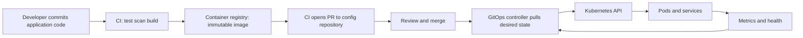
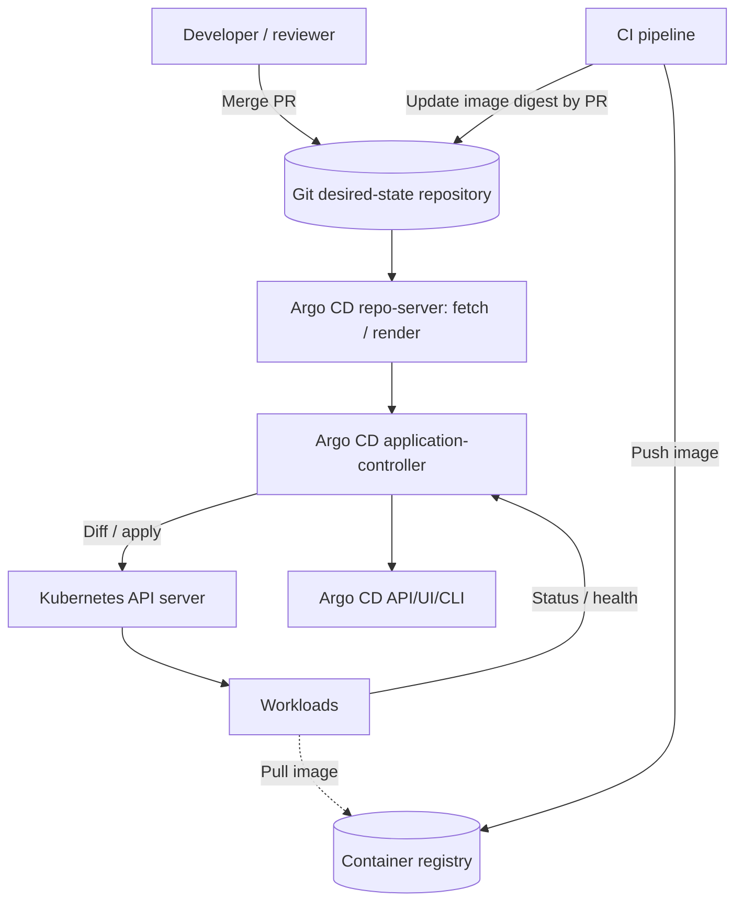
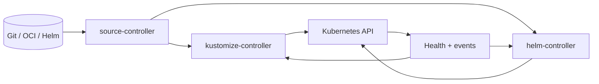
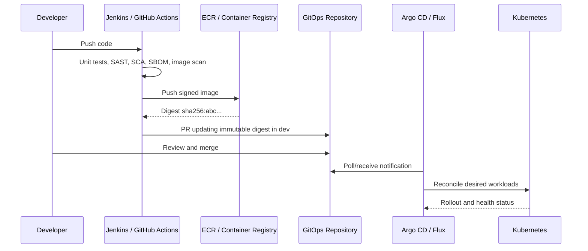
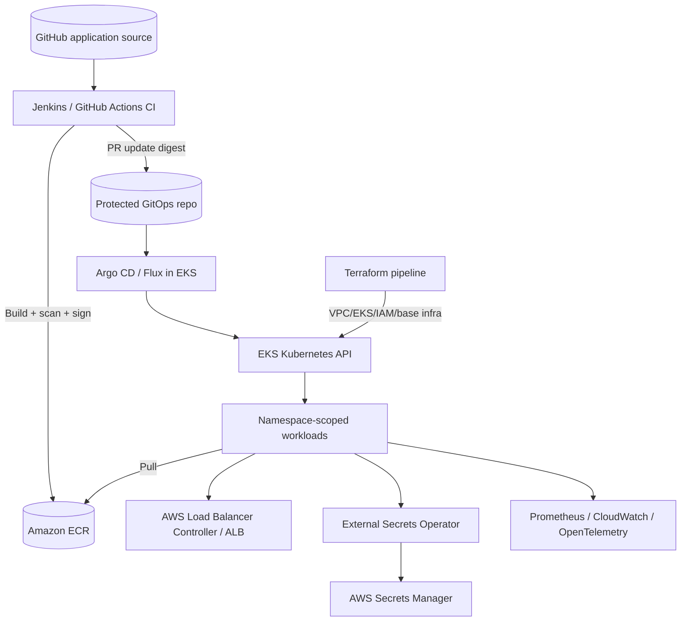
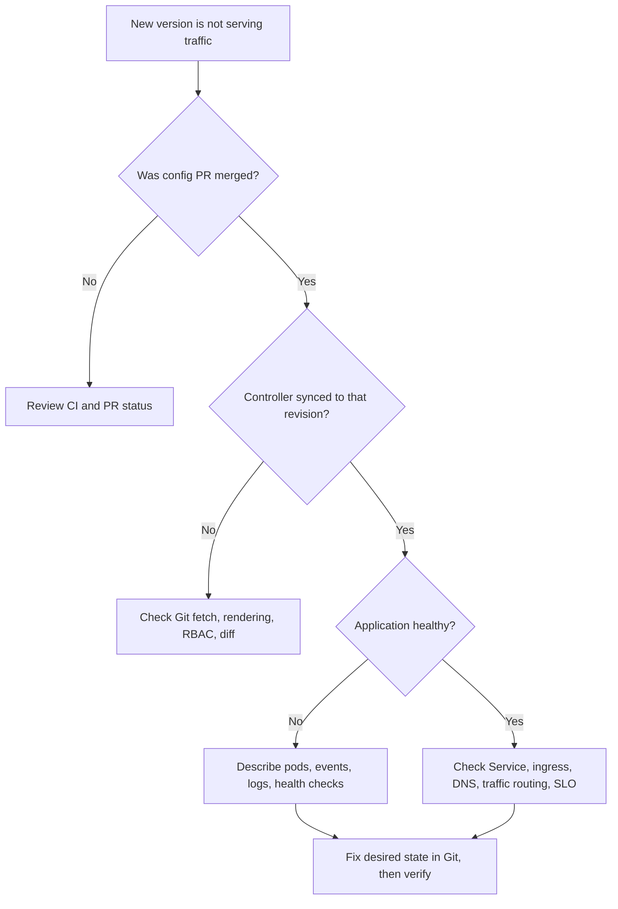

# GitOps — End-to-End Notes, Hands-On Labs & Interview Guide

> **Target roles:** DevOps Engineer · Site Reliability Engineer (SRE) · Platform Engineer · Cloud Engineer · DevSecOps Engineer  
> **Level:** Beginner → Intermediate → Advanced → Production Architect  
> **Primary stack:** Kubernetes · Git · Argo CD · Flux · Helm · Kustomize · GitHub Actions/Jenkins · Terraform · AWS EKS  
> **Updated:** November 2026 · Commands and APIs should be checked against the versions installed in your environment.

[](https://opengitops.dev/) [](https://argo-cd.readthedocs.io/) [](https://fluxcd.io/) [](https://kubernetes.io/)

## Table of Contents

1. [How to use this guide](#1-how-to-use-this-guide)
2. [GitOps fundamentals and four principles](#2-gitops-fundamentals-and-four-principles)
3. [GitOps vs CI/CD, DevOps, IaC and push deployments](#3-gitops-vs-cicd-devops-iac-and-push-deployments)
4. [GitOps architecture and reconciliation](#4-gitops-architecture-and-reconciliation)
5. [Git repository strategy and environment promotion](#5-git-repository-strategy-and-environment-promotion)
6. [Kubernetes foundations required for GitOps](#6-kubernetes-foundations-required-for-gitops)
7. [Kustomize: base, overlays and validation](#7-kustomize-base-overlays-and-validation)
8. [Helm with GitOps](#8-helm-with-gitops)
9. [Argo CD architecture and installation](#9-argo-cd-architecture-and-installation)
10. [Argo CD Application: complete example](#10-argo-cd-application-complete-example)
11. [Argo CD CLI, sync, health, drift and rollback](#11-argo-cd-cli-sync-health-drift-and-rollback)
12. [ApplicationSet, AppProjects and multi-cluster](#12-applicationset-appprojects-and-multi-cluster)
13. [Sync waves, hooks and ordering](#13-sync-waves-hooks-and-ordering)
14. [Flux architecture, installation and CRDs](#14-flux-architecture-installation-and-crds)
15. [Flux Kustomization and HelmRelease](#15-flux-kustomization-and-helmrelease)
16. [GitOps secrets and identity](#16-gitops-secrets-and-identity)
17. [Image updates, CI integration and promotions](#17-image-updates-ci-integration-and-promotions)
18. [Progressive delivery: canary and blue-green](#18-progressive-delivery-canary-and-blue-green)
19. [AWS EKS GitOps production reference architecture](#19-aws-eks-gitops-production-reference-architecture)
20. [Security, RBAC and policy as code](#20-security-rbac-and-policy-as-code)
21. [Observability, SRE, DR and scaling](#21-observability-sre-dr-and-scaling)
22. [Common pitfalls and architecture decisions](#22-common-pitfalls-and-architecture-decisions)
23. [Production troubleshooting playbooks](#23-production-troubleshooting-playbooks)
24. [Scenario-based interview questions](#24-scenario-based-interview-questions)
25. [Interview question bank with answers](#25-interview-question-bank-with-answers)
26. [Hands-on labs](#26-hands-on-labs)
27. [Command cheat sheet](#27-command-cheat-sheet)
28. [Sample system-design interview response](#28-sample-system-design-interview-response)
29. [7-day and 14-day interview roadmap](#29-7-day-and-14-day-interview-roadmap)
30. [Last-minute revision checklist](#30-last-minute-revision-checklist)
31. [Official documentation and further reading](#31-official-documentation-and-further-reading)

---

## 1. How to use this guide

**First pass (2–3 hours):** Sections 2–5, 9–11, 16–18 and the first 50 interview questions.  
**Second pass (hands-on):** Deploy a local Kubernetes cluster, perform Labs 1–5, break an application deliberately, recover it.  
**Production depth:** Sections 12–23, scenario questions and remaining interview bank.  
**Before interview:** Explain a complete application deployment in 90 seconds without looking at notes.

**Interview response formula:** Definition → why it matters → example → trade-off / failure mode → how to validate it.

**Important conventions:**

- Replace `YOUR_ORG`, `YOUR_REPO`, `YOUR_ACCOUNT_ID`, URLs, registry names, placeholders, paths and credentials before running commands.
- YAML examples are educational, not a ready-to-run production stack. Review namespaces, cluster permissions, chart versions, artifact provenance and deletion behavior.
- Prefer **immutable image digests**, protected branches, explicit approvals and least privilege in production.
- Some labs create cloud resources that cost money. Run `terraform plan`, review cost, and delete lab resources when finished.
- Never store plaintext passwords, cloud credentials, kubeconfig files, private keys or decrypted SOPS output in Git.

---

## 2. GitOps fundamentals and four principles

### What is GitOps?

**GitOps** is an operational model in which the desired system state is described declaratively, versioned in a source such as Git, pulled by software agents, and continuously reconciled against the actual state. Git is the reviewable change history; a controller is the deployment/reconciliation engine.

### Four OpenGitOps principles

| Principle | Meaning | Practical evidence |
|---|---|---|
| **Declarative** | Describe *what* should exist | Kubernetes YAML, Helm values, Kustomize overlays |
| **Versioned & immutable** | Desired-state history is traceable and recoverable | Protected Git commits/tags and auditable changes |
| **Pulled automatically** | An agent retrieves the desired state | Argo CD or Flux fetches Git/OCI source |
| **Continuously reconciled** | Agent compares desired and actual state repeatedly | Drift detection and eventual correction |

**Easy definition:** Git describes the target; a reconciler keeps the cluster aligned with it.

### Desired vs actual state

- **Desired:** `Deployment.spec.replicas: 3` committed in the configuration repository.
- **Actual:** A developer temporarily runs `kubectl scale deploy web --replicas=5`.
- **Drift:** Desired = 3; actual = 5.
- **Reconciliation:** With automatic self-healing enabled, Argo CD returns the Kubernetes Deployment spec to 3 (subject to controller behavior and configuration). The Deployment controller then manages Pods toward that state.

**Nuance:** GitOps reconciles declared objects, not every possible side effect. HPA, mutating webhooks, defaulting, secrets controllers, or server-populated fields can generate benign differences and need carefully configured ownership/ignore rules.

### Benefits and limitations

**Benefits:** peer review, traceability, repeatability, reduced broad CI cluster credentials, easier promotions, detection of drift and faster environment reconstruction.  
**Limitations:** bad Git changes can be deployed consistently; secret management and bootstrap require design; controller availability matters; drift correction may fight emergency operational changes; databases/stateful migrations need separate safeguards.

---

## 3. GitOps vs CI/CD, DevOps, IaC and push deployments

| Dimension | Traditional push-style deployment | Pull-style GitOps |
|---|---|---|
| Who changes the cluster? | CI pipeline or operator runs `kubectl`, `helm` | Cluster-side reconciler applies desired config |
| Credentials | CI often needs cluster deployment access | Controller holds scoped cluster access; CI writes Git |
| Drift management | Usually needs explicit checks | Continuous reconciliation and alerts |
| Audit trail | Pipeline logs + commits | Git change history + controller events |
| Rollback | Re-run an old deployment or command | Revert / promote desired-state commit, then reconcile |
| Approval | CI release gate | Protected PR + environment-specific policies |

**GitOps ≠ CI:** CI builds, tests, scans and publishes an artifact. GitOps CD updates desired state and deploys it.  
**GitOps ≠ Terraform:** Terraform provisions/manages infrastructure through plans and state. GitOps commonly reconciles Kubernetes application resources; using Git to store Terraform code **alone** does not automatically make a workflow pull-based GitOps.  
**GitOps ≠ a product:** Argo CD and Flux are implementations; GitOps is the operating approach.  
**GitOps ≠ simply storing YAML in Git:** Without automatic pull and continuous reconciliation, it is version-controlled configuration, not a complete GitOps system.

### Standard flow



**Golden rule:** Avoid CI and a GitOps controller competing to deploy the same Kubernetes resources.

---

## 4. GitOps architecture and reconciliation

### Typical Argo CD architecture



### Reconciliation lifecycle

1. An authorized PR updates desired configuration in Git.
2. Source watcher/poll/webhook allows the agent to discover a new revision.
3. Repository/rendering service loads Kubernetes YAML or renders Helm/Kustomize.
4. Agent compares desired resources with live Kubernetes resources.
5. If configured for manual sync, a human approves synchronization; if auto-sync, the controller can apply eligible changes automatically.
6. Kubernetes controllers create/update/delete runtime objects.
7. GitOps controller reports **sync state** and **health state** independently.
8. Reconciliation repeats periodically; alerts fire on errors or prolonged drift.

**Critical distinction:** `Synced` means manifests match the tracked desired configuration; `Healthy` is about observed resource readiness. An application can be `Synced` but `Degraded`.

### GitOps source types

- Git commit, tag or branch (prefer controlled immutable release references for production).
- Helm chart/OCI artifact with pinned version/digest where supported.
- Rendered YAML/Kustomize trees from Git.

### Reconciliation is eventual, not instantaneous

Polling intervals, Git provider webhooks, repository caches, Kubernetes API rate limits, health checks and controller workload determine time to converge. A webhook can speed refresh; reconciliation still remains authoritative.

---

## 5. Git repository strategy and environment promotion

### Common repository models

| Model | Advantages | Risks |
|---|---|---|
| Monorepo (code + config) | Simple for small teams | App + ops access boundaries can blur |
| App repo + GitOps config repo | Clear CI/CD boundary and permissions | Two-repo coordination needed |
| Environment repositories | Strong isolation/approval rules | Duplication and promotion overhead |
| Platform/fleet repo plus app repos | Works for many teams/clusters | Ownership and scale complexity |

**Recommended interview design:** CI publishes immutable images from the application repo; PRs update deployment definitions in a separate environment/config repository.

### Example layout

```text
gitops-platform/
├── apps/
│   └── hello/
│       ├── base/
│       │   ├── deployment.yaml
│       │   ├── service.yaml
│       │   └── kustomization.yaml
│       └── overlays/
│           ├── dev/kustomization.yaml
│           ├── stage/kustomization.yaml
│           └── prod/kustomization.yaml
├── clusters/
│   ├── dev-eu/
│   │   ├── argocd/hello-application.yaml
│   │   └── platform/
│   └── prod-eu/
│       ├── argocd/hello-application.yaml
│       └── platform/
├── policies/
│   ├── kyverno/
│   └── admission/
├── scripts/
└── README.md
```

**App source repo** → build digest `sha256:...` → config PR `dev` → test → PR `stage` → approvals → PR `prod` → reconcile.

### Promotion patterns

1. **Directory/overlay promotion:** copy/update the exact image digest into `stage`/`prod` overlays.
2. **Commit/tag pinning:** release from a reviewed Git revision, with protected tags.
3. **Environment branch:** possible, but increases merge complexity; use only when a clear governance need exists.
4. **Automated PR promotion:** bot opens PR; required checks and human approval remain for prod.

**Avoid:** rebuilding an image for production after it passed staging. Promote the **same image digest** so you can prove artifact identity.

### Controls worth mentioning

- `CODEOWNERS`, required reviews, protected branches and status checks.
- YAML schema validation and dry-run rendering in PR CI.
- Mandatory image signing/verification, SBOM and security scanning.
- Different credentials and permissions for dev/stage/prod.
- Commit authorship and audit correlation between build → PR → sync → deployment.

---

## 6. Kubernetes foundations required for GitOps

You must understand **Pods**, Deployments, Services, Ingress/Gateway API, namespaces, ConfigMaps, Secrets, RBAC, NetworkPolicies, PVCs, CRDs, controllers and admission policies.

| Resource | GitOps-related use |
|---|---|
| Deployment | Declarative replicas, Pod templates, rolling updates |
| Service | Stable DNS and traffic routing |
| ConfigMap | Non-secret settings |
| Secret | Reference a secret provisioned securely; do not commit plaintext |
| ServiceAccount | Workload identity and least privilege |
| NetworkPolicy | Pod communication controls (requires compatible CNI) |
| Ingress/Gateway | Expose service traffic |
| PVC | Storage requirements; deletion can have data implications |
| CRD/Custom resource | Install controllers before dependent custom resources |
| HPA | Autoscale replicas; may require ownership conventions to prevent diffs |

### Quick baseline checks

```bash
kubectl config current-context
kubectl cluster-info
kubectl get nodes -o wide
kubectl get ns
kubectl get deployments,svc,pods -A
kubectl api-resources | head
kubectl auth can-i create deployments -n dev
```

### Two distinct reconcilers

- **GitOps controller** ensures Kubernetes object specs match desired manifest data.
- **Kubernetes controllers** ensure actual workload behavior matches those Kubernetes specs.

If the first controller is healthy but the scheduler cannot place a Pod, the GitOps Application may be synchronized yet the workload remains unhealthy.

---

## 7. Kustomize: base, overlays and validation

Kustomize produces Kubernetes YAML by composing a shared base and environment-specific changes. It is declarative and supported by `kubectl -k`.

### `apps/hello/base/deployment.yaml`

```yaml
apiVersion: apps/v1
kind: Deployment
metadata:
  name: hello
spec:
  replicas: 2
  selector:
    matchLabels:
      app: hello
  template:
    metadata:
      labels:
        app: hello
    spec:
      containers:
        - name: web
          image: nginx:1.27.5 # Lab image only; pin a verified digest in production
          ports:
            - containerPort: 80
          resources:
            requests:
              cpu: 50m
              memory: 64Mi
            limits:
              memory: 128Mi
          readinessProbe:
            httpGet:
              path: /
              port: 80
            initialDelaySeconds: 2
            periodSeconds: 5
```

### `apps/hello/base/service.yaml`

```yaml
apiVersion: v1
kind: Service
metadata:
  name: hello
spec:
  selector:
    app: hello
  ports:
    - port: 80
      targetPort: 80
```

### `apps/hello/base/kustomization.yaml`

```yaml
apiVersion: kustomize.config.k8s.io/v1beta1
kind: Kustomization
resources:
  - deployment.yaml
  - service.yaml
```

### `apps/hello/overlays/dev/kustomization.yaml`

```yaml
apiVersion: kustomize.config.k8s.io/v1beta1
kind: Kustomization
namespace: hello-dev
resources:
  - ../../base
images:
  - name: nginx
    newTag: 1.27.5
replicas:
  - name: hello
    count: 1
commonLabels:
  environment: dev
```

Create namespace independently in the cluster or via the Argo CD `CreateNamespace=true` sync option shown later.

### Validate before merge

```bash
kubectl kustomize apps/hello/overlays/dev
kubectl kustomize apps/hello/overlays/dev > rendered.yaml
kubectl apply --dry-run=client -f rendered.yaml
# Server-side dry-run needs permissions, CRDs and admission chain available:
kubectl apply --dry-run=server -f rendered.yaml
```

**Interview traps:** namespace transformations vs namespace resources, patch targeting, list-merging semantics, Kustomize version differences, and generated ConfigMaps triggering rollouts. Prefer `labels` transformer rather than `commonLabels` in new Kustomize configurations when selector modification is undesirable; the example uses widely supported syntax for familiarity.

---

## 8. Helm with GitOps

**Helm:** packages applications as versioned charts and templates. **Kustomize:** composes and patches YAML. GitOps controllers can render both.

### Helm CLI basics

```bash
helm repo add bitnami https://charts.bitnami.com/bitnami
helm repo update
helm search repo bitnami/nginx
helm template demo bitnami/nginx --version <PINNED_CHART_VERSION> \
  -f environments/dev/values.yaml > rendered.yaml
helm lint ./mychart
helm show values bitnami/nginx --version <PINNED_CHART_VERSION>
```

The chart version is a **placeholder**: select a released, reviewed version rather than inventing a version number.

### Argo CD + Helm Application fragment

```yaml
spec:
  source:
    repoURL: https://charts.bitnami.com/bitnami
    chart: nginx
    targetRevision: <PINNED_CHART_VERSION>
    helm:
      valuesObject:
        replicaCount: 2
```

**Important:** For a native Helm-chart source, `repoURL` is a chart repository (or OCI chart location), not an application Git folder. With a Git-source Helm chart, `path` points to the chart directory. The `targetRevision` above must be replaced before applying.

### Helm vs Kustomize comparison

| Topic | Helm | Kustomize |
|---|---|---|
| Main concept | Parameterized reusable chart | Base + overlays + patches |
| Packaging | Charts and chart versions | Plain YAML directories |
| Complexity | Templates/values and dependencies | Patch complexity as overlays grow |
| Good use | Third-party addons, reusable product charts | First-party app config and differences |
| GitOps tool | Argo CD render or Flux Helm Controller | Argo CD/Flux Kustomization |

**Argo CD caveat:** Argo CD uses Helm primarily as a **template renderer**, not as an ordinary `helm install` release lifecycle. Do not assume `helm list` necessarily displays Argo CD-managed chart deployments.

---

## 9. Argo CD architecture and installation

### Main components

- **API server:** UI/API/CLI, authentication and user actions.
- **Repository server:** retrieves repositories and renders manifests from Git/Helm/Kustomize.
- **Application controller:** watches Applications, compares desired vs live state and reconciles.
- **ApplicationSet controller:** generates and manages multiple Application objects.
- **Redis / notification/dex components:** caching and optional integration; deployment components depend on installation configuration.

### Installation on a disposable cluster

> This is a learning installation. For production, pin a reviewed Argo CD release, back up config/credentials, set SSO/TLS/RBAC and use a supported upgrade plan. Installing the official manifest requires cluster-admin permissions.

```bash
kubectl create namespace argocd
kubectl apply -n argocd --server-side --force-conflicts \
  -f https://raw.githubusercontent.com/argoproj/argo-cd/stable/manifests/install.yaml
kubectl -n argocd get pods
kubectl -n argocd rollout status deploy/argocd-server
```

Official recent documentation uses **server-side apply** because some CRDs exceed the annotation limit of client-side apply.

### Access UI locally

```bash
kubectl -n argocd port-forward svc/argocd-server 8080:443
# Open https://localhost:8080 and expect locally forwarded TLS.
# Retrieve one-time bootstrap password on a lab-only install:
kubectl -n argocd get secret argocd-initial-admin-secret \
  -o jsonpath='{.data.password}' | base64 -d; echo
```

Rotate/delete bootstrap credentials according to the installation guide; do not expose the UI directly to the internet without strong authentication and TLS.

### Install Argo CD CLI

Follow the official [CLI installation page](https://argo-cd.readthedocs.io/en/stable/cli_installation/) and **verify binary origin**. Then check:

```bash
argocd version --client
argocd login localhost:8080 --username admin
argocd account get-user-info
```

For local port-forward login, certificate validation depends on the lab setup; do not disable TLS verification as a default in production.

---

## 10. Argo CD Application: complete example

Prerequisite: push the folder structure from Section 5 (including the complete `apps/hello` base and overlay) to your real Git repository, and create the namespace via GitOps or `CreateNamespace=true`.

### `clusters/dev-eu/argocd/hello-application.yaml`

```yaml
apiVersion: argoproj.io/v1alpha1
kind: Application
metadata:
  name: hello-dev
  namespace: argocd
spec:
  project: default
  source:
    repoURL: https://github.com/YOUR_ORG/YOUR_REPO.git
    targetRevision: main
    path: apps/hello/overlays/dev
  destination:
    server: https://kubernetes.default.svc
    namespace: hello-dev
  syncPolicy:
    automated:
      enabled: true
      prune: false  # opt in separately after reviewing deletion impact
      selfHeal: true
    syncOptions:
      - CreateNamespace=true
    retry:
      limit: 3
      backoff:
        duration: 5s
        factor: 2
        maxDuration: 1m
```

### Apply and verify

```bash
kubectl apply -f clusters/dev-eu/argocd/hello-application.yaml
kubectl -n argocd get applications
argocd app get hello-dev
argocd app diff hello-dev
kubectl -n hello-dev get deploy,pods,svc
```

**Remember:** `Application` is a Kubernetes custom resource created by the Argo CD CRDs. Its `metadata.namespace` is usually the Argo CD control namespace; `destination.namespace` is the application's workload namespace.

### Important sync settings

| Setting | Effect | Production concern |
|---|---|---|
| `automated.enabled: true` | Enable automatic sync | Merge may deploy immediately |
| `automated.prune: true` | Delete tracked objects removed from desired state | Deletion and stateful data risk |
| `automated.selfHeal: true` | Reconcile live-state drift | Fights emergency manual edits |
| `automated.allowEmpty: true` | Allow pruning app down to zero resources | Dangerous if path temporarily empty |
| `CreateNamespace=true` | Create destination namespace if missing | Not a general namespace lifecycle policy |
| `PruneLast=true` | Delay deletion to final sync wave | Still review deletion impact |
| `ServerSideApply=true` | Use server-side apply | Understand field ownership |

**Safer production defaults:** protected PRs, manual approvals for destructive transitions, `prune: false` until validated, audited rollback via Git revert, policy checks, and strong application-scoped permissions.

---

## 11. Argo CD CLI, sync, health, drift and rollback

```bash
argocd app list
argocd app get hello-dev
argocd app diff hello-dev
argocd app history hello-dev
argocd app manifests hello-dev
argocd app resources hello-dev
argocd app sync hello-dev
argocd app wait hello-dev --sync --health --timeout 300
argocd app set hello-dev --self-heal
argocd app logs hello-dev
argocd app terminate-op hello-dev  # Only when you understand operation state
```

### Interpret common status pairs

| Sync | Health | Interpretation |
|---|---|---|
| Synced | Healthy | Desired resources match and health looks good |
| OutOfSync | Healthy | Live config differs; app still serving requests |
| Synced | Degraded | Manifests match; workload/runtime unhealthy |
| OutOfSync | Missing | Desired resource is not found in cluster |
| Synced | Progressing | Waiting for readiness (e.g. rollout in progress) |
| Unknown | Unknown | Controller/source/API communication needs checking |

### Drift demonstration

```bash
# For a disposable dev app only:
kubectl -n hello-dev scale deployment/hello --replicas=4
kubectl -n hello-dev get deploy hello -w
argocd app get hello-dev
```

If self-heal is configured and no other actor is modifying the same field, the declared replicas should eventually be restored.

### Rollback: most important interview nuance

**Preferred GitOps rollback:** revert the configuration commit that selected the bad image, merge the revert and let the controller reconcile. Record the image digest, failed deployment, decision and post-incident follow-up.

```bash
# Create a reviewed revert in your config repo:
git log --oneline -5
git revert <BAD_CONFIG_COMMIT>
git push origin <YOUR_FEATURE_BRANCH>
# Open/approve PR, merge, then verify Argo CD sync + health.
```

Argo CD's CLI/history rollback feature is **not available while automated sync is enabled**. To use operational rollback where supported, first intentionally suspend/disable automation and use the documented rollback mechanism; re-align Git before re-enabling or the old desired state can return.

### Unhealthy app troubleshooting order

1. `argocd app get/diff` — source revision, sync reason and resource list.
2. `kubectl describe` — scheduling, admission, image pulls, readiness.
3. `kubectl logs --previous` — crashes and process exits.
4. Controller/repo-server logs — rendering, repo auth and Kubernetes API problems.
5. Compare desired Git commit, rendered manifest, live object and owners/managed fields.

---

## 12. ApplicationSet, AppProjects and multi-cluster

### Application vs ApplicationSet

- **Application:** deploys one logical app from one or more sources into a destination.
- **ApplicationSet:** generates/manages *many* Applications from templates and generators (list, clusters, Git, matrix, merge and others).

### Example: two environments from one ApplicationSet

```yaml
apiVersion: argoproj.io/v1alpha1
kind: ApplicationSet
metadata:
  name: hello-envs
  namespace: argocd
spec:
  generators:
    - list:
        elements:
          - name: dev
            namespace: hello-dev
          - name: stage
            namespace: hello-stage
  template:
    metadata:
      name: 'hello-{{name}}'
    spec:
      project: default
      source:
        repoURL: https://github.com/YOUR_ORG/YOUR_REPO.git
        targetRevision: main
        path: 'apps/hello/overlays/{{name}}'
      destination:
        server: https://kubernetes.default.svc
        namespace: '{{namespace}}'
      syncPolicy:
        syncOptions:
          - CreateNamespace=true
```

The above example intentionally leaves **auto-sync off** for controlled lab deployment. Be careful with generator removals and ApplicationSet deletion policies: they can delete generated Applications and possibly their managed workloads depending on finalizers/policy.

### AppProject: restrict allowed destinations and sources

```yaml
apiVersion: argoproj.io/v1alpha1
kind: AppProject
metadata:
  name: team-apps
  namespace: argocd
spec:
  description: Team-scoped application deployments
  sourceRepos:
    - https://github.com/YOUR_ORG/YOUR_REPO.git
  destinations:
    - namespace: 'team-*'
      server: https://kubernetes.default.svc
  clusterResourceWhitelist: []
```

**Note:** An AppProject is a constraint mechanism; define explicit namespace-resource policies, Roles, SSO group assignments and allowed destinations suited to your platform. Don't use the unrestricted `default` project for shared production environments.

### Patterns

- **App of Apps:** parent Argo CD Application manages child Application CRs. Useful but makes ownership and cascading deletions important.
- **ApplicationSet cluster generator:** deploy the same addon to registered clusters with labels/filters.
- **Hub-and-spoke vs per-cluster control plane:** central Argo CD improves fleet visibility; per-cluster controllers improve isolation and blast-radius limits.

### Multi-cluster safety checklist

Use short-lived/rotated credentials, tightly scoped namespaces/projects, per-cluster quotas, labels identifying environment/region, audit trails, progressive rollout waves and separate break-glass paths.

---

## 13. Sync waves, hooks and ordering

**Why ordering matters:** CRDs must exist before corresponding custom resources; namespaces and policy/controller prerequisites may need to be healthy before workloads.

### Sync wave example

```yaml
apiVersion: batch/v1
kind: Job
metadata:
  name: preflight-check
  annotations:
    argocd.argoproj.io/hook: PreSync
    argocd.argoproj.io/hook-delete-policy: HookSucceeded
    argocd.argoproj.io/sync-wave: "-1"
spec:
  backoffLimit: 1
  template:
    spec:
      restartPolicy: Never
      containers:
        - name: check
          image: busybox:1.36
          command: ["sh", "-c", "echo preflight-ok"]
```

### Hook types

| Hook | Purpose |
|---|---|
| `PreSync` | Run before resource application, e.g. carefully designed migration/preflight |
| `Sync` | Run as part of sync operation |
| `PostSync` | Run after sync succeeds and resources become healthy |
| `SyncFail` | Cleanup/report on sync failure |
| `Skip` | Exclude a resource from apply |
| `PreDelete`/`PostDelete` | Application deletion lifecycle hooks where supported |

**Precedence:** sync phase → wave (smaller first) → kind → resource name. Hooks may run again on later syncs; design jobs to be idempotent. A hook's successful exit code is not proof that a database migration achieved every intended business invariant.

---

## 14. Flux architecture, installation and CRDs

Flux is a set of Kubernetes controllers for reconciling source artifacts, Kustomize content, Helm charts and (optionally) image updates.

### Common Flux controllers

| Controller | Role |
|---|---|
| `source-controller` | Fetch Git/Helm/OCI source artifacts |
| `kustomize-controller` | Build/apply Kustomize content and reconcile drift |
| `helm-controller` | Reconcile HelmRelease chart releases |
| `notification-controller` | Events, alerts, receivers/webhooks |
| `image-reflector-controller` (optional) | Scan image repositories and policies |
| `image-automation-controller` (optional) | Update files in Git according to image policies |

### Quick prerequisites

```bash
flux check --pre
kubectl config current-context
```

### Bootstrap GitHub (example)

```bash
# Generate a suitably scoped GitHub credential securely out-of-band.
# Export GITHUB_TOKEN in your terminal without committing it to files.
export GITHUB_TOKEN='<TEMPORARY_TOKEN>'
flux bootstrap github \
  --owner=YOUR_ORG \
  --repository=YOUR_REPO \
  --branch=main \
  --path=clusters/dev-eu
flux check
flux get all -A
```

If using a personal GitHub account rather than an organization, the official command may require `--personal`. For production, prefer GitHub App/deploy-key or scoped short-lived credentials where supported. Bootstrap requires initial administrative privileges, then the Flux installation can manage itself via Git.

### Flux reconciler architecture



### Key Flux resource types

- `GitRepository`: declares Git URL, branch/tag/ref and polling interval.
- `OCIRepository` / `HelmRepository`: declares other sources.
- `Kustomization`: path, sourceRef, interval, prune, health checks and dependencies. **Different from a plain `kustomization.yaml`**.
- `HelmRelease`: desired chart release, values, reconciliation/remediation behavior.
- `ImageRepository`, `ImagePolicy`, `ImageUpdateAutomation`: optional image discovery/update chain.

---

## 15. Flux Kustomization and HelmRelease

### GitRepository source

```yaml
apiVersion: source.toolkit.fluxcd.io/v1
kind: GitRepository
metadata:
  name: app-config
  namespace: flux-system
spec:
  interval: 1m
  url: https://github.com/YOUR_ORG/YOUR_REPO
  ref:
    branch: main
```

### Flux Kustomization

```yaml
apiVersion: kustomize.toolkit.fluxcd.io/v1
kind: Kustomization
metadata:
  name: hello-dev
  namespace: flux-system
spec:
  interval: 5m
  path: ./apps/hello/overlays/dev
  prune: false
  sourceRef:
    kind: GitRepository
    name: app-config
  targetNamespace: hello-dev
  healthChecks:
    - apiVersion: apps/v1
      kind: Deployment
      name: hello
      namespace: hello-dev
```

Prerequisite: create `hello-dev` namespace with a separate declarative resource/Kustomization. `targetNamespace` does not implicitly create the namespace.

### Flux dependencies

```yaml
spec:
  dependsOn:
    - name: platform-addons
```

`dependsOn` ensures the referenced Kustomization reaches readiness before applying a dependent Kustomization. Use health checks or `wait: true` where relevant; avoid circular dependency chains.

### HelmRelease skeleton

```yaml
apiVersion: helm.toolkit.fluxcd.io/v2
kind: HelmRelease
metadata:
  name: demo-web
  namespace: demo
spec:
  interval: 10m
  chart:
    spec:
      chart: nginx
      version: '<PINNED_CHART_VERSION>'
      sourceRef:
        kind: HelmRepository
        name: bitnami
        namespace: flux-system
  values:
    replicaCount: 2
```

Create a separate `HelmRepository` resource (e.g. Bitnami's chart URL), create the `demo` namespace and replace the placeholder chart version before using.

### Operational commands

```bash
flux get all -A
flux get sources git -A
flux get kustomizations -A
flux get helmreleases -A
flux reconcile source git app-config -n flux-system
flux reconcile kustomization hello-dev -n flux-system --with-source
flux logs --level=error --all-namespaces
flux events --for Kustomization/hello-dev -n flux-system
flux suspend kustomization hello-dev -n flux-system
flux resume kustomization hello-dev -n flux-system
```

**Be precise:** Flux `Kustomization` with capital K is a CRD and reconciler contract; `kustomization.yaml` with lower-case k is a build instruction interpreted by Kustomize.

---
## 16. GitOps secrets and identity

### The problem

Git has long-lived history and broad replication. A secret removed from the latest commit may still be recoverable from old commits, caches, clones and backups. Kubernetes Secrets are normally base64 encoded, **not encrypted merely because they are Secrets**.

### Recommended patterns

| Pattern | How it works | Common use |
|---|---|---|
| External Secrets Operator (ESO) | Cluster controller syncs external secret manager entries into Kubernetes Secrets | AWS Secrets Manager, Vault, cloud secret stores |
| SOPS + age/KMS | Encrypt select YAML fields in Git, decrypt only in trusted reconciliation boundary | Secrets-as-code with protected keys |
| Sealed Secrets | Encrypt for a designated cluster controller/key | Cluster-specific encrypted Secret manifests |
| Secret Store CSI Driver | Mount secrets from supported external providers into Pods | File-mounted secrets; optional Kubernetes Secret sync |
| Vault integration | Dynamic credentials, leasing, rotation | Complex identity/secrets lifecycle |

### External Secrets conceptual resource

```yaml
# Requires External Secrets Operator and a working SecretStore/ClusterSecretStore.
apiVersion: external-secrets.io/v1
kind: ExternalSecret
metadata:
  name: payment-api-secret
  namespace: payments
spec:
  refreshInterval: 1h
  secretStoreRef:
    name: aws-secrets
    kind: SecretStore
  target:
    name: payment-api-secret
  data:
    - secretKey: DB_PASSWORD
      remoteRef:
        key: /prod/payments/database
        property: password
```

**Verify the installed ESO CRD/API version** before applying; the resource will not work until the operator, AWS permissions and referenced SecretStore are configured.

### SOPS + age conceptual workflow (Flux)

```bash
# Install sops and age using their official release instructions.
age-keygen -o age.agekey
# Store the age private key securely. Never commit age.agekey.
# Set RECIPIENT to the PUBLIC recipient printed by age-keygen.
export RECIPIENT='age1REPLACE_WITH_REAL_PUBLIC_KEY'
sops --age="$RECIPIENT" --encrypted-regex '^(data|stringData)$' \
  --encrypt --in-place secrets/secret.yaml
# Commit only the encrypted YAML; verify it is ciphertext first.
```

Flux's Kustomization can declare SOPS decryption, backed by a key Secret, cloud KMS or supported identity mechanism. Argo CD typically needs a supported integration/plugin pattern for SOPS decryption; SOPS support is not identical between the tools.

### Security principles

- Prefer workload identity / IAM roles and short-lived tokens over hard-coded cloud access keys.
- Use RBAC, resource-specific namespaces and least-privilege SecretStore access.
- Rotate secrets; test rotation and revoked credential scenarios.
- Enable encryption at rest for Kubernetes Secrets and control access to etcd/backups.
- Restrict repository credentials and image registry credentials.
- Scan Git history and PRs for accidental secrets; rotation is mandatory after a leak.

---

## 17. Image updates, CI integration and promotions

### CI should produce an immutable artifact



### Jenkins pipeline example (CI only, no direct prod kubectl)

```groovy
pipeline {
  agent any
  environment {
    IMAGE = 'registry.example.com/team/hello'
  }
  stages {
    stage('Checkout') {
      steps { checkout scm }
    }
    stage('Test') {
      steps { sh './scripts/test.sh' }
    }
    stage('Build and Push') {
      steps {
        // Configure registry login via Jenkins credentials in a reviewed script.
        sh './scripts/build-and-push.sh'
      }
    }
    stage('Propose GitOps Update') {
      steps {
        // Script reads the pushed IMAGE DIGEST, updates only dev overlay,
        // opens a PR using scoped bot credentials and a unique branch.
        sh './scripts/open-gitops-pr.sh'
      }
    }
  }
}
```

Scripts are **placeholders**: implement registry auth, credential masking, artifact signing, SBOM generation, PR creation, retry/idempotence, and approval policies before use.

### Minimal GitHub Actions conceptual workflow

```yaml
name: CI
on:
  push:
    branches: [main]
permissions:
  contents: read
jobs:
  verify:
    runs-on: ubuntu-latest
    steps:
      - uses: actions/checkout@v4  # Pin reviewed commit SHA in production
      - name: Test
        run: ./scripts/test.sh
      - name: Build, scan and propose GitOps update
        run: echo 'Replace with secured registry and PR automation'
```

**Strong production practice:** use federation/OIDC to obtain short-lived cloud credentials, pin Actions to commit SHAs, require PR approvals, sign images and pass immutable image digests between systems.

### Image update controller options

- **Argo CD Image Updater:** detects eligible image changes and can write updates to Git when configured; investigate current installation and write-back settings.
- **Flux Image Automation:** ImageRepository → ImagePolicy → ImageUpdateAutomation can update Git manifests (requires optional controllers).
- **CI-controlled promotion:** CI records digest and opens PR; useful when approvals and evidence must precede changes.

### Promotion rule

Deploy **the same digest** from dev → stage → production. Gate promotion on integration/security checks, operational readiness and approvals. For incident rollback, revert the digest in Git rather than silently editing live objects.

---

## 18. Progressive delivery: canary and blue-green

### Strategies

| Strategy | Concept | Risk/trade-off |
|---|---|---|
| Rolling update | Replace old Pods gradually | Traffic split less precise; mixing versions |
| Blue-green | Maintain two environments and switch production traffic | Extra infrastructure/capacity; DB compatibility |
| Canary | Route a small subset of requests to new version, expand if metrics pass | Requires reliable metrics and traffic controls |
| Feature flags | Enable behavior independently of binary deployment | Flags need ownership and cleanup |
| Shadow traffic | Mirror selected traffic without serving result | Privacy and capacity risks |

### Argo Rollouts canary example

> Requires the Argo Rollouts controller and CRDs. `setWeight` without a traffic router generally approximates rollout proportion by Pod replicas; it is not guaranteed exact traffic percentage. Configure a supported ingress/service-mesh traffic router for precise traffic splitting.

```yaml
apiVersion: argoproj.io/v1alpha1
kind: Rollout
metadata:
  name: hello-rollout
  namespace: hello-dev
spec:
  replicas: 5
  revisionHistoryLimit: 3
  selector:
    matchLabels:
      app: hello-rollout
  template:
    metadata:
      labels:
        app: hello-rollout
    spec:
      containers:
        - name: web
          image: nginx:1.27.5
          ports:
            - containerPort: 80
  strategy:
    canary:
      steps:
        - setWeight: 20
        - pause: {duration: 60s}
        - setWeight: 50
        - pause: {}
        - setWeight: 100
```

### Metric-aware promotion

- Track 5xx error ratio, latency percentiles (p95/p99), request rate, saturation and business success signals.
- Use `AnalysisTemplate` / `AnalysisRun` in Argo Rollouts, Prometheus queries and failure limits.
- Abort on reliable guardrail violation; differentiate startup transients from sustained errors.
- Keep Service/Ingress routing, DB schema and backward compatibility explicit.

### Troubleshooting a bad canary

```bash
kubectl -n hello-dev get rollouts
kubectl -n hello-dev describe rollout hello-rollout
kubectl -n hello-dev get analysisruns
# Requires the kubectl argo rollouts plugin:
kubectl argo rollouts get rollout hello-rollout -n hello-dev
kubectl argo rollouts abort hello-rollout -n hello-dev
```

**Distinction:** GitOps controls *what version should be deployed*; progressive-delivery controllers control *how safely traffic moves* between versions.

---

## 19. AWS EKS GitOps production reference architecture

### Reference deployment design



### Terraform + GitOps ownership boundary

| Component | Typical owner |
|---|---|
| AWS VPC, subnet, NAT, private endpoints | Terraform |
| EKS cluster, managed node groups, IAM/OIDC identities | Terraform / cluster platform IaC |
| GitOps controller installation/bootstrap | Terraform/Helm initially, then documented GitOps ownership handoff |
| App Deployments, ConfigMaps, Services, policy | GitOps controller |
| App charts and platform addons | GitOps or IaC, **not competing ownership** |
| Image artifacts | CI + ECR |
| Secret values | Secrets Manager/Vault; ESO/CSI consumes them |

### EKS-specific interview notes

- Use EKS **Pod Identity** or IAM roles for service accounts (IRSA), depending on cluster support and organizational design; never embed AWS keys in Pod YAML.
- EKS worker nodes in private subnets need connectivity to ECR/S3/STS/Kubernetes endpoints as applicable. NAT and VPC endpoints are alternative or complementary solutions depending on architecture.
- Restrict EKS public API endpoint, source access and network routes; controller needs reliable Kubernetes API and repository access.
- Use multiple AZs for worker nodes, configure PodDisruptionBudgets and managed node scaling.
- Run AWS Load Balancer Controller and EBS CSI driver with least-privileged AWS identities.
- Define requests/limits, image digest pinning and scheduled upgrades.
- Measure MTTR, change failure rate, deployment frequency, recovery time and reconciliation lag.

### Common failure case: no internet, private EKS cluster

**Symptom:** Argo CD cannot fetch Git; Pods cannot pull ECR image.  
**Diagnosis:** separate controller → Git reachability from node → image registry connectivity. Check DNS, NAT/VPC endpoints, endpoint policies, IAM, TLS/proxy and network policies.  
**Fix:** provide a secure reachable source endpoint/mirror for Git; configure necessary AWS endpoints or NAT for ECR and related services; verify policy and DNS. **ECR VPC endpoints do not grant access to arbitrary public Git hosts.**

---

## 20. Security, RBAC and policy as code

### Threat model: GitOps adds privileged automation

A merged configuration can create privileged workloads, modify security policies or cause resource deletion **if the reconciler has those privileges**. Git review does not replace cluster admission enforcement.

### Defense-in-depth controls

1. **Git:** protected default branches, CODEOWNERS, review gates, signed commits/tags where applicable.
2. **CI:** secret scanning, SAST/SCA, image scanning, SBOM, signature verification, policy tests.
3. **GitOps:** read-only Git credentials where possible, constrained AppProjects/tenants, allowed repos/destinations.
4. **Kubernetes:** RBAC, admission policies, Pod Security Admission, quotas, NetworkPolicies and separate namespaces.
5. **Cloud:** IAM workload identities, KMS, private networking, CloudTrail/Audit logs.
6. **Operations:** audit controller actions, break-glass policy, restore drills and monitoring.

### Policy-as-code tooling

- **Kyverno**: Kubernetes-native validation, mutation and generation policies.
- **OPA Gatekeeper**: OPA/Rego constraints and admission enforcement.
- **Conftest / Checkov / Trivy**: pre-merge policy or IaC security checks.
- **Sigstore Cosign + policy:** image signature checks integrated with admission policy.

Example: prohibit privileged containers, require resources/approved registries, and restrict `latest` tags using admission/policy tests. Validate policies on a staging cluster before enforcing them on production.

### GitOps supply-chain attacks

| Threat | Mitigation |
|---|---|
| Compromised repo maintainer token | MFA, protected branches, scoped bot credentials, short-lived tokens |
| Supply-chain poisoned chart | Pin and verify chart/version/digest, vetted repos, scan templates |
| Malicious image injected via update bot | Signing + registry policy + digest allowlists |
| Secret in Git history | Rotate; remove exposure, audit forks/clones and restrict retention |
| Controller privilege escalation | Narrow resource scope, admission policies, separate control planes |
| Untrusted PR rendering | Sandboxed tooling, avoid arbitrary post-render shell scripts, restrict credentials |
| Accidental destructive prune | Protected config paths, deletion reviews, backups, `prune: false` for high-risk resources |

---

## 21. Observability, SRE, DR and scaling

### Monitor both the application and GitOps control loop

**GitOps signals:** sync state, reconciliation success/failure, reconciliation duration, queue backlog, repository fetch/manifest render errors, controller restarts, cache pressure, API throttling, audit events.  
**App signals:** availability, latency, traffic, errors, saturation, Pod failures, release success and incidents.

### Example useful alerts

- Production Application remains `OutOfSync` beyond a documented window.
- Application reports `Degraded` for a sustained period.
- Git repository credential fails or TLS is invalid.
- Reconciler remains unavailable or cannot reach Kubernetes API.
- Rollout fails guardrail metrics or is stuck on a pause.
- Secret sync fails / certificate near expiration.
- Flux Kustomization has `Ready=False` for too long.

### Disaster recovery plan

1. Back up cluster-critical data and storage, not just manifests.
2. Retain private repo access plan, source credentials, KMS/age keys, secret manager resources and bootstrap definitions.
3. Recreate infrastructure with Terraform and restore cluster prerequisites.
4. Bootstrap Argo CD/Flux with controlled credentials.
5. Reconcile core addons in dependency order, then application namespaces.
6. Restore persistent data using application-consistent backups.
7. Validate external DNS, TLS, endpoints, security and application SLOs.

**Git is not a database backup:** Git holds declarative configs; it does not restore PVC contents or transactional state.

### Scaling designs

- Use ApplicationSet/Flux fleet patterns, clear ownership, sharded or scaled controllers when needed.
- Reduce unnecessary repository refreshes and Helm rendering costs.
- Monitor API server throttling, informer cache pressure and Git host rate limits.
- Stage config changes across regions/clusters to limit blast radius.
- Separate core platform dependencies from application onboarding.

---

## 22. Common pitfalls and architecture decisions

| Pitfall | Why it fails | Better approach |
|---|---|---|
| CI also runs `kubectl apply` on same resource | Two writers compete | CI writes Git; controller owns apply |
| Image uses mutable `latest` | Desired state not uniquely repeatable | Promote immutable digest |
| Prod auto-prune enabled blindly | Deleted Git path can delete workloads | Explicit, reviewed deletion policy |
| Helm chart `targetRevision: main` | Non-reproducible third-party chart changes | Pin chart version/digest |
| Secrets stored as base64 YAML in Git | Base64 is not encryption | External secret store or encrypted manifests |
| App's health assumed from `Synced` | Readiness is separate from spec match | Alert on both sync and health |
| HPA and Git both own `replicas` unexpectedly | Reconciliation conflict | Agree ownership/ignore semantics and test |
| Revert changes only with `kubectl set image` | GitOps may override hotfix | Revert desired-state Git revision |
| CRD and CR deployed simultaneously without ordering | Unknown-kind admission error | Dependency/wave and health control |
| Entire fleet deploys one bad policy | Large blast radius | Progressive promotions and canary clusters |
| Repository credentials never rotated | Exposure persists | Token lifecycle and rotation drills |
| Controller down means workloads stop | Misunderstands architecture | Existing workloads usually keep running; GitOps changes/drift repair pause |
| Git is treated as state backup | Data not captured | App-consistent backups + restore plan |
| ApplicationSet manages child app but edits are made directly to it | Controller overwrites child changes | Edit ApplicationSet source/template |
| Apply only tests syntax | Admission/health/runtime can still fail | Test render, server dry-run, integration, rollout/SLO |

---

## 23. Production troubleshooting playbooks

Use a disciplined sequence: **impact → desired revision → controller status → source/render → API apply → Kubernetes resource health → remediation → verify**. Avoid making unreviewed production changes that fight GitOps reconciliation.

### T01 — App is OutOfSync after merge

**Likely causes:** queued reconciliation, webhook not received, chart rendering drift, diff customizations, wrong source path/branch.  
**Check:** `argocd app get APP`, `argocd app diff APP`, source revision, repo-server logs.  
**Fix:** verify actual commit and path; inspect diff; reconcile; adjust legitimate diff rules only after understanding field owners.

### T02 — Synced but app is Degraded

**Likely causes:** failed Pod, readiness probe, broken image or dependency.  
**Check:** `kubectl -n NS describe deploy APP`, `kubectl get pods -o wide`, `kubectl logs --previous`.  
**Fix:** fix code/config/probes/capacity; commit corrective manifest and confirm SLO.

### T03 — Repository authentication failed

**Check:** repo URL, SSH host key, credential expiry, deploy-key access, Git host reachability/TLS.  
**Fix:** rotate/repair scoped credentials without exposing secrets in logs; test fetch from repo-server/controller environment.

### T04 — Helm template generation fails

**Check:** chart version availability, dependency resolution, values type, `helm template` and `helm lint` locally.  
**Fix:** pin valid chart version, correct values schema and reopen reviewed PR.

### T05 — Kubernetes manifests fail with `no matches for kind`

**Cause:** CRD missing/too old or wrong apiVersion.  
**Check:** `kubectl api-resources`, `kubectl get crds`, controller installation order.  
**Fix:** install supported CRD first; order dependent resource sync and health checks.

### T06 — Resource unexpectedly deleted after Git change

**Check:** auto-prune flags, deleted files, App finalizers, Kustomization `prune`, ApplicationSet removal.  
**Fix:** stop further harmful reconciliation, restore reviewed Git config and data backups where needed; add deletion gates. Restoring YAML alone does not restore lost PV data.

### T07 — Manual `kubectl scale` keeps reverting

**Cause:** desired replicas and self-healing or an external writer.  
**Check:** HPA, GitOps settings, managed fields, deployment events.  
**Fix:** update Git and clarify ownership; use an approved emergency suspension if necessary.

### T08 — Deployment stuck Pending

**Check:** `kubectl describe pod`, node allocatable, taints/tolerations, affinity, PVC binding, quotas.  
**Fix:** repair capacity/scheduling/storage/config and verify status.

### T09 — ImagePullBackOff in EKS

**Check:** image digest/tag, ECR auth, node permissions, network/VPC endpoints, platform/arch mismatch, image repository policy.  
**Fix:** correct the immutable reference and AWS access or networking.

### T10 — CrashLoopBackOff after sync

**Check:** `kubectl logs --previous`, app args, missing Secret/env vars, startup probes, dependency connectivity and OOM.  
**Fix:** revert bad config/image via Git or fix dependencies; track incident impact.

### T11 — Argo CD Application stuck Progressing

**Check:** missing readiness, stuck pre-sync Job, health-check interpretation, custom resource health, controller logs.  
**Fix:** correct health source or broken dependency; avoid indiscriminate force sync.

### T12 — Argo CD app sync fails due to RBAC

**Check:** destination namespace/cluster, AppProject constraints, Kubernetes service account roles, audit logs.  
**Fix:** give narrowly scoped permissions; do not grant global `cluster-admin` to hide the error.

### T13 — Deleting Application does not behave as expected

**Check:** deletion finalizers, orphan vs cascading deletion, ApplicationSet policy, resource tracking/ownership.  
**Fix:** choose policy intentionally; back up persistent data and test in staging.

### T14 — ApplicationSet overwrites manual Application edits

**Cause:** child Application generated from template.  
**Fix:** edit the ApplicationSet definition/source; use documented sync control for generated Applications.

### T15 — Flux Kustomization Ready=False

**Check:** `flux get kustomizations -A`, `flux events`, `.status.conditions`, source availability, dependent resources.  
**Fix:** correct build/apply/health/dependsOn problem and reconcile.

### T16 — Flux GitRepository cannot fetch

**Check:** `flux get sources git -A`, `kubectl describe gitrepository`, controller logs, secretRef/SSH known hosts.  
**Fix:** repair remote URL/credentials/transport and source reachability.

### T17 — Flux SOPS decryption failed

**Check:** encrypted file validity, key Secret, age/KMS identity, Flux decryption settings and permissions.  
**Fix:** restore correct key/identity without logging plaintext; validate decrypt locally in controlled environment.

### T18 — Flux HelmRelease install/upgrade failed

**Check:** `flux get helmreleases`, `kubectl describe helmrelease`, helm-controller logs, chart values, CRD compatibility.  
**Fix:** address root cause, align chart version/values and use documented remediation.

### T19 — HPA scale fights desired replica count

**Check:** autoscaler target, Deployment managedFields and GitOps diff.  
**Fix:** establish spec field ownership and ignore only expected drift with targeted rules.

### T20 — Admission policy rejects deployment

**Check:** validation webhook/admission failure reason, Pod Security Admission, signed image policy.  
**Fix:** satisfy policy (requests, labels, signature, image registry, securityContext); don't bypass control to pass CI.

### T21 — Argo CD controller or repo-server OOM

**Check:** memory usage, pod restarts, queue size, manifest generation cost, oversized apps.  
**Fix:** right-size resources, split huge apps, tune caching/concurrency according to official guidance, and monitor recurrence.

### T22 — Secret updated externally but Pod still uses old value

**Cause:** env vars from Secrets are generally read at Pod startup; file-mounted secret updates have different timing.  
**Fix:** use safe rollout/reloader strategy, verify secret version, avoid dumping values in logs.

### T23 — Canary shows elevated 5xx

**Check:** AnalysisRuns, Prometheus metrics, error distribution, routing weights, backend error logs.  
**Fix:** abort/pause canary, restore stable route and revert desired version as needed.

### T24 — Production sync worked in dev but fails in prod

**Check:** namespace RBAC, admission differences, resource quotas, private registry access, missing CRDs, environment values.  
**Fix:** reproduce with prod-specific policy checks and least-privileged access; document environment skew.

### T25 — GitOps repo accidentally becomes empty

**Risk:** prune/allowEmpty can have destructive results.  
**Fix:** suspend unsafe reconciliation when authorized, restore Git ref/path; enforce branch protections and deletion review. Don't enable `allowEmpty` casually.

### T26 — Certificate or Git webhook expired

**Check:** source connectivity, certificate validation, webhook delivery failures, poll interval.  
**Fix:** rotate the cert/credential; Git polling may still eventually reconcile if source access is valid.

### T27 — Two Argo CD instances claim one resource

**Cause:** overlapping Applications/resource tracking.  
**Fix:** assign a single owner, isolate AppProjects/clusters/namespaces and remove conflicting writers.

### T28 — Argo CD displays harmless drift from mutating webhook

**Check:** normalized vs live field, defaulting/managed fields, controller ownership.  
**Fix:** use precise ignoreDifferences or server-side apply configuration after validating the mutated behavior; never globally ignore security fields.

### T29 — Reconciliation stopped after emergency suspension

**Check:** Argo CD auto-sync status / Flux suspend flag and incident ticket.  
**Fix:** re-align Git state, confirm safe recovery, resume in change window and watch for drift.

### T30 — Fresh cluster cannot bootstrap

**Check:** API connectivity, CRDs, namespace install sequence, registry/repo/DNS availability, identity and GitOps controller credentials.  
**Fix:** restore minimal bootstrap dependencies, then reconcile platform addons, namespaces and applications; validate backup restore separately.

---

## 24. Scenario-based interview questions

These are **model approaches**, not claims about any particular project or production system. Adapt to hands-on experience and metrics you can demonstrate.

**S01. CI successfully builds an image, but no Pods update. What next?**  
Trace immutable digest → GitOps PR merge → config path/revision → controller reconciliation status → Deployment image field → Kubernetes events. A registry push alone does not modify desired state.

**S02. One engineer changes Deployment replica count manually; it reverts. Explain.**  
Reconciler detects drift and reapplies Git-defined replicas when self-heal is on. Check HPA before deciding Git should be sole owner.

**S03. A production PR deletes a directory containing live manifests. What do you do?**  
Check pruning settings, block unreviewed destructive changes, assess blast radius and retention, recover Git and data backups, and review why PR policy missed deletion.

**S04. Security team wants no Kubernetes credentials in Jenkins. Design deployment.**  
Jenkins tests/builds/scans/pushes image; opens config PR using scoped Git identity. Argo CD/Flux pulls Git using in-cluster authority and reconciles. Enforce admission policy and audit.

**S05. Your team needs deployments across 20 clusters. Design it.**  
Use ApplicationSet Cluster generator or Flux fleet topology, cluster labels, templated overlays, Git review, per-cluster controls and phased rollout; isolate high-risk environments.

**S06. Need to promote exactly the tested version to production.**  
Build once, record digest, validate dev/stage, promote same digest via reviewed prod PR. Do not use a mutable tag or rebuild.

**S07. Database migration must run before app release.**  
Use backwards-compatible expand/migrate/contract, explicit preflight/migration orchestration, idempotent hooks, health gates and rollback/data strategy. Don't depend solely on resource ordering.

**S08. Can Argo CD guarantee 10% traffic canary with only 10 Pods?**  
No. Without traffic routing integration, `setWeight` approximates replica proportions, not exact request percentage. Use compatible ingress/service mesh for precise weighting.

**S09. Design GitOps for private EKS worker nodes.**  
Ensure controller can access Git endpoint, K8s API and any Helm/OCI source; configure ECR/S3 endpoint and STS requirements where necessary, TLS, DNS and scoped IAM. Test each path independently.

**S10. A secret is committed accidentally to a private config repo.**  
Revoke/rotate immediately, assess exposure/audit, remove from tracked config/history as feasible, move to an external store or encrypted pattern, and scan repositories. Deleting the latest commit is insufficient.

**S11. Argo CD reports Synced/Degraded; incident pressure is high.**  
Investigate runtime health (pods, events, logs, metrics), contain traffic impact, revert Git revision if change-related, and distinguish operational rollback from Argo CD CLI rollback semantics.

**S12. Want production auto-sync but manual approval. Is that contradictory?**  
No. Protect the prod config branch/path with PR approvals. After approved merge, auto-sync deploys. Additional progressive traffic gates can be configured.

**S13. Need to install cert-manager CRDs before certificates.**  
Place CRDs/controller in prerequisite Application/Kustomization, use sync waves or `dependsOn` with health checks, then apply issuer/certificate resources.

**S14. Your Git provider is down. Will production go down?**  
Existing running workloads normally remain active. Desired-state updates and possibly some reconciliation paths pause. Monitor and avoid change decisions until repository access returns; keep approved DR source strategies.

**S15. Your GitOps controller is down. Is cluster traffic affected?**  
Usually current workloads keep running because Kubernetes controllers continue. GitOps changes/drift correction, UI and status reporting may stall; indirect effects can occur if the controller manages time-sensitive prerequisites.

**S16. Separate application teams on one Argo CD instance.**  
Use AppProjects, namespace-specific destinations, approved source repos, RBAC/SSO mapping, quotas, admission and dedicated repository credentials. Consider separate controllers for strict isolation.

**S17. Flux Kustomization dependsOn is set, but startup still fails.**  
Verify upstream `Ready` is meaningful and actually waits on workload readiness. Add healthChecks/wait, validate CRD registration and check circular dependencies.

**S18. A mutable image tag is changed but Git has not changed.**  
GitOps may not recognize new artifact bytes as a desired-state change. Prefer digest pinning and Git updates by CI/image automation.

**S19. Need to restore a destroyed environment after a region failure.**  
Provision network/cluster/IAM with IaC, bootstrap GitOps, restore secrets and persistent state, reconcile dependencies, update DNS/routing and validate security/SLOs. Git alone is insufficient.

**S20. Two teams both modify a shared Namespace object.**  
Designate one owner; separate common platform resource management from app manifests; enforce Git/reconciler ownership and project restrictions.

**S21. Why does scaling replicas in Git conflict with HPA?**  
Both can write Deployment replicas. Clarify desired responsibility; configure safe targeting/field diffs and validate with HPA in the actual cluster.

**S22. How do you measure GitOps ROI?**  
Use metrics: change lead time, deployment frequency, failure/recovery rates, drift duration, toil, audit completeness and rollback speed. Baseline before adoption and exclude misleading comparisons.

**S23. CEO asks for emergency live fix without a PR.**  
Use documented break-glass with approvals and audit, stabilize service, deliberately suspend fighting reconciler if necessary, then reconcile the fix back into Git and re-enable automation.

**S24. How to prevent malicious chart changes?**  
Pin chart versions and sources, scan templates, verify provenance/signatures where supported, protect config PRs and restrict runtime resources with admission policies.

**S25. How would you migrate from Jenkins push-deployment to GitOps?**  
Inventory existing resources and ownership, set up controller with constrained permissions, migrate app-by-app, split CI artifact vs CD config PR, test rollback/drift, prevent dual writers and add monitoring and disaster-recovery procedures.

---
## 25. Interview question bank with answers

**180 questions** organized by the most common interview categories. Answers are deliberately concise so you can speak them aloud in a 30–60 second response and extend with a real example.

### A. GitOps fundamentals

**Q001. What is GitOps?**  
**Answer:** A declarative operational model where desired state is versioned, pulled automatically and continually reconciled with live systems.

**Q002. What are the four OpenGitOps principles?**  
**Answer:** Declarative, versioned/immutable, automatically pulled, and continuously reconciled.

**Q003. Why is Git a good source of desired state?**  
**Answer:** It supports review, history, versioning, rollback evidence and access controls; the reconciling agent provides the automation.

**Q004. Is GitOps only for Kubernetes?**  
**Answer:** No. Kubernetes is its dominant use case, but the principles can govern other systems with suitable declarative controllers.

**Q005. Is keeping all YAML in Git enough?**  
**Answer:** No. Pull-based automation and continuous reconciliation are required to meet all four principles.

**Q006. What is desired state?**  
**Answer:** A declarative definition of the configuration an agent is attempting to establish, for example Deployment image and replicas.

**Q007. What is actual/live state?**  
**Answer:** The resources and observed conditions currently present in the managed system or Kubernetes API.

**Q008. What is configuration drift?**  
**Answer:** A difference between intended config and the observed managed configuration, such as a manually changed image.

**Q009. What is a reconciliation loop?**  
**Answer:** A repeated observe/compare/act process used by controllers to converge live state to desired state.

**Q010. What does idempotence mean?**  
**Answer:** Applying the same desired state repeatedly does not introduce additional unintended changes; operations and hooks should be designed for this property.

**Q011. What is eventual consistency in GitOps?**  
**Answer:** Changes may take time to be detected, applied and become healthy because polling, queues and Kubernetes controllers are asynchronous.

**Q012. How does GitOps improve auditability?**  
**Answer:** A Git commit records proposed config changes and approvals; controller logs/events correlate the commit to attempted cluster changes.

**Q013. Can GitOps avoid all downtime?**  
**Answer:** No. It improves process and repeatability, but broken software, network outages, unsafe migrations and policy errors still cause incidents.

**Q014. Does GitOps replace SRE?**  
**Answer:** No. SRE still defines SLIs/SLOs, incident handling, capacity, safe change practices and reliability engineering.

**Q015. What is the biggest GitOps interview pitfall?**  
**Answer:** Saying that Git alone deploys applications; in practice a reconciling agent applies the declared desired state.

### B. CI/CD, IaC and Git workflows

**Q016. What is the difference between CI and GitOps CD?**  
**Answer:** CI tests and builds artifacts; GitOps CD takes reviewed desired config and reconciles the runtime to it.

**Q017. Push vs pull deployment?**  
**Answer:** Push grants the triggering system direct deployment access; pull lets an environment-side agent retrieve desired state and apply it.

**Q018. Why separate application and configuration repositories?**  
**Answer:** It isolates write access and review policies while letting CI update an immutable image reference without owning cluster credentials.

**Q019. Can one repository hold both code and config?**  
**Answer:** Yes, but enforce clear environment paths, permissions and boundaries to avoid accidental prod changes.

**Q020. What is environment promotion?**  
**Answer:** Moving the same tested artifact/digest from dev to stage/prod through controlled config changes.

**Q021. Why prefer an immutable image digest?**  
**Answer:** A digest identifies the artifact content and avoids silent changes from mutable tags.

**Q022. How should production changes be reviewed?**  
**Answer:** Use PRs, CODEOWNERS, required checks, approvals and ideally policy validation on rendered manifests.

**Q023. Why not rebuild images for every environment?**  
**Answer:** Rebuilding can change artifact contents and invalidates evidence that production runs the exact artifact tested earlier.

**Q024. How does GitOps relate to Terraform?**  
**Answer:** Terraform commonly provisions infra through plan/apply and state; GitOps commonly reconciles application config in a target cluster. Define one owner per resource.

**Q025. Is Terraform code in Git automatically GitOps?**  
**Answer:** No. Without pull-style automated reconciliation it is simply IaC stored in version control.

**Q026. What does a promotion bot do?**  
**Answer:** Opens a narrow config PR updating the exact approved image digest, preserving human review and audit.

**Q027. Why avoid direct git push to main by CI?**  
**Answer:** A bot can bypass review or accidentally deploy unsafe edits; prefer branch protections and PR gates.

**Q028. What can be checked in a GitOps PR?**  
**Answer:** Syntax, render, schemas, admission/policy, image signatures, security scans and changed-resource deletion warnings.

**Q029. Should production use a branch or overlay?**  
**Answer:** Both can work; main plus per-environment overlays simplifies history for many teams, but isolation needs determine choice.

**Q030. What must be recorded after deployment?**  
**Answer:** Source commit, image digest, environment, controller sync, health, approver and incident/rollout evidence.

### C. Kubernetes and architecture

**Q031. Why does GitOps fit Kubernetes?**  
**Answer:** Kubernetes exposes declarative objects and controllers that continually converge workload state to resource specs.

**Q032. What are the two reconciliation layers?**  
**Answer:** GitOps controller reconciles Kubernetes objects; Kubernetes built-in controllers reconcile running Pods and related runtime behavior.

**Q033. What is a Kubernetes CRD?**  
**Answer:** A CustomResourceDefinition adds an API resource type; tools like Argo CD, Flux and Rollouts use CRDs.

**Q034. What does an Operator do?**  
**Answer:** A controller watches custom resources and reconciles application-specific operations.

**Q035. How is a Deployment different from an Argo CD Application?**  
**Answer:** Deployment controls application Pods; Argo CD Application tracks and deploys a collection of Kubernetes resources from a source.

**Q036. What happens after a Git commit?**  
**Answer:** Source change is detected, manifests render, desired/live diff is computed, resources apply per policy and health is observed.

**Q037. What is manifest rendering?**  
**Answer:** Converting Helm charts, Kustomize overlays or source files into Kubernetes API manifests before diff/apply.

**Q038. How does repo-server differ from application-controller?**  
**Answer:** Repo-server fetches/renders sources; application-controller compares and reconciles Kubernetes resources.

**Q039. What is a GitOps bootstrap problem?**  
**Answer:** Initial controller/identity/cluster must be installed before it can manage itself from Git; define a trusted, repeatable first step.

**Q040. What if the Git provider is offline?**  
**Answer:** Existing workloads usually continue; source refresh/promotion may be blocked until connectivity or source availability returns.

**Q041. What if Argo CD is down?**  
**Answer:** Existing Pods normally run because Kubernetes keeps operating; new reconciliations and drift correction stop or lag.

**Q042. Why does namespace ownership matter?**  
**Answer:** Competing declarative managers can overwrite each other; platform and app namespaces need clear ownership contracts.

**Q043. Why is CRD ordering important?**  
**Answer:** Applying custom resources before their CRDs exist produces unknown-kind errors or validation failures.

**Q044. Can a GitOps controller update external cloud resources?**  
**Answer:** Yes indirectly using supported controllers/CRDs such as cloud operators, but define IAM scope and ownership carefully.

**Q045. What is an application health check?**  
**Answer:** A rule for determining whether resources are ready or degraded, separate from whether specs are synchronized.

### D. Argo CD core

**Q046. What is Argo CD?**  
**Answer:** A Kubernetes-focused GitOps continuous delivery system that observes desired manifests and synchronizes them to Kubernetes clusters.

**Q047. What is an Argo CD Application?**  
**Answer:** A CRD specifying sources, project, destination and sync behavior for a logical collection of manifests.

**Q048. What does the Argo CD API server do?**  
**Answer:** Exposes API/UI/CLI, authentication and application-management operations.

**Q049. What is the repository server?**  
**Answer:** It fetches configuration sources and generates desired Kubernetes manifests.

**Q050. What does the application controller do?**  
**Answer:** It computes differences, drives synchronization and tracks application resource health.

**Q051. What is Synced status?**  
**Answer:** Managed live configuration corresponds to rendered desired configuration according to the diff rules.

**Q052. What is OutOfSync status?**  
**Answer:** One or more managed resources differ from desired state or are missing/extra under tracking rules.

**Q053. What is Healthy status?**  
**Answer:** Tracked resources meet Argo CD health criteria; it does not guarantee all external dependencies or business outcomes.

**Q054. What is the difference between Synced and Healthy?**  
**Answer:** Synced represents configuration matching; Healthy represents workload readiness/health.

**Q055. What does auto-sync do?**  
**Answer:** Automatically syncs eligible desired-state differences rather than requiring each sync to be initiated manually.

**Q056. What does selfHeal do?**  
**Answer:** Allows auto-sync of live drift against the same tracked desired Git revision, subject to Argo CD semantics.

**Q057. What does prune do?**  
**Answer:** Allows deletion of tracked resources no longer declared in desired manifests; it carries significant risk.

**Q058. What is allowEmpty?**  
**Answer:** A safeguard override permitting an app to sync/prune to no desired resources; avoid in sensitive production apps.

**Q059. What is CreateNamespace=true?**  
**Answer:** A sync option that can create the destination namespace; it is not a full namespace lifecycle manager.

**Q060. How do you see Argo CD application differences?**  
**Answer:** Use `argocd app diff APP`, then inspect actual manifest and live object before syncing.

### E. Argo CD advanced

**Q061. What is ApplicationSet?**  
**Answer:** A controller resource that generates multiple Argo CD Applications from a template and data generators.

**Q062. Name common ApplicationSet generators.**  
**Answer:** List, Git directory/file, Cluster, Matrix, Merge, SCM Provider, Pull Request and others.

**Q063. What is AppProject?**  
**Answer:** A boundary for allowed source repositories, deployment destinations and resource policies for Applications.

**Q064. What is the app-of-apps pattern?**  
**Answer:** A parent Application manages child Application resources; handle ownership and cascading deletion carefully.

**Q065. What is a sync hook?**  
**Answer:** A Kubernetes resource annotated for execution during pre-sync, sync, post-sync, failure or delete phases.

**Q066. What is a sync wave?**  
**Answer:** An ordering annotation that places resources into numeric waves, with lower numbers applied first within a phase.

**Q067. What order does Argo CD use for sync?**  
**Answer:** Phase first, then wave number, then kind and name; unhealthy early waves can block later ones.

**Q068. Why must PreSync jobs be idempotent?**  
**Answer:** They may execute on repeated syncs and should not double-apply migrations or mutate data incorrectly.

**Q069. Can you use argocd app rollback with auto-sync enabled?**  
**Answer:** No; CLI history rollback is not available while automated sync is enabled. Prefer Git revert as the lasting change.

**Q070. How should a prod emergency fix work?**  
**Answer:** Use audited break-glass, stabilize service, reflect the change in Git, then resume automation after alignment.

**Q071. How do you restrict team apps in Argo CD?**  
**Answer:** Use AppProjects, RBAC/SSO, repository controls, destinations and admission policies.

**Q072. How do you onboard many clusters?**  
**Answer:** Register clusters safely and use ApplicationSet cluster generators or deliberate per-cluster controller deployments.

**Q073. Can multiple Argo CD Applications manage the same resource?**  
**Answer:** They can conflict; design single ownership and enable conflict detection/guardrails.

**Q074. What is ignoreDifferences?**  
**Answer:** Targeted diff customization for legitimate externally managed fields; do not hide security-critical drift broadly.

**Q075. Why use sync retry/backoff?**  
**Answer:** It tolerates transient failures while limiting repeat load; persistent errors still require diagnosis.

### F. Flux

**Q076. What is Flux?**  
**Answer:** A collection of Kubernetes controllers that continuously reconcile Git/OCI/Helm sources and deployment resources.

**Q077. Which Flux component fetches Git?**  
**Answer:** `source-controller` handles GitRepository and related source artifacts.

**Q078. Which Flux component applies Kustomize manifests?**  
**Answer:** `kustomize-controller` processes Flux Kustomization resources and applies rendered manifests.

**Q079. Which Flux component reconciles Helm releases?**  
**Answer:** `helm-controller` watches HelmRelease resources and manages chart releases.

**Q080. Which Flux component handles notifications?**  
**Answer:** `notification-controller` supports events, alerts and receivers.

**Q081. What does `flux bootstrap` do?**  
**Answer:** Installs Flux controllers, commits their manifests and configures reconciliation against a Git repository.

**Q082. What is a Flux GitRepository?**  
**Answer:** A source custom resource specifying repository URL, Git ref and polling behavior.

**Q083. What is a Flux Kustomization?**  
**Answer:** A CRD defining sourceRef, path, interval, prune policy, target namespace and health/dependency behavior.

**Q084. How is Flux Kustomization different from kustomization.yaml?**  
**Answer:** One is a Flux Kubernetes resource controlling reconciliation; the other tells Kustomize how to build manifests.

**Q085. What is dependsOn in Flux?**  
**Answer:** It gates reconciliation on readiness of referenced Kustomizations to order dependencies.

**Q086. What does `prune: true` do in Flux?**  
**Answer:** Enables garbage collection of resources removed from that Kustomization's desired inventory.

**Q087. How can you pause Flux reconciliation?**  
**Answer:** `flux suspend kustomization NAME -n NAMESPACE`, then `resume` after Git is aligned.

**Q088. How do you force Flux to reconcile now?**  
**Answer:** Use `flux reconcile kustomization NAME --with-source` or reconcile the source separately.

**Q089. What are Flux ImageRepository and ImagePolicy?**  
**Answer:** Optional image automation resources for discovering image tags and selecting a candidate using a configured policy.

**Q090. How do you diagnose Flux failure?**  
**Answer:** Inspect `flux get all -A`, Kustomization conditions/events and relevant controller logs.

### G. Helm and Kustomize

**Q091. When would you prefer Helm over Kustomize?**  
**Answer:** Helm is useful for packaged reusable products and templated charts; Kustomize is often simpler for first-party base/overlay differences.

**Q092. What is a Helm chart?**  
**Answer:** A versioned package containing templates, chart metadata, values and optionally dependencies.

**Q093. What is values.yaml?**  
**Answer:** A configuration file supplying values rendered into Helm chart templates.

**Q094. What does helm template do?**  
**Answer:** Renders chart templates into Kubernetes YAML without installing them.

**Q095. What does helm lint do?**  
**Answer:** Performs chart structure and common template checks; it does not prove a release is runtime healthy.

**Q096. How does Argo CD use Helm?**  
**Answer:** Typically as a manifest renderer; Argo CD, not ordinary Helm release metadata, owns the sync lifecycle.

**Q097. What is a Kustomize base?**  
**Answer:** A shared set of Kubernetes resources referenced by environment-specific overlays.

**Q098. What is a Kustomize overlay?**  
**Answer:** A path that composes a base with patches, image changes or environment settings.

**Q099. What does kubectl kustomize do?**  
**Answer:** Builds rendered Kubernetes YAML from a Kustomization directory.

**Q100. What is an image transformer?**  
**Answer:** Kustomize configuration that changes image names/tags/digests in rendered manifests.

**Q101. Why pin Helm chart versions?**  
**Answer:** Reproducibility and reviewability; an unpinned upstream chart may produce unexpected manifests.

**Q102. What happens when a Helm value changes type?**  
**Answer:** Rendering or schema validation can fail, or the template can behave unexpectedly; validate with exact chart version.

**Q103. Should Helm secrets be in values.yaml unencrypted?**  
**Answer:** No. Keep sensitive values in a secure secret system or properly encrypted source with controlled key access.

**Q104. Can one app use multiple Argo CD sources?**  
**Answer:** Yes, supported multi-source Applications allow combining supported source inputs; understand precedence and ownership implications.

**Q105. How do you test overlays?**  
**Answer:** Render each overlay, run schema/policy validation and test with appropriate admission/cluster conditions.

### H. Secrets and supply-chain security

**Q106. Is Kubernetes Secret base64 data encrypted?**  
**Answer:** No. Base64 is an encoding; encryption at rest is a separate cluster configuration and threat control.

**Q107. What is SOPS?**  
**Answer:** A tool to encrypt selected fields in config files using age, PGP or cloud KMS while retaining readable structure.

**Q108. What is External Secrets Operator?**  
**Answer:** A Kubernetes operator that reads external secret stores and writes/refreshes corresponding Kubernetes Secret objects.

**Q109. What is Sealed Secrets?**  
**Answer:** A controller pattern for encrypting a Secret manifest for authorized decryption by a specific cluster/controller key.

**Q110. What is workload identity on EKS?**  
**Answer:** A mechanism such as EKS Pod Identity or IRSA for Pods to access AWS APIs without embedded long-lived AWS keys.

**Q111. Where should Git credentials be stored?**  
**Answer:** In narrowly scoped credentials managed by Kubernetes/secret stores with rotation and audit; never in plain config Git.

**Q112. How do you respond to an exposed secret?**  
**Answer:** Revoke/rotate immediately, investigate access, remove sources/history where feasible and establish preventive scanning.

**Q113. Why protect the GitOps controller's service account?**  
**Answer:** It may hold broad deployment capabilities; compromise could modify cluster resources at scale.

**Q114. What is admission control?**  
**Answer:** Kubernetes API policy evaluation that may allow, deny or mutate objects before persistence.

**Q115. What is Kyverno used for?**  
**Answer:** Kubernetes policy enforcement and mutation with Kubernetes-native policy objects.

**Q116. What is OPA Gatekeeper?**  
**Answer:** An admission/policy framework applying constraints using OPA/Rego.

**Q117. Why verify image signatures?**  
**Answer:** To enforce trusted provenance and reduce chances of deploying tampered/unauthorized artifacts.

**Q118. What is an SBOM?**  
**Answer:** A software bill of materials listing components/dependencies to support vulnerability and supply-chain visibility.

**Q119. What is least privilege for GitOps?**  
**Answer:** Limit source credentials, target namespaces/resources, cluster permissions and reviewer/bot identities to what each needs.

**Q120. Can a valid signed image still be vulnerable?**  
**Answer:** Yes. Signing identifies provenance/integrity; it does not prove freedom from vulnerabilities or misconfigurations.

### I. CI pipelines and progressive delivery

**Q121. How would Jenkins integrate with Argo CD?**  
**Answer:** Jenkins tests, scans and pushes an immutable image, then creates a reviewed config PR; Argo CD deploys after merge.

**Q122. Does CI need access to the Kubernetes API in pure GitOps?**  
**Answer:** Usually not for app deployment; in-cluster controller owns apply, although CI may use separate test clusters.

**Q123. How would you build a deployment approval gate?**  
**Answer:** Require protected prod config PR reviews and checks before merge; let auto-sync occur only after approval.

**Q124. What is progressive delivery?**  
**Answer:** A controlled release that gradually exposes a new version and validates traffic/health before expansion.

**Q125. What is blue-green deployment?**  
**Answer:** Maintain two versions/environments and switch traffic between stable and candidate.

**Q126. What is canary deployment?**  
**Answer:** Send part of traffic or users to a new version before broad rollout.

**Q127. What is Argo Rollouts?**  
**Answer:** A Kubernetes controller and CRDs for advanced canary/blue-green rollouts, analysis and controlled promotion.

**Q128. What does AnalysisTemplate define?**  
**Answer:** Metrics and success/failure rules for automated rollout analysis.

**Q129. Does setWeight guarantee exact 20% HTTP traffic?**  
**Answer:** Not by itself. Without traffic-router integration, Pod replica proportions only approximate traffic distribution.

**Q130. What metrics gate a canary?**  
**Answer:** Error ratio, latency, request volume, saturation and business signals with statistically meaningful windows.

**Q131. How do you abort a bad rollout?**  
**Answer:** Pause/abort progressive rollout, protect stable traffic, investigate metrics and revert desired state when needed.

**Q132. What is image automation?**  
**Answer:** Software updates desired-state file references when approved image policies select a new artifact.

**Q133. Why keep approvals even with auto-sync?**  
**Answer:** Approval should happen on the Git change; auto-sync may safely execute after the reviewed merge.

**Q134. How should an app rollback be recorded?**  
**Answer:** Revert/replace Git image digest, capture commit and reason, monitor recovered health and link the incident.

**Q135. What is one deployment failure mode GitOps cannot solve?**  
**Answer:** An incompatible database schema or bad release that passes simplistic health checks still harms users.

### J. EKS and networking

**Q136. What is EKS?**  
**Answer:** Amazon's managed Kubernetes service; workloads and networking still require operator design.

**Q137. What is Amazon ECR in a GitOps architecture?**  
**Answer:** A container artifact registry holding images addressed by tags/digests that workloads pull.

**Q138. Do ECR endpoints provide access to GitHub?**  
**Answer:** No. GitHub needs separate reachable egress/mirror connectivity.

**Q139. What AWS services handle external Secrets for EKS?**  
**Answer:** AWS Secrets Manager/SSM with ESO, CSI integrations and scoped IAM identities are common choices.

**Q140. What is IRSA?**  
**Answer:** IAM roles for service accounts, using federated identity to grant scoped AWS permissions to service accounts.

**Q141. What is EKS Pod Identity?**  
**Answer:** An EKS mechanism for associating IAM roles with Kubernetes service accounts where supported.

**Q142. Why prefer private EKS nodes?**  
**Answer:** Reduce direct exposure while providing necessary controlled endpoints, NAT or proxies for dependencies.

**Q143. How do private nodes pull from ECR?**  
**Answer:** They need compatible network routes/endpoints, DNS, IAM/repository policies and S3 access as required for image layers.

**Q144. What can prevent Argo CD from reaching EKS API?**  
**Answer:** Invalid credentials/RBAC, private endpoint access, DNS, TLS or network restrictions.

**Q145. What is AWS Load Balancer Controller?**  
**Answer:** A Kubernetes controller managing supported AWS load balancer resources based on Kubernetes objects.

**Q146. Where does Terraform end and GitOps begin?**  
**Answer:** Typically Terraform provisions EKS/network/IAM while GitOps controls namespaced workloads and add-ons; ownership must be deliberate.

**Q147. How do you avoid IAM keys in Pods?**  
**Answer:** Use IRSA or EKS Pod Identity and only required permissions.

**Q148. How can EKS cluster environments be isolated?**  
**Answer:** Separate clusters/accounts and roles for sensitive environments, with controlled cross-account connectivity.

**Q149. What is the role of Route 53 in delivery?**  
**Answer:** DNS routing and cutover; it does not itself replace application or progressive deployment health logic.

**Q150. What EKS metrics help diagnose deployment failures?**  
**Answer:** Node/Pod capacity, pending Pods, image pull errors, API errors, CNI and ingress metrics, latency and error rates.

### K. Reliability and troubleshooting

**Q151. What does OutOfSync + Healthy mean?**  
**Answer:** Configuration differs from desired state, but tracked workload is currently considered healthy.

**Q152. What does Synced + Degraded mean?**  
**Answer:** Config matches Git, but the workload is not meeting health criteria.

**Q153. How do you diagnose CrashLoopBackOff?**  
**Answer:** Inspect Pod events, current/previous logs, startup command, env/Secrets, OOM and dependencies.

**Q154. How do you diagnose ImagePullBackOff?**  
**Answer:** Check image digest/name, registry auth/policy, DNS, network and platform compatibility.

**Q155. How do you diagnose a Pending Pod?**  
**Answer:** Check scheduling events, node resources, taints, affinity, quotas and PVC binding.

**Q156. How would you investigate a Git fetch failure?**  
**Answer:** Validate source URL/ref, repository credentials, network/DNS/TLS, source-controller/repo-server events and logs.

**Q157. How would you investigate drift caused by a webhook?**  
**Answer:** Compare rendered vs live fields and managed ownership, then target only legitimate externally managed fields.

**Q158. What is a reconciliation lag SLI?**  
**Answer:** Time between a desired-state change and confirmed reconciliation, measured with awareness of polling/health windows.

**Q159. Can GitOps substitute for backups?**  
**Answer:** No. Git generally lacks persistent application data and external systems required for full recovery.

**Q160. What is a disaster recovery runbook for GitOps?**  
**Answer:** Recreate infrastructure, bootstrap controllers, restore identity/secrets and persistent data, then verify app dependencies and SLOs.

**Q161. What happens if repo-server OOMs?**  
**Answer:** Manifest rendering can fail/slow; inspect memory pressure, workload size, logs and controller configuration.

**Q162. What is a break-glass process?**  
**Answer:** A tightly controlled, auditable emergency operational path that later reconciles the action back into Git.

**Q163. Why should we test controller outages?**  
**Answer:** To confirm running apps stay resilient and operators understand recovery and halted change behavior.

**Q164. Why alert on both sync and health?**  
**Answer:** An app may be synchronized but broken, or healthy but drifting from intended configuration.

**Q165. What are useful incident metrics?**  
**Answer:** MTTD, MTTR, change failure rate, error-budget burn, deployment lead time and recurring causes.

### L. Advanced engineering and design

**Q166. What is a multi-tenant GitOps design?**  
**Answer:** Isolate app teams by repos/projects/namespaces/identities and admission policies, with defined platform ownership.

**Q167. What is an app-of-apps risk?**  
**Answer:** Parent/child lifecycle can cause cascading deletion or hidden cross-app dependencies.

**Q168. How can GitOps roll out addons across regions safely?**  
**Answer:** Use staged regional batches, change freezes where required, health gates and abort criteria.

**Q169. How does ApplicationSet differ from Helm templating?**  
**Answer:** ApplicationSet generates Application CRs based on data; Helm renders Kubernetes manifests from charts.

**Q170. When choose Argo CD over Flux?**  
**Answer:** Often for its integrated UI, Application model and AppProjects; evaluate governance, ecosystem, team skill and operational needs.

**Q171. When choose Flux over Argo CD?**  
**Answer:** Often for composable controller-based workflows, native HelmRelease and Git automation; choose based on platform fit, not blanket ranking.

**Q172. What is a dangerous use of ignoreDifferences?**  
**Answer:** Hiding security or admission-relevant field changes across all resources can conceal real drift and ownership faults.

**Q173. Why is an empty config path hazardous?**  
**Answer:** With certain deletion settings the reconciler may prune all managed resources; block unreviewed broad path deletion.

**Q174. What is field ownership in Kubernetes?**  
**Answer:** Managed fields track managers responsible for object fields, important when multiple controllers modify the same object.

**Q175. Why can HPA trigger repeated diffs?**  
**Answer:** It changes a Deployment replica field that might also be declared or reconciled by another actor.

**Q176. What is a controller dependency DAG?**  
**Answer:** A directed acyclic graph of prerequisites used to ensure foundational resources are ready before dependents.

**Q177. What risks come from a centralized fleet controller?**  
**Answer:** A compromised/misconfigured controller can affect many clusters; use strong access controls and rollout blast-radius limits.

**Q178. How to test rollback readiness?**  
**Answer:** Practice reverting image/manifest commits, validating controller convergence, service recovery and database compatibility.

**Q179. What is drift detection coverage?**  
**Answer:** The fraction of intended resources/fields monitored for undesired changes; unmanaged or ignored fields may escape detection.

**Q180. Explain a strong GitOps architecture in 90 seconds.**  
**Answer:** CI publishes tested signed digests, PRs update protected config overlays, a least-privileged Argo CD/Flux controller reconciles Kubernetes, admission enforces policy, and SRE observes health with safe promotion/rollback.

## 26. Hands-on labs

> **Safety:** Prefer Minikube, Kind or a disposable development cluster. Argo CD and Flux can technically coexist, but **never assign both to manage the same objects**. Use separate clusters or namespaces and clear single ownership. Commands below are examples; adjust cluster context and versions before running.

### Lab 1 — Prepare a Kubernetes development cluster

**Goal:** Verify Kubernetes connectivity and baseline tooling.

```bash
# Option A: if Minikube is installed:
minikube start --driver=docker

# Alternative: use an already configured Kind/EKS/test cluster.
kubectl config current-context
kubectl get nodes
kubectl create namespace hello-dev --dry-run=client -o yaml | kubectl apply -f -
kubectl get ns hello-dev
```

**Success:** Node `Ready`; namespace exists. **Interview takeaway:** Cluster prerequisites, context selection and namespace isolation.

### Lab 2 — Render a base and dev overlay

**Goal:** Create files from Section 7 in the exact folder structure, then validate rendering.

```bash
kubectl kustomize apps/hello/overlays/dev > /tmp/hello-dev.yaml
kubectl apply --dry-run=client -f /tmp/hello-dev.yaml
kubectl apply -f /tmp/hello-dev.yaml
kubectl -n hello-dev rollout status deploy/hello
kubectl -n hello-dev get svc,pods
```

If you initially deploy with `kubectl apply`, **do not let manual apply and Argo CD compete over the same resources** after onboarding. End the manual deployment workflow and let the GitOps controller become the sole owner of future changes.

**Success:** The dev overlay renders a one-replica Deployment and Service in `hello-dev`.

### Lab 3 — Create stage and production overlays

**Goal:** Demonstrate immutable promotion and different replica counts.

Create `apps/hello/overlays/stage/kustomization.yaml`:

```yaml
apiVersion: kustomize.config.k8s.io/v1beta1
kind: Kustomization
namespace: hello-stage
resources:
  - ../../base
replicas:
  - name: hello
    count: 2
```

Create `apps/hello/overlays/prod/kustomization.yaml`:

```yaml
apiVersion: kustomize.config.k8s.io/v1beta1
kind: Kustomization
namespace: hello-prod
resources:
  - ../../base
replicas:
  - name: hello
    count: 3
```

For real release promotion, pin an immutable image digest in each overlay and move the **exact same digest** between directories with reviewed PRs.

```bash
kubectl kustomize apps/hello/overlays/stage | head -50
kubectl kustomize apps/hello/overlays/prod | head -50
```

**Success:** Stage renders two replicas; prod renders three.

### Lab 4 — Install Argo CD and deploy an Application

**Goal:** Git → Argo CD → Kubernetes.

1. Follow Section 9 install instructions on the disposable cluster.
2. Push all app paths to a real Git repository and update `repoURL`.
3. Apply `hello-application.yaml` from Section 10.
4. Inspect status and rollout.

```bash
kubectl apply -f clusters/dev-eu/argocd/hello-application.yaml
argocd app get hello-dev
argocd app wait hello-dev --sync --health --timeout 300
kubectl -n hello-dev get deployments,services,pods
```

**Success:** Argo CD reports `Synced/Healthy`, with resources in `hello-dev`.

### Lab 5 — Create drift and observe self-healing

**Goal:** Explain reconciliation using observable evidence.

```bash
kubectl -n hello-dev scale deployment hello --replicas=4
kubectl -n hello-dev get deployment hello -w
# In another terminal:
argocd app get hello-dev
argocd app diff hello-dev
```

**Success:** Assuming no HPA/other actor owns replicas and self-heal is active, the controller eventually returns the declared replica count. Record the elapsed convergence time without assuming an exact default interval.

### Lab 6 — Introduce a broken image and recover using Git

**Goal:** Practice Git-based incident response.

1. In a *disposable dev overlay*, change the image to a nonexistent digest or tag.
2. Commit/merge the change and observe the GitOps sync.
3. Inspect the Pod `ImagePullBackOff` event.
4. Revert the config commit and verify recovery.

```bash
kubectl -n hello-dev describe pods
argocd app get hello-dev
# In your config repo, on a review branch:
git revert <BAD_CONFIG_COMMIT>
```

**Success:** Restore `Synced/Healthy`, demonstrate cause and recovery timeline, and explain why merely running `kubectl set image` is not durable under GitOps.

### Lab 7 — Manage dev and stage with ApplicationSet

**Goal:** Use one template to generate two Applications.

1. Use the ApplicationSet YAML in Section 12.
2. Ensure both `dev` and `stage` overlays exist and point to the real Git repository.
3. Create target namespaces or allow controlled `CreateNamespace=true`.
4. Inspect generated child Applications.

```bash
kubectl -n argocd get applicationsets
kubectl -n argocd get applications
argocd app list
```

**Success:** Applications `hello-dev` and `hello-stage` exist. **Caution:** Don't simultaneously use standalone `hello-dev` from Lab 4 and the ApplicationSet-generated `hello-dev` with conflicting ownership; replace/adopt cleanly in the lab first.

### Lab 8 — Restrict deployments with AppProject

**Goal:** Understand team boundaries.

1. Create `team-apps` AppProject from Section 12 after replacing source URL.
2. Set a test Application's `spec.project: team-apps` and destination `team-dev`.
3. Check that an unapproved namespace such as `finance-prod` is rejected by project constraints.
4. Revert test changes and document the RBAC and project policy interaction.

**Success:** Authorized source/destination works while forbidden destination is blocked. **Caution:** Do not test permissions against actual production namespaces.

### Lab 9 — Flux bootstrap on an isolated cluster

**Goal:** Compare Flux and Argo CD architectures safely.

```bash
flux check --pre
# Use an isolated test cluster with a secured GitHub credential:
flux bootstrap github --owner=YOUR_ORG --repository=YOUR_REPO \
  --branch=main --path=clusters/flux-lab
flux get all -A
```

1. Add `GitRepository` and `Kustomization` from Sections 14–15 with your real repo and path.
2. Create `hello-dev` namespace separately before reconcile.
3. Inspect `flux get kustomizations` and controller events.
4. Do not run Flux against the same `hello-dev` resources owned by Argo CD.

**Success:** Flux controllers reach readiness, then a Flux-managed test application is created.

### Lab 10 — Encrypt a Kubernetes Secret with SOPS

**Goal:** Keep secret data out of Git plaintext.

1. Generate a lab-only `age` keypair in a secure folder.
2. Make a Kubernetes Secret YAML containing *dummy* values.
3. Use SOPS to encrypt `data`/`stringData` fields.
4. Inspect the ciphertext and confirm private keys are not staged.
5. Enable Flux SOPS decryption using a securely created key Secret in your test cluster.
6. Rotate/delete the demo credential after testing.

```bash
sops --age="$RECIPIENT" \
  --encrypted-regex '^(data|stringData)$' \
  --encrypt --in-place secrets/demo-secret.yaml

git status --short
# Do not commit age.agekey or decrypted YAML.
```

**Success:** Git contains only encrypted secret data; authorized reconciliation creates the correct Secret in the lab.

### Lab 11 — Simulate CI build → config PR → GitOps deployment

**Goal:** Practice the separation of responsibilities without production credentials.

1. Build and scan a sample image in CI.
2. Push to a test registry and capture the digest.
3. Have a bot/script open a PR updating dev overlay image digest.
4. Validate rendered manifests in PR checks.
5. Merge, observe controller reconciliation, and verify Pod image digest.

```bash
kubectl -n hello-dev get deploy hello -o jsonpath='{.spec.template.spec.containers[0].image}'; echo
argocd app get hello-dev
```

**Success:** A complete audited chain exists: application commit → artifact digest → config PR → merged revision → cluster state.

### Lab 12 — Canary and recovery rehearsal

**Goal:** Demonstrate progressive deployment and incident containment.

1. Install Argo Rollouts controller and plugin by its official instructions in a test cluster.
2. Create `Rollout` from Section 18 and inspect state.
3. Change image using Git; observe pause step.
4. Abort a rollout, then perform reviewed Git revert/redeployment.
5. For advanced testing, add Prometheus-based `AnalysisTemplate` and a supported traffic router.

```bash
kubectl -n hello-dev get rollout,analysisrun
kubectl argo rollouts get rollout hello-rollout -n hello-dev
kubectl argo rollouts abort hello-rollout -n hello-dev
```

**Success:** You can explain the difference between aborting an in-progress rollout and reverting Git desired state.

### Optional Lab 13 — AWS EKS platform architecture (may cost money)

**Goal:** Design and optionally deploy EKS+Terraform+GitOps without ownership conflicts.

1. Terraform provisions private VPC subnets, EKS, IAM and initial platform prerequisites.
2. Install and bootstrap Argo CD/Flux with a documented ownership handoff.
3. Configure secure ECR access and workload identity, then provision external secrets.
4. Deploy a single stateless app using the config repository.
5. Add CloudWatch/Prometheus alerts and apply policy checks.
6. Test the exact digest promotion process; then destroy lab resources according to a reviewed cleanup plan.

**Success:** You can articulate all AWS/network dependencies and the infra/app ownership boundary. **Warning:** Cluster deletion may not remove separately created cloud load balancers, volumes, repositories and retained secret resources; review AWS billing and cleanup explicitly.

---

## 27. Command cheat sheet

### Git and configuration validation

```bash
git status
git log --oneline --decorate -10
git show <COMMIT>
git diff HEAD~1 HEAD -- apps/
git revert <BAD_CONFIG_COMMIT>
kubectl kustomize apps/hello/overlays/dev
kubectl apply --dry-run=client -f rendered.yaml
kubectl apply --dry-run=server -f rendered.yaml
helm lint ./chart
helm template demo ./chart -f values.yaml
```

### Kubernetes health/debugging

```bash
kubectl config current-context
kubectl get nodes -o wide
kubectl get pods -A
kubectl get events -A --sort-by=.lastTimestamp
kubectl -n hello-dev get deploy,rs,pods,svc
kubectl -n hello-dev describe deploy hello
kubectl -n hello-dev describe pod <POD>
kubectl -n hello-dev logs <POD> --all-containers=true --tail=100
kubectl -n hello-dev logs <POD> -p --tail=100
kubectl -n hello-dev rollout status deploy/hello
kubectl -n hello-dev rollout history deploy/hello
kubectl auth can-i patch deployments -n hello-dev
kubectl get crds
```

### Argo CD

```bash
argocd version --client
argocd app list
argocd app get APP
argocd app diff APP
argocd app manifests APP
argocd app history APP
argocd app resources APP
argocd app sync APP
argocd app wait APP --sync --health --timeout 300
kubectl -n argocd get applications,applicationsets,appprojects
kubectl -n argocd logs deploy/argocd-repo-server --tail=100
kubectl -n argocd logs statefulset/argocd-application-controller --tail=100
```

Controller workloads and names can differ by installation/version; inspect `kubectl -n argocd get workloads` first if an example log command fails.

### Flux

```bash
flux check
flux get all -A
flux get sources git -A
flux get kustomizations -A
flux get helmreleases -A
flux reconcile source git app-config -n flux-system
flux reconcile kustomization hello-dev -n flux-system --with-source
flux events --for Kustomization/hello-dev -n flux-system
flux logs --level=error --all-namespaces
flux suspend kustomization hello-dev -n flux-system
flux resume kustomization hello-dev -n flux-system
```

### Argo Rollouts

```bash
kubectl get rollouts -A
kubectl get analysisruns -A
kubectl argo rollouts get rollout hello-rollout -n hello-dev
kubectl argo rollouts abort hello-rollout -n hello-dev
kubectl argo rollouts promote hello-rollout -n hello-dev
```

### Fast debugging decision tree



---

## 28. Sample system-design interview response

### Interview question

**"Design a secure GitOps platform for 30 microservices deployed on AWS EKS across development, staging and production. Explain CI, CD, secrets, approvals, deployment strategies, drift recovery and disaster recovery."**

### Model answer: 90-second version

> I would use Terraform to provision EKS, networking and cloud IAM with clear infrastructure ownership. Each service's CI pipeline would test, run static analysis and dependency/image scans, build once, sign and push an immutable image digest to ECR. CI would propose a PR in a protected GitOps configuration repository rather than deploy directly to the production cluster. Environment overlays or pinned Helm values would select the exact digest approved for each environment. Argo CD or Flux, with namespace-scoped permissions and per-environment controls, would reconcile the desired state. I would use workload identity and AWS Secrets Manager through External Secrets rather than put plaintext credentials in Git. Production changes would need peer approval and policy checks; critical services would roll out via canary with metrics-based aborts. Prometheus/CloudWatch alerts would monitor app SLOs and reconciliation health. Rollback would usually be a Git revert to the last known-good digest. Disaster recovery would rebuild EKS with Terraform, bootstrap GitOps, restore secrets and persistent data, and validate DNS and service availability.

### Deeper follow-up discussion

**Repository strategy:** application repository per team/service; one protected platform/config repository or environment-separated repositories based on blast-radius requirements. Add CODEOWNERS and scoped bot credentials.  
**Application boundaries:** AppProjects/Kustomizations segmented by team and environment. Use ApplicationSets for fleets and explicit dependencies for CRDs/platform addons.  
**Traffic:** AWS ALB and a supported canary routing integration; use Argo Rollouts or another proven progressive controller.  
**Observability:** latency, errors, traffic, saturation, error-budget burn, GitOps reconciliation errors and rollback time.  
**State:** RDS/PVC backups, schema migration strategy, KMS keys and identity restoration.  
**Security:** policy-as-code, namespace isolation, signing, image digests, least privilege, audit.  
**Failure modes:** Git unavailable, registry outage, bad manifest, API throttling, controller down, invalid certificate, leaked token, data migration rollback.  
**Trade-off:** central GitOps control offers fleet visibility but broad blast radius; per-cluster controllers improve fault isolation with extra operations.

### What interviewers commonly ask next

**Q: "How do you prevent Jenkins from deploying directly?"**  
Remove production Kubernetes credentials from Jenkins, enforce repository approvals and let a cluster-side controller apply the desired state.

**Q: "What happens if an engineer deletes a prod Deployment manually?"**  
GitOps with self-healing can recreate it from Git, subject to tracking/permissions, but service disruption may occur; alert on drift and enforce resource delete RBAC.

**Q: "Can Argo CD roll back a database migration?"**  
No generic guarantee. Plan backward-compatible migrations, backup/restore and deliberate data rollback/forward-fix strategy.

**Q: "What if the Git repo is compromised?"**  
Block/rotate credentials, assess unauthorized commits, suspend unsafe changes if necessary, invoke backup/known-good source, preserve evidence and strengthen admission and repo access controls.

---

## 29. 7-day and 14-day interview roadmap

### Focused 7-day roadmap

| Day | Topics | Practice | Output |
|---|---|---|---|
| 1 | Four principles, CI/CD and IaC differences, reconciliation | Draw complete GitOps flow | Explain GitOps in 90 seconds |
| 2 | Kubernetes YAML, Kustomize, Helm | Labs 1–3 | Render dev/stage/prod overlays |
| 3 | Argo CD installation, Application, status | Labs 4–5 | Synced/Healthy + drift demo |
| 4 | AppProjects, ApplicationSet, hooks/waves | Labs 7–8 | Explain multi-team/multi-cluster |
| 5 | Flux controllers, bootstrap, SOPS/ESO | Labs 9–10 | Compare Flux vs Argo CD |
| 6 | CI image promotion, canary, EKS | Labs 11–12 | Describe secured delivery chain |
| 7 | 180 Q&A, incidents, system design | Mock interview and diagrams | 20 short answers + 5 scenarios |

### Extended 14-day roadmap

| Day | Focus |
|---|---|
| 1 | GitOps principles, reconciliation, Git-driven operations |
| 2 | Git strategies, environment isolation, branch protection |
| 3 | Kubernetes controllers, resources, networking, RBAC |
| 4 | Kustomize bases, overlays, patches, schema checks |
| 5 | Helm charts, values, dependencies, version pinning |
| 6 | Argo CD installation, Components, UI/CLI, Applications |
| 7 | Argo CD auto-sync/prune/self-heal, drift and rollback |
| 8 | ApplicationSets, AppProjects, hooks, waves, multi-cluster |
| 9 | Flux bootstrap, sources, Kustomization and HelmRelease |
| 10 | Secret systems, IAM, SOPS/age, supply-chain policy |
| 11 | Jenkins/GitHub Actions → ECR → PR → GitOps pipeline |
| 12 | Argo Rollouts, metric gates, EKS networking, observability |
| 13 | Production break/fix labs, DR, auditing, dependency ordering |
| 14 | 180 Q&A revision, architecture mock, personal project explanation |

**Daily practice routine:** 20 minutes concepts + 30 minutes hands-on + 20 minutes troubleshooting + 20 minutes speaking interview answers.

---

## 30. Last-minute revision checklist

- [ ] Explain GitOps and all four OpenGitOps principles.
- [ ] Compare GitOps pull vs Jenkins/CI push deployment.
- [ ] Explain desired state, actual state, drift and reconciliation.
- [ ] Draw app code → CI → registry digest → config PR → GitOps → EKS.
- [ ] Explain why immutable digest promotion matters.
- [ ] Name Argo CD server, repo-server, application-controller and ApplicationSet controller.
- [ ] Explain `Synced` vs `Healthy`; give examples of each mixed-state combination.
- [ ] Explain auto-sync, selfHeal, prune, allowEmpty and danger of destructive deletion.
- [ ] Describe a secure Argo CD Application YAML.
- [ ] Explain AppProject, ApplicationSet and App-of-Apps differences.
- [ ] Explain sync waves, PreSync hooks and CRD ordering.
- [ ] Explain why auto-sync must be handled before CLI history rollback.
- [ ] Compare Flux GitRepository, Kustomization, HelmRelease and controllers.
- [ ] Compare Helm and Kustomize; distinguish Flux Kustomization vs `kustomization.yaml`.
- [ ] Explain environment promotion and protected PR workflow.
- [ ] Explain SOPS, ESO, Sealed Secrets and why base64 is not secret protection.
- [ ] Explain IAM workload identity for EKS Pods and private-node network requirements.
- [ ] Explain progressive canary rollout and metric-aware abort.
- [ ] Explain why 20% canary Pods do not guarantee 20% real request traffic.
- [ ] Investigate `OutOfSync`, `Degraded`, fetch errors and crash loops.
- [ ] Explain controller outage, Git outage and complete cluster rebuild.
- [ ] Explain drift ownership conflict with HPA and mutating webhooks.
- [ ] Explain when Terraform owns infrastructure vs GitOps owns workloads.
- [ ] Prepare an authentic CI/CD project story using technologies you have used.
- [ ] Practice 5 scenario-based answers and the 90-second system-design response.

### Five high-value interview one-liners

1. **"Git is the desired-state record, but a continuously reconciling controller is what makes it GitOps."**
2. **"CI builds and proves the artifact; GitOps CD deploys the approved immutable digest."**
3. **"Synced is not the same as Healthy, and healthy is not the same as meeting user SLOs."**
4. **"For durable rollback I revert the Git desired state; I don't rely on a temporary kubectl edit."**
5. **"The most dangerous GitOps defaults are the ones that can delete production resources without deliberate review."**

---

## 31. Official documentation and further reading

Prefer the official documentation corresponding to your *installed software version* instead of assuming that an online `latest` example works unchanged everywhere.

- [OpenGitOps — official principles](https://opengitops.dev/)
- [OpenGitOps principles source](https://github.com/open-gitops/documents/blob/main/PRINCIPLES.md)
- [Argo CD official documentation](https://argo-cd.readthedocs.io/)
- [Argo CD getting started](https://argo-cd.readthedocs.io/en/stable/getting_started/)
- [Argo CD automated sync and pruning](https://argo-cd.readthedocs.io/en/stable/user-guide/auto_sync/)
- [Argo CD sync phases and waves](https://argo-cd.readthedocs.io/en/stable/user-guide/sync-waves/)
- [Argo CD ApplicationSet](https://argo-cd.readthedocs.io/en/stable/operator-manual/applicationset/)
- [Argo CD AppProjects](https://argo-cd.readthedocs.io/en/stable/user-guide/projects/)
- [Flux official documentation](https://fluxcd.io/flux/)
- [Flux getting started](https://fluxcd.io/flux/get-started/)
- [Flux GitHub bootstrap](https://fluxcd.io/flux/installation/bootstrap/github/)
- [Flux Kustomization API and health checks](https://fluxcd.io/flux/components/kustomize/kustomizations/)
- [Flux HelmRelease](https://fluxcd.io/flux/components/helm/helmreleases/)
- [Flux SOPS integration](https://fluxcd.io/flux/guides/mozilla-sops/)
- [Kubernetes concepts](https://kubernetes.io/docs/concepts/)
- [Kustomize reference](https://kubectl.docs.kubernetes.io/references/kustomize/)
- [Helm documentation](https://helm.sh/docs/)
- [Argo Rollouts](https://argoproj.github.io/argo-rollouts/)
- [External Secrets Operator](https://external-secrets.io/latest/)
- [SOPS official repository](https://github.com/getsops/sops)
- [AWS EKS user guide](https://docs.aws.amazon.com/eks/latest/userguide/what-is-eks.html)
- [Amazon ECR user guide](https://docs.aws.amazon.com/AmazonECR/latest/userguide/what-is-ecr.html)
- [Terraform documentation](https://developer.hashicorp.com/terraform/docs)
- [Open Policy Agent](https://www.openpolicyagent.org/)
- [Kyverno](https://kyverno.io/)

---

### Suggested GitHub interview-preparation repository structure

```text
Interview_Prep_2026/
├── README.md
├── AWS.md
├── Kubernetes.md
├── Terraform.md
├── GitOps.md            <-- this guide
├── Jenkins.md
├── Docker.md
├── GitHub_Actions.md
└── Networking.md
```

**Suggested personal project to discuss in interviews:** "Secure GitOps-based Continuous Delivery on AWS EKS" — Terraform-provisioned EKS infrastructure, Jenkins/GitHub Actions CI, ECR immutable images, separate protected configuration repository, Argo CD/Flux reconciler, External Secrets, security guardrails, monitoring and a canary rollback demonstration.

**Keep project claims accurate:** Only describe CI/CD, EKS, Flux/Argo CD, observability and security components as personally implemented when you have evidence from a working deployment or lab. For anything still being learned, present it as a proposed architecture or hands-on practice.

---

*End of GitOps end-to-end interview guide. Use the questions to rehearse clear definitions, then back each answer with a command, a debugging step or a small demonstrable lab.*
