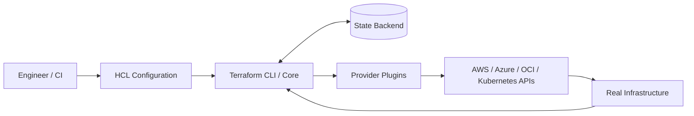
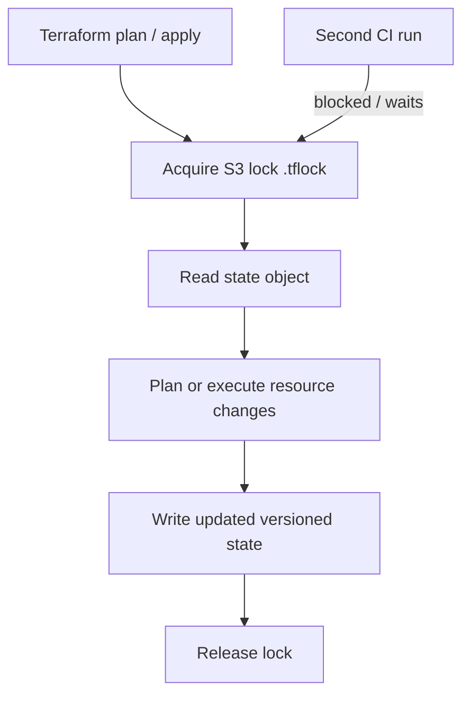
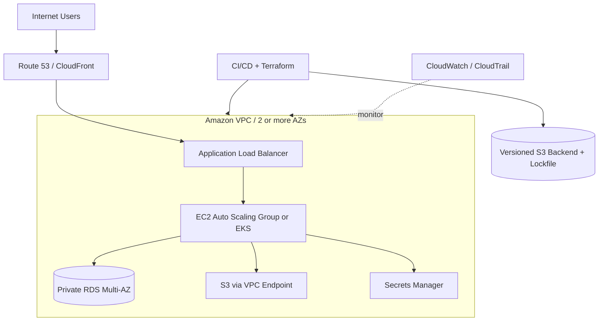
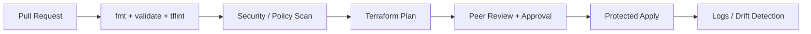

# Terraform End-to-End Interview Notes | DevOps, SRE, Cloud & Platform Engineering

> **Audience:** DevOps / SRE / Cloud / Platform Engineering interviews (roughly 1–5 years of experience).  
> **Goal:** Understand Terraform deeply, explain design trade-offs, write safe HCL, implement AWS infrastructure, debug incidents, and answer real production scenarios.  
> **Last reviewed:** November 2026. Terraform CLI and provider releases evolve independently; verify syntax and compatibility using the official docs linked at the end.

[](https://developer.hashicorp.com/terraform) [](https://aws.amazon.com/) [](#) [](#)

**Fast navigation:** [Basics](#1-terraform-at-a-glance) · [Workflow](#4-cli-and-lifecycle-workflow) · [HCL](#5-hcl-language-core) · [State](#9-terraform-state-deep-dive) · [AWS](#15-aws-infrastructure-as-code) · [CI/CD](#19-terraform-in-cicd) · [Troubleshooting](#25-production-troubleshooting-playbook) · [Questions](#27-interview-questions-and-model-answers) · [Labs](#29-hands-on-labs) · [Commands](#30-command-cheat-sheet)

## Table of Contents

1. [Terraform at a Glance](#1-terraform-at-a-glance)
2. [Infrastructure as Code Fundamentals](#2-infrastructure-as-code-fundamentals)
3. [Terraform Architecture](#3-terraform-architecture)
4. [CLI and Lifecycle Workflow](#4-cli-and-lifecycle-workflow)
5. [HCL Language Core](#5-hcl-language-core)
6. [Variables, Outputs and Locals](#6-variables-outputs-and-locals)
7. [Resources, Data Sources and Providers](#7-resources-data-sources-and-providers)
8. [Dependency Graph and Meta-Arguments](#8-dependency-graph-and-meta-arguments)
9. [Terraform State Deep Dive](#9-terraform-state-deep-dive)
10. [Remote Backend and Locking on AWS](#10-remote-backend-and-locking-on-aws)
11. [Workspaces and Environment Strategies](#11-workspaces-and-environment-strategies)
12. [Modules and Reusable Architecture](#12-modules-and-reusable-architecture)
13. [Importing, Refactoring and Moving Infrastructure](#13-importing-refactoring-and-moving-infrastructure)
14. [Lifecycle, Drift and Destructive Changes](#14-lifecycle-drift-and-destructive-changes)
15. [AWS Infrastructure as Code](#15-aws-infrastructure-as-code)
16. [Secrets, IAM and Terraform Security](#16-secrets-iam-and-terraform-security)
17. [Validation, Testing and Code Quality](#17-validation-testing-and-code-quality)
18. [Policy as Code and Governance](#18-policy-as-code-and-governance)
19. [Terraform in CI/CD](#19-terraform-in-cicd)
20. [Terraform with Kubernetes, Helm and GitOps](#20-terraform-with-kubernetes-helm-and-gitops)
21. [Advanced Terraform Language](#21-advanced-terraform-language)
22. [Performance, Scale and Cost](#22-performance-scale-and-cost)
23. [HCP Terraform and Team Operations](#23-hcp-terraform-and-team-operations)
24. [Production Design and Best Practices](#24-production-design-and-best-practices)
25. [Production Troubleshooting Playbook](#25-production-troubleshooting-playbook)
26. [Scenario-Based Interview Rounds](#26-scenario-based-interview-rounds)
27. [Interview Questions and Model Answers](#27-interview-questions-and-model-answers)
28. [Comparisons and Interview Traps](#28-comparisons-and-interview-traps)
29. [Hands-on Labs](#29-hands-on-labs)
30. [Command Cheat Sheet](#30-command-cheat-sheet)
31. [7-Day and 14-Day Interview Roadmap](#31-7-day-and-14-day-interview-roadmap)
32. [Projects and Resume Talking Points](#32-projects-and-resume-talking-points)
33. [Flashcards and Self-Assessment](#33-flashcards-and-self-assessment)
34. [Official References](#34-official-references)

---

## How to use this guide

1. **Read Sections 1–14:** Terraform model, HCL, backends, state, dependency ordering and modules.
2. **Practice Sections 15–20:** AWS resources, authentication, tests, policies, Jenkins and GitHub Actions.
3. **Solve Section 25 without looking:** explain diagnosis before proposing commands.
4. **Rehearse Section 27 aloud:** each response should take 30–90 seconds; deepen answers when prompted.
5. **Do the labs:** create infrastructure only in a sandbox account, check costs and destroy everything after practice.

**Interview answer pattern:** *Definition → why it matters → example → failure mode → production best practice.*

> **Safety:** `terraform apply`, AWS CLI, NAT gateways, RDS, EKS and EC2 can create billable resources. Never execute examples against production without review, approval and a tested recovery plan. Do not put AWS keys, passwords, tokens or plaintext state files in Git.

---

## 1. Terraform at a Glance

**Terraform** is a declarative Infrastructure as Code (IaC) tool. You describe the desired infrastructure in HCL; Terraform calculates and executes changes through provider APIs while tracking managed resources in **state**.



| Concept | One-line answer |
|---|---|
| Declarative | Describe **what** should exist, not every imperative creation step. |
| Provider | Plugin that integrates Terraform with an API (AWS, Kubernetes, etc.). |
| Resource | Object Terraform manages, e.g., `aws_instance.web`. |
| Data source | Reads an existing object without owning its lifecycle. |
| Module | Reusable group of Terraform configuration. |
| State | Mapping between resource addresses and remote objects, plus tracked attributes. |
| Backend | Determines where state lives and, where supported, how locking works. |
| Plan | Preview of proposed changes; not a transaction guarantee. |
| Apply | Executes the proposed operations through providers and updates state. |
| Drift | Difference between recorded/desired infrastructure and actual infrastructure. |
| Workspace | Named state instance for a configuration; **not** an IAM security boundary. |

### Typical workflow

```text
Write .tf -> terraform fmt -> terraform init -> terraform validate
         -> terraform plan -> peer review / approval
         -> terraform apply -> observe / verify -> manage drift
```

**Golden rule:** Terraform is great at provisioning and managing infrastructure; use Ansible/cloud-init/AMI/image pipelines for OS configuration and Kubernetes/Helm/GitOps for application deployments, depending on the problem.

## 2. Infrastructure as Code Fundamentals

### Why IaC?

- Reproducible environments, reviewable changes, auditability and less configuration drift.
- Automated provisioning and standardized naming, labels, network controls and encryption.
- Disaster recovery by redeploying definitions **plus** restoring data, secrets and external dependencies.
- Repeatable integration into pull requests, CI and compliance checks.

### Declarative vs imperative

```hcl
# Declarative: desired state
resource "aws_s3_bucket" "logs" {
  bucket = "change-me-unique-demo-logs-bucket"
}
```

```bash
# Imperative: an action, not continuous desired-state reconciliation
aws s3api create-bucket --bucket change-me-unique-demo-logs-bucket \
  --region ap-south-1 --create-bucket-configuration LocationConstraint=ap-south-1
```

Terraform is **not** a constantly running controller: it checks changes when `plan` or `apply` executes. It does not continuously revert console changes on its own.

### IaC vs configuration management

| Tool | Primary responsibility | Example |
|---|---|---|
| Terraform | Resource lifecycle and infrastructure graph | VPC, IAM roles, EKS cluster |
| Ansible | Configure hosts and software | Install packages, change config files |
| Packer | Build machine images | Golden AMI |
| Kubernetes | Desired state of containers | Deployments, Services |
| Helm | Package and release Kubernetes applications | Ingress controller chart |
| Argo CD | Reconcile Git-defined cluster state | App version deployment |

**Common interview trap:** Terraform is usually *idempotent in intent*, but changes, API behavior, provider bugs and external drift can affect actual results; do not claim absolute idempotency in every scenario.

## 3. Terraform Architecture

### Components

1. **Terraform CLI/Core:** parses files, validates, builds dependency graph, refreshes state and plans actions.
2. **Providers:** independently versioned plugins implementing managed resources and data sources.
3. **Backend:** state storage/locking (local, S3, HCP Terraform, etc.).
4. **Modules:** root module (working directory) and child modules (local/registry/Git).
5. **Remote platform:** AWS API, Kubernetes API, Azure API, etc.

```text
repo/
├── main.tf                 # Resource and module calls
├── providers.tf            # required_providers, provider config
├── versions.tf             # Terraform constraints
├── variables.tf            # Inputs
├── outputs.tf              # Outputs
├── locals.tf               # Local expressions
├── terraform.tfvars        # Non-secret environment values (optional)
├── .terraform.lock.hcl     # COMMIT: provider versions and checksums
├── .terraform/             # IGNORE: downloaded plugins/modules
└── terraform.tfstate       # IGNORE: local state; sensitive
```

### Standard runtime sequence

1. Read config and provider schemas.
2. Obtain the current state (and lock when needed/supported).
3. Refresh/read remote objects to compare reality with state, unless refresh is disabled.
4. Produce a dependency-aware plan.
5. During apply, invoke provider operations, update state and release lock.

**Important distinction:** Terraform state is not simply a copy of `.tf` files, and the provider is not the state backend. Providers interact with APIs; the backend manages state persistence.

## 4. CLI and Lifecycle Workflow

| Command | Purpose | Interview detail |
|---|---|---|
| `terraform version` | Check CLI version | Core version differs from provider version. |
| `terraform init` | Configure backend; download modules/providers | Rerun after backend/provider/module changes. |
| `terraform fmt -recursive` | Format HCL | Use `-check` in CI. |
| `terraform validate` | Validate configuration | Does not prove credentials, quotas or deployability. |
| `terraform plan` | Preview changes | Default can query cloud APIs. |
| `terraform plan -out=tfplan` | Save binary plan | Treat plan file as sensitive. |
| `terraform apply tfplan` | Apply reviewed plan | Don't run another unreviewed plan. |
| `terraform destroy` | Destroy managed infrastructure | Dangerous in shared environments. |
| `terraform show` | Render state or plan | `-json` for machine-readable detail. |
| `terraform output` | Inspect root outputs | `-json` / `-raw` can expose secrets. |
| `terraform console` | Evaluate expressions | Useful with `try`, maps and comprehensions. |
| `terraform graph` | Generate dependency graph DOT | Debug indirect dependencies. |
| `terraform state list` | List state addresses | Diagnostic; not cloud inventory. |
| `terraform state show ADDRESS` | Inspect tracked object | May include confidential details. |
| `terraform import` | Attach existing object to state | Must also maintain matching `.tf` configuration. |
| `terraform test` | Run native HCL tests | May create real resources unless mocked or plan-only. |

```bash
terraform fmt -check -recursive
terraform init -input=false
terraform validate
terraform plan -out=tfplan -input=false
terraform show tfplan
terraform apply -input=false tfplan
```

### Explain plan symbols

```text
+      create
-      destroy
~      update in place
-/+    destroy and then create replacement
+/-    create before destroy replacement (when possible)
<=     data read during apply (notation varies by context)
```

**Production note:** A saved plan improves review-to-apply consistency, but an external actor can still change cloud infrastructure between planning and applying. Terraform might reject the plan if state changes; cloud APIs may also fail at apply time.

### Detailed exit codes

```bash
terraform plan -detailed-exitcode -input=false
# 0 = success, no diff
# 1 = error
# 2 = success, changes present
```

Shell scripts should capture the exit code without treating code `2` as an application failure.

### Useful initialization flags

```bash
terraform init -backend-config=backend-prod.hcl   # Non-secret backend settings
terraform init -reconfigure                       # Accept current backend config
terraform init -migrate-state                     # Migrate state (plan/backup first)
terraform init -upgrade                           # Re-resolve provider/module versions
terraform init -lockfile=readonly                 # Enforce existing provider selections
```

`init -reconfigure` does **not** migrate state. Use `-migrate-state` for a deliberate migration, with backups and change control.

## 5. HCL Language Core

### Minimal provider + resource

```hcl
terraform {
  required_version = ">= 1.11.0, < 2.0.0"
  required_providers {
    aws = {
      source  = "hashicorp/aws"
      version = "~> 6.0"
    }
  }
}

provider "aws" {
  region = "ap-south-1"
}

resource "aws_s3_bucket" "example" {
  bucket = "replace-with-globally-unique-sandbox-bucket"
  tags   = { Project = "terraform-interview" }
}
```

**Resource address:** `aws_s3_bucket.example`. The AWS remote ID and Terraform resource address are different concepts.

### Types and values

```hcl
name    = "app"                   # string
count   = 3                       # number
enabled = true                    # bool
tags    = { Team = "Platform" }    # object/map
zones   = ["ap-south-1a", "ap-south-1b"] # list/tuple
allowed = toset(["80", "443"])  # set
nothing = null                    # absence / null value
```

### Operators and useful functions

```hcl
locals {
  prefix      = "${var.project}-${var.environment}"
  instance_on = var.environment == "prod" ? true : false
  all_tags    = merge(var.common_tags, { Environment = var.environment })
  clean_name  = lower(replace(var.project, "_", "-"))
  first_zone  = element(var.azs, 0)
  normalized  = distinct(["a", "b", "a"])
  cidr_a      = cidrsubnet(var.vpc_cidr, 8, 0)
}
```

Important functions: `merge`, `lookup`, `try`, `can`, `coalesce`, `concat`, `flatten`, `distinct`, `toset`, `tomap`, `length`, `keys`, `values`, `jsonencode`, `yamldecode`, `templatefile`, `cidrsubnet`, `cidrhost`, `filesha256`.

```hcl
locals {
  # Transform a map into a list of uppercased environment names
  env_labels = [for env in ["dev", "stage", "prod"] : upper(env)]

  # Filter a map: only enabled services
  enabled_services = {
    for k, v in var.services : k => v if v.enabled
  }
}
```

**HCL fundamentals interview:** `locals` are computed expressions, `variables` are external inputs, `outputs` expose module results. `terraform.tfvars` supplies variable values; it is not a Terraform resource definition.

## 6. Variables, Outputs and Locals

```hcl
variable "environment" {
  description = "Deployment environment"
  type        = string
  default     = "dev"

  validation {
    condition     = contains(["dev", "stage", "prod"], var.environment)
    error_message = "Environment must be dev, stage or prod."
  }
}

variable "instance_type" {
  type    = string
  default = "t3.micro"
}

variable "common_tags" {
  type = map(string)
  default = {
    ManagedBy = "terraform"
    Team      = "platform"
  }
}

locals {
  resource_prefix = "app-${var.environment}"
}

output "deployment_label" {
  description = "Computed environment label"
  value       = local.resource_prefix
}
```

### Type system quick reference

- Primitive: `string`, `number`, `bool`.
- Collection: `list(T)`, `set(T)`, `map(T)`.
- Structural: `object({ name = string, size = number })`, `tuple([string, number])`.
- Flexible: `any`; prefer explicit types for public module interfaces.
- Object optional fields: `optional(string, "default")` in an object constraint.

### Variable sources and precedence

**From lower to higher precedence** for ordinary root variables: defaults → `TF_VAR_name` environment variables → `terraform.tfvars` → `terraform.tfvars.json` → `*.auto.tfvars` / `*.auto.tfvars.json` (lexical order) → `-var` / `-var-file` command-line options (later wins). HCP Terraform has additional variable handling: validate precedence for your execution mode.

```bash
export TF_VAR_environment=stage
terraform plan -var='environment=dev'
terraform plan -var-file=prod.tfvars
```

### Avoid dangerous secret handling

```hcl
variable "db_password" {
  type      = string
  sensitive = true
}
```

`sensitive = true` **redacts CLI display but does not necessarily omit the value from state or saved plans**. Use least privilege, secret backends, protected state and—where supported—ephemeral variables with write-only provider arguments; see Section 16.

### Outputs in pipelines

```bash
terraform output
terraform output -raw deployment_label
terraform output -json > outputs.json # Protect: can include sensitive outputs
```

## 7. Resources, Data Sources and Providers

### Resource vs data source

```hcl
# Managed: Terraform creates/updates/deletes it
resource "aws_security_group" "app" {
  name        = "interview-app-sg"
  description = "Example SG"
  vpc_id      = var.vpc_id
}

# Read-only lookup: Terraform does NOT own this VPC
# (Assumes a VPC tagged Name=shared-network exists.)
data "aws_vpc" "shared" {
  filter {
    name   = "tag:Name"
    values = ["shared-network"]
  }
}
```

### Provider configuration vs required_providers

```hcl
terraform {
  required_providers {
    aws = {
      source  = "hashicorp/aws"
      version = "~> 6.0"
    }
  }
}

provider "aws" {
  region = "ap-south-1"
}

provider "aws" {
  alias  = "secondary"
  region = "ap-south-2"
}

# Example resource in second region
resource "aws_s3_bucket" "second_region" {
  provider = aws.secondary
  bucket   = "replace-with-unique-name-secondary-example"
}
```

For cross-account roles, prefer `assume_role` and workload identity (Jenkins agent role, AWS IAM OIDC, GitHub Actions OIDC) over static access keys.

### Lock file vs required version

- `required_providers` defines acceptable provider versions and source addresses.
- `.terraform.lock.hcl` records a selected provider version and checksums: **commit it**.
- `required_version` constrains Terraform CLI, not AWS provider.
- `terraform init -upgrade` explicitly considers newer allowed provider versions; review release notes and plan.

## 8. Dependency Graph and Meta-Arguments

### Implicit dependencies (preferred)

```hcl
resource "aws_subnet" "app" {
  vpc_id            = aws_vpc.main.id # Terraform infers dependency on VPC
  cidr_block        = "10.50.1.0/24"
  availability_zone = "ap-south-1a"
}
```

### Explicit dependencies

```hcl
resource "aws_instance" "app" {
  ami           = var.ami_id
  instance_type = "t3.micro"
  subnet_id     = var.subnet_id

  # Only if an API dependency isn't visible in attribute references:
  depends_on = [aws_iam_role_policy_attachment.app]
}
```

Overusing `depends_on` makes plans more conservative and can slow execution. Prefer direct resource references.

### `count` vs `for_each`

```hcl
resource "aws_s3_bucket" "count_demo" {
  count  = 2
  bucket = "replace-me-bucket-${count.index}"
}

resource "aws_s3_bucket" "named" {
  for_each = toset(["dev", "stage"])
  bucket   = "replace-me-${each.key}-globally-unique"
}
```

**Addresses:** `aws_s3_bucket.count_demo[0]` vs `aws_s3_bucket.named["dev"]`.

| `count` | `for_each` |
|---|---|
| Best for numeric repetition or binary create/no-create | Best for stable, identifiable instances |
| Index shifting can cascade replacements when list changes | Stable keys reduce address churn |
| `count.index` | `each.key`, `each.value` |
| Integer count | Map or set of strings |

**Key limitation:** The keys of `for_each` and the number used for `count` generally must be known before remote resource actions. Avoid deriving keys from IDs only known after apply.

### Dynamic blocks

```hcl
variable "ingress_rules" {
  type = list(object({ from = number, to = number, cidr = string }))
  default = [{ from = 443, to = 443, cidr = "10.0.0.0/8" }]
}

resource "aws_security_group" "dynamic_demo" {
  name   = "dynamic-demo"
  vpc_id = var.vpc_id

  dynamic "ingress" {
    for_each = var.ingress_rules
    content {
      from_port   = ingress.value.from
      to_port     = ingress.value.to
      protocol    = "tcp"
      cidr_blocks = [ingress.value.cidr]
    }
  }
}
```

Use dynamic blocks sparingly: separate security group rule resources are often easier to manage in real projects. `dynamic` generates nested blocks, **not** top-level resource blocks or meta-arguments.

## 9. Terraform State Deep Dive

### What state solves

- Maps Terraform addresses to API-managed object identities.
- Stores attributes needed to calculate future operations.
- Helps Terraform understand dependencies, changes and removals.
- Stores sensitive information for many resource types, even when input/output is marked sensitive.

```text
main.tf                    terraform.tfstate                  AWS
aws_instance.web     <->   aws_instance.web: i-abc...   <->   EC2 i-abc...
```

### Files and state commands

```bash
terraform state list
terraform state show 'aws_instance.web'
terraform state pull > state-backup.json  # Handle like a secret
terraform state mv 'aws_instance.old' 'aws_instance.new'
terraform state rm 'aws_instance.legacy'  # Forgets, does NOT delete object
```

**Caution:** Direct state surgery is an exceptional recovery/refactoring tool. Use declarative `moved` and `removed` blocks when possible. Avoid editing state JSON manually.

### `state rm`, `destroy`, `import` differences

| Operation | Real cloud object | Terraform state |
|---|---|---|
| `terraform destroy -target=...` | May delete object | Removes tracking when destruction succeeds |
| `terraform state rm ADDRESS` | Remains | Stops tracking |
| `terraform import ADDRESS ID` | Remains | Starts tracking |
| Remove resource block only | Often scheduled for deletion in next apply | Remains until applied |
| `removed { destroy = false }` | Remains | Declarative removal from management |

### State failure modes

- **Lost state:** Terraform may plan duplicate infrastructure, not automatically rediscover everything.
- **Stale state:** drift, remote deletion or external modification changes next plan.
- **Concurrent applies:** conflict unless locking/protection is correctly configured.
- **Exposed state:** can leak secrets and internal architecture.
- **State moved to wrong backend/key:** Terraform may treat resources as unmanaged or propose recreation.

**Recovery order:** stop writes → identify backend/key/workspace → inspect versioned state backup → compare actual cloud inventory → restore carefully or import → run plan → approve correction. Never overwrite production state based on a guess.

## 10. Remote Backend and Locking on AWS

### Recommended S3 remote backend

```hcl
terraform {
  backend "s3" {
    bucket       = "replace-with-existing-secure-state-bucket"
    key          = "myapp/prod/terraform.tfstate"
    region       = "ap-south-1"
    encrypt      = true
    use_lockfile = true
  }
}
```

**Modern detail:** The S3 backend supports **native S3 lock files** via `use_lockfile = true`. **DynamoDB-based locking is deprecated**; older material may recommend it as the default. S3 bucket versioning is strongly recommended to recover state versions. The bucket must exist *before* initializing the backend. See [S3 backend docs](https://developer.hashicorp.com/terraform/language/backend/s3).



### Bootstrap remote state separately

The state bucket is foundational infrastructure: create it in a separate bootstrap stack/account or through reviewed AWS provisioning. Enable S3 public access blocking, versioning, encryption, least-privilege access and recovery procedures.

```bash
# Sandbox example; replace with a unique bucket and your authorized AWS profile.
BUCKET="replace-with-unique-tfstate-bucket"
REGION="ap-south-1"
aws s3api create-bucket --bucket "$BUCKET" --region "$REGION" \
  --create-bucket-configuration LocationConstraint="$REGION"
aws s3api put-public-access-block --bucket "$BUCKET" \
  --public-access-block-configuration \
  BlockPublicAcls=true,IgnorePublicAcls=true,BlockPublicPolicy=true,RestrictPublicBuckets=true
aws s3api put-bucket-versioning --bucket "$BUCKET" \
  --versioning-configuration Status=Enabled
aws s3api put-bucket-encryption --bucket "$BUCKET" \
  --server-side-encryption-configuration \
  '{"Rules":[{"ApplyServerSideEncryptionByDefault":{"SSEAlgorithm":"AES256"}}]}'
```

**AWS permissions:** Terraform needs `s3:ListBucket`, `s3:GetObject` and `s3:PutObject` for the state path. When S3 locking is enabled, grant `GetObject`, `PutObject`, `DeleteObject` for the `.tflock` object as documented. Restrict IAM by prefixes/roles. If using SSE-KMS, provide appropriate KMS permissions.

### Remote state best practices

1. Isolate production and nonproduction via separate account / backend paths / credentials as justified.
2. Enable versioning and test recovery from a previous state version.
3. Encrypt storage and transport; limit `GetObject` and access to state backups.
4. Enable locking in every supported shared backend; do not rely on teammates avoiding overlap.
5. Use CI deployment queues or concurrency controls **in addition to** backend locking.
6. Do not commit `terraform.tfstate`, `.terraform/`, saved `tfplan`, backup state or backend credentials.

### Lock troubleshooting

```bash
terraform plan -lock-timeout=5m
terraform force-unlock LOCK_ID   # Only after verifying the owner is not running
```

Never casually use `-lock=false` or `force-unlock` on active state. First check your CI jobs, Terraform run status and lock owner; forced unlock can corrupt state if another operation is active.

## 11. Workspaces and Environment Strategies

```bash
terraform workspace list
terraform workspace new dev
terraform workspace select dev
terraform workspace show
terraform workspace select default
```

A CLI workspace isolates state for the *same configuration*; it does not by itself isolate access, credentials, accounts or secrets.

### Strategy comparison

| Strategy | Strength | Caveat |
|---|---|---|
| CLI workspaces `dev`, `prod` | Simple state separation | Easy to deploy to wrong workspace; shared configuration/access |
| Separate root directories | Clear config/state boundaries | Some duplication unless modules used |
| Separate repositories | Strong organizational ownership | Cross-repo coordination; possible duplication |
| Separate accounts | Strong security/failure isolation | More governance and role setup |
| HCP Terraform workspaces | Managed runs, variables, state and policy integration | Workspace semantics differ from CLI state-selection workflow |

**Typical production layout** (shared modules, distinct roots):

```text
infra/
├── modules/
│   ├── network/
│   ├── compute/
│   └── database/
└── environments/
    ├── dev/
    │   ├── main.tf
    │   └── backend.tf
    ├── stage/
    │   ├── main.tf
    │   └── backend.tf
    └── prod/
        ├── main.tf
        └── backend.tf
```

For enterprise production, prefer isolation that follows security boundaries, not only workspace names. Keep independent blast-radius domains (network, cluster, app, data) in separate states when warranted.

## 12. Modules and Reusable Architecture

### Local child module example

```text
project/
├── main.tf
└── modules/
    └── s3_bucket/
        ├── main.tf
        ├── variables.tf
        └── outputs.tf
```

**`modules/s3_bucket/variables.tf`**

```hcl
variable "name" { type = string }
variable "tags" { type = map(string) }
```

**`modules/s3_bucket/main.tf`**

```hcl
resource "aws_s3_bucket" "this" {
  bucket = var.name
  tags   = var.tags
}
```

**`modules/s3_bucket/outputs.tf`**

```hcl
output "bucket_id" { value = aws_s3_bucket.this.id }
```

**Root `main.tf`**

```hcl
module "logs" {
  source = "./modules/s3_bucket"
  name   = "replace-with-globally-unique-bucket-name"
  tags   = { Team = "platform", ManagedBy = "terraform" }
}

output "log_bucket_id" {
  value = module.logs.bucket_id
}
```

**Module inputs** = variables. **Module outputs** = exposed interface. A root module is the entry point; child modules do not automatically expose all internal resources.

### Git modules and version pinning

```hcl
module "network" {
  source = "git::https://github.com/example-org/terraform-aws-network.git?ref=v1.2.0"
  # ...required module arguments...
}
```

Prefer immutable version tags/commits for shared modules, semantic release notes, input validation, examples, documentation and tests. Do not reference a moving `main` branch in production without a deliberate policy.

### Good module boundaries

- Compose VPC and subnet resources in a network module; expose IDs and CIDRs.
- Compose related resources with a common lifecycle and owning team.
- Avoid mega-modules managing all resources for all apps.
- Document version constraints, contracts, required IAM permissions and replacements.
- Avoid provider configuration inside reusable child modules where possible; pass aliases from root if required.
- Use separate Terraform states when deployments have different owners, change cadence or blast radius.

## 13. Importing, Refactoring and Moving Infrastructure

### Existing resource: import block (declarative)

```hcl
resource "aws_s3_bucket" "existing" {
  bucket = "a-real-existing-bucket-name"
}

import {
  to = aws_s3_bucket.existing
  id = "a-real-existing-bucket-name"
}
```

```bash
terraform plan
terraform apply
```

Review the plan for unexpected updates or replacement! Import attaches the remote object to an address; configuration must correctly model its intended attributes. The `import` block can be retained for audit or removed once successfully imported according to team standards.

### Legacy CLI import

```bash
terraform import aws_s3_bucket.existing a-real-existing-bucket-name
```

The CLI import modifies state; it does not normally create a corresponding fully modeled resource block for you. Terraform supports HCL import blocks and can generate candidate config using `terraform plan -generate-config-out=generated.tf` in supported workflows (review generated code).

### Rename without destruction

```hcl
moved {
  from = aws_s3_bucket.old_name
  to   = aws_s3_bucket.new_name
}
```

### Stop managing without deleting

```hcl
removed {
  from = aws_s3_bucket.legacy
  lifecycle { destroy = false }
}
```

Remove the corresponding active resource block when using a `removed` block, and verify the planned operation is **forget**, not destroy. If moving across state files or teams, plan a coordinated ownership transfer; two states must not manage one cloud object simultaneously.

**Difference:** A `moved` block changes **Terraform address**; it does not relocate an EC2 instance to a new AWS region or rename a bucket remotely.

## 14. Lifecycle, Drift and Destructive Changes

### Lifecycle meta-arguments

```hcl
resource "aws_s3_bucket" "protected" {
  bucket = "replace-with-unique-protected-bucket"

  lifecycle {
    prevent_destroy = true
    ignore_changes  = [tags["LastPatchedBy"]]
  }
}
```

- `prevent_destroy`: blocks a planned destroy while **this lifecycle rule remains in configuration**; not a replacement for AWS policy/backup.
- `create_before_destroy`: requests replacement with new resource first when remote API/naming allows it.
- `ignore_changes`: suppresses Terraform-proposed updates for selected attributes after create; can conceal drift.
- `replace_triggered_by`: requests replacement when specified managed resources or attributes change.
- `precondition` / `postcondition`: explicit runtime assertions.

**Critical trap:** Removing the entire resource block also removes its `prevent_destroy` rule; a destroy can then be planned. Protect production with policy and IAM too.

### Drift detection

```bash
terraform plan                          # Compare config, state and remote reality
terraform plan -refresh-only            # Propose state-only reconciliation
terraform apply -refresh-only           # Review before accepting state-only update
```

`-refresh-only` **updates Terraform's view of remote reality**, not the resource configuration back to the desired settings. If someone changed a security group outside Terraform, a normal `plan` may propose restoration; a refresh-only apply updates stored state to reflect the observed remote values.

### Intentional replacements

```bash
terraform plan -replace='aws_instance.web'
terraform apply -replace='aws_instance.web'   # Explicit and destructive
```

`terraform taint` is a legacy/deprecated workflow; `-replace` is preferred for explicit replacement plans. Resource changes that force replacement are determined by provider schema and specific argument semantics.

## 15. AWS Infrastructure as Code

### AWS architecture: a typical 3-tier deployment



**Production model:** public ALB, private app subnets, isolated database subnets, security groups with least privilege, multi-AZ availability, private connectivity and logs. Public/private depends on routes and public addressing—not only a subnet's name.

### VPC, subnet and internet gateway

```hcl
resource "aws_vpc" "main" {
  cidr_block           = "10.20.0.0/16"
  enable_dns_support   = true
  enable_dns_hostnames = true
  tags = { Name = "interview-vpc" }
}

resource "aws_internet_gateway" "main" {
  vpc_id = aws_vpc.main.id
  tags   = { Name = "interview-igw" }
}

resource "aws_subnet" "public_a" {
  vpc_id                  = aws_vpc.main.id
  cidr_block              = "10.20.1.0/24"
  availability_zone       = "ap-south-1a"
  map_public_ip_on_launch = true
  tags = { Name = "public-a" }
}

resource "aws_route_table" "public" {
  vpc_id = aws_vpc.main.id
  route {
    cidr_block = "0.0.0.0/0"
    gateway_id = aws_internet_gateway.main.id
  }
}

resource "aws_route_table_association" "public_a" {
  subnet_id      = aws_subnet.public_a.id
  route_table_id = aws_route_table.public.id
}
```

A **public subnet** has a route to an internet gateway; an EC2 instance still needs an appropriate public IP/IPv6 address, security group and NACL to communicate. Private subnets often use NAT for outbound IPv4 or VPC endpoints for AWS services. NAT gateways are billable.

### Security groups and least privilege

```hcl
resource "aws_security_group" "web" {
  name        = "web-example"
  description = "Web tier access"
  vpc_id      = aws_vpc.main.id
}

resource "aws_vpc_security_group_ingress_rule" "web_https" {
  security_group_id = aws_security_group.web.id
  cidr_ipv4         = "0.0.0.0/0" # Appropriate only for deliberately public HTTPS
  from_port         = 443
  to_port           = 443
  ip_protocol       = "tcp"
}

resource "aws_vpc_security_group_egress_rule" "web_egress" {
  security_group_id = aws_security_group.web.id
  cidr_ipv4         = "0.0.0.0/0" # Restrict in high-security environments
  ip_protocol       = "-1"
}
```

Prefer dedicated rule resources for clarity and to avoid managing the same rule inline and separately. Do not expose SSH/RDP to the internet in production; use SSM Session Manager or controlled bastions.

### EC2 with an existing AMI

```hcl
variable "ami_id" { type = string }

resource "aws_instance" "web" {
  ami                    = var.ami_id
  instance_type          = "t3.micro"
  subnet_id              = aws_subnet.public_a.id
  vpc_security_group_ids = [aws_security_group.web.id]
  metadata_options {
    http_tokens = "required" # IMDSv2
  }
  tags = { Name = "tf-web-demo" }
}
```

A production EC2 module should also consider an encrypted EBS root volume, SSM agent/roles, patching, cloud-init, alarms, launch template, ASG and rollback. Don't blindly choose `latest` AMIs for deterministic production infrastructure.

### ALB and ASG: architectural skeleton

```hcl
# Conceptual excerpt (not stand-alone): assumes subnets, target group,
# listener and launch template are defined elsewhere.
resource "aws_autoscaling_group" "app" {
  name                = "interview-app-asg"
  min_size            = 2
  desired_capacity    = 2
  max_size            = 4
  vpc_zone_identifier = var.private_subnet_ids
  target_group_arns   = [aws_lb_target_group.app.arn]

  launch_template {
    id      = aws_launch_template.app.id
    version = "$Latest"
  }

  tag {
    key                 = "ManagedBy"
    value               = "Terraform"
    propagate_at_launch = true
  }
}
```

**Design choice:** avoid Terraform fighting ASG's legitimate dynamic desired capacity. Depending on design, consider ignoring ASG `desired_capacity` after creation, or manage scale targets explicitly. Ignoring changes is a trade-off, not universal best practice.

### S3 baseline security configuration

```hcl
resource "aws_s3_bucket" "app" {
  bucket = var.unique_bucket_name
}

resource "aws_s3_bucket_public_access_block" "app" {
  bucket                  = aws_s3_bucket.app.id
  block_public_acls       = true
  block_public_policy     = true
  ignore_public_acls      = true
  restrict_public_buckets = true
}

resource "aws_s3_bucket_versioning" "app" {
  bucket = aws_s3_bucket.app.id
  versioning_configuration { status = "Enabled" }
}

resource "aws_s3_bucket_server_side_encryption_configuration" "app" {
  bucket = aws_s3_bucket.app.id
  rule {
    apply_server_side_encryption_by_default { sse_algorithm = "AES256" }
  }
}
```

**S3 tip:** a versioned bucket with data generally cannot be removed just by deleting a Terraform resource block; secure data-retention and lifecycle policies matter. Avoid using `force_destroy = true` on valuable buckets.

### RDS / database design

- Private DB subnets across two or more AZs; `publicly_accessible = false`.
- Security groups allow only the application tier to reach DB port.
- Multi-AZ for availability; read replicas for read scaling (not equivalent).
- Encryption, Secrets Manager-managed credentials, backup retention, logs, monitoring.
- Snapshot policy and deletion protection; confirm any replica/engine constraints.
- Avoid hardcoding passwords in `.tf` or `.tfvars`.

### EKS integration

Terraform commonly provisions VPC, EKS, IAM/OIDC or Pod Identity plumbing, node groups, security groups and storage prerequisites. Prefer Kubernetes/Helm/GitOps for high-churn app releases; avoid a single massive Terraform state for the entire cluster and every Helm release.

## 16. Secrets, IAM and Terraform Security

### Threat model for Terraform

| Sensitive surface | Risk | Protection |
|---|---|---|
| `.tf` files | Hard-coded secrets committed | Code review, scanning, never embed creds |
| `terraform.tfvars` | Passwords/token values | Secret store; gitignore if contains secrets |
| `terraform.tfstate` | Secrets and internal infrastructure detail | Restricted encrypted remote backend |
| Saved `tfplan` | Can contain sensitive material | Secure, short retention, restricted access |
| CI logs | Outputs and command arguments leaked | Mask, use OIDC/roles, no `set -x` for secrets |
| Provider authentication | Credential theft / escalation | Short-lived roles, least privilege, separate prod |
| Module source | Supply chain compromise | Trusted sources, pinned versions, review |
| Providers | Plugin integrity / upgrades | Checksums via lock file, pinned constraints |

### Use OIDC or temporary roles (preferred)

- **GitHub Actions:** OIDC federates workflow identity to AWS role using STS; lock role trust to repository, environment and allowed branches.
- **Jenkins in AWS:** attach an IAM role to the agent instance/service account or assume a dedicated deploy role; avoid permanent keys.
- **Cross-account:** AWS provider `assume_role` for target account with narrowly scoped permissions.
- **Local developers:** IAM Identity Center / SSO or short-lived sessions instead of access keys in source.

```hcl
provider "aws" {
  region = "ap-south-1"
  assume_role {
    role_arn     = "arn:aws:iam::123456789012:role/TerraformDeploymentRole"
    session_name = "terraform-ci"
  }
}
```

Role ARN above is illustrative. Credentials for the **source identity** still must be available securely (e.g., OIDC, instance profile, SSO).

### Sensitive vs ephemeral vs write-only

| Mechanism | Redacts output? | Omits from state/plan? | Caveat |
|---|---|---|---|
| `sensitive = true` | Yes, in normal CLI rendering | **No** | Still protect state and plans |
| `ephemeral = true` | Not necessarily unless also sensitive | **Yes** for value | Only valid in supported contexts |
| Provider write-only arguments | Usually designed for secret inputs | **Yes** for write-only value | Provider/resource must support it |
| Secret external store | Access-controlled service | Depends on how value is consumed | Ordinary data source output may enter state |

**Version note:** ephemeral variables/resources are available in Terraform 1.10+; managed-resource write-only arguments are available in Terraform 1.11+. Provider support varies. A root output cannot be ephemeral; child module outputs can be ephemeral in supported contexts.

```hcl
# Supported only when your Terraform/provider combination permits it.
variable "db_password" {
  type      = string
  sensitive = true
  ephemeral = true
}

# Illustrative RDS snippet (other required database fields omitted):
# resource "aws_db_instance" "db" {
#   ...
#   password_wo         = var.db_password
#   password_wo_version = 1
# }
```

Changing write-only secret values often requires incrementing corresponding `_wo_version` arguments. Store/rotate secret values in an appropriate secret manager; ephemeral values are not a substitute for persistent secret storage.

### Security checklist

- Protected branches, peer-reviewed plans, separate production approvals.
- Required IAM permissions only; separate state-read and apply privileges where practical.
- Scan code with Checkov/tfsec (where maintained), Trivy config, TFLint and secret scanners.
- Encrypt state at rest and in transit; audit backend access with cloud logging.
- Restrict Terraform runner egress and protect build artifacts.
- Require tagging, encryption and no public exposure using preventive controls.
- Avoid automatic `apply` from untrusted pull requests and injected secrets in forked PRs.

## 17. Validation, Testing and Code Quality

### Quality gates

```bash
terraform fmt -check -recursive
terraform init -backend=false      # Can validate configuration without backend access
terraform validate
terraform test                      # Inspect tests: may apply real infrastructure
```

### Static analysis tools

| Tool | Use case |
|---|---|
| `terraform fmt` | Canonical formatting |
| `terraform validate` | Syntax/schema/config sanity |
| `terraform test` | Native Terraform tests |
| TFLint | Terraform linting, provider-specific conventions/rules |
| Checkov / Trivy config | IaC misconfiguration/security checks |
| Infracost | Cloud cost estimate changes |
| OPA / Conftest | Custom policy checks |
| HCP Terraform policies | Enforcement in managed Terraform runs |

**`validate` does not contact AWS to ensure a resource can be created.** A plan can fail on credentials, permissions, data lookup, region limitations, provider API or quota issues.

### Native `.tftest.hcl` test example

**`tests/variables.tftest.hcl`** (example expects the `deployment_label` output from Section 6):

```hcl
run "default_environment_label" {
  command = plan
  assert {
    condition     = output.deployment_label == "app-dev"
    error_message = "Default environment should be dev."
  }
}

run "production_environment_label" {
  command = plan
  variables { environment = "prod" }
  assert {
    condition     = output.deployment_label == "app-prod"
    error_message = "Prod environment label mismatch."
  }
}
```

Tests support `plan` or `apply` runs; **`apply` can create and incur costs**. Mock providers are available in Terraform 1.7+ for unit-style tests without creating real resources.

### Mock provider test (conceptual independent test)

```hcl
# A module's outputs/resource attributes must match the actual module under test.
mock_provider "aws" {}

run "plan_does_not_need_real_aws_credentials" {
  command = plan
  assert {
    condition     = true
    error_message = "Demonstration assertion."
  }
}
```

A real test should assert meaningful module outputs or resource properties, not `true`; validate that mocks provide enough data for your graph.

### Preconditions and postconditions

```hcl
resource "aws_s3_bucket" "logs" {
  bucket = var.unique_bucket_name
  lifecycle {
    precondition {
      condition     = length(var.unique_bucket_name) >= 3
      error_message = "Bucket name is too short."
    }
  }
}
```

Use variable validation for simple input checks; use pre/postconditions for assertions about resources and data. A `check` block can also express broader assertions without the same blocking semantics as resource preconditions.

## 18. Policy as Code and Governance

**Why policies?** Terraform code can be syntactically valid but violate company requirements: internet-exposed SSH, missing encryption, unrestricted IAM, missing tags or excessive instance sizes.

### Three layers

1. **Developer feedback:** lint/security scans in pre-commit or PR checks.
2. **Terraform plan policy:** inspect proposed changes (OPA/Sentinel/conftest or managed policy sets).
3. **Cloud guardrails:** SCPs, IAM permission boundaries, AWS Config and runtime controls.

Example policies:

- Every S3 bucket blocks public access and uses encryption.
- Every EC2 launch uses IMDSv2 and approved AMIs/instance classes.
- Database must be private, encrypted and deletion-protected.
- Required tags: `Owner`, `Environment`, `CostCenter`, `ManagedBy`.
- Production changes require approval from authorized maintainers.

### Enforcement pattern



Terraform policy engines reduce risk but do not replace AWS-side permission boundaries and monitoring.

## 19. Terraform in CI/CD

### Recommended PR-to-production lifecycle

1. Pull request triggers `fmt`, `validate`, security scan, tests and **read-only plan**.
2. Store/share plan securely; human reviews add/update/replace/destroy counts and sensitive changes.
3. Require protected branch/environment approval.
4. Apply with short-lived credentials from a trusted job; protect the remote state and lock.
5. Verify the deployed infrastructure; publish change/audit log and monitor.
6. Serialize applies to the same state and prevent stale-plan race conditions.

### Jenkins pipeline example

This pipeline assumes a trusted Jenkins agent already has AWS identity through an attached role or equivalent approved mechanism. Replace `infra/prod` with your actual path and protect the Jenkins job from untrusted contributors.

```groovy
pipeline {
  agent { label 'terraform-agent' }
  options {
    timestamps()
    disableConcurrentBuilds()
    timeout(time: 45, unit: 'MINUTES')
  }
  environment {
    TF_IN_AUTOMATION = 'true'
    AWS_REGION = 'ap-south-1'
  }
  stages {
    stage('Validate') {
      steps {
        dir('infra/prod') {
          sh '''
            terraform fmt -check -recursive
            terraform init -input=false -lockfile=readonly
            terraform validate
          '''
        }
      }
    }
    stage('Plan') {
      steps {
        dir('infra/prod') {
          sh 'terraform plan -input=false -lock-timeout=5m -out=tfplan'
          sh 'terraform show -no-color tfplan > plan-review.txt'
        }
      }
    }
    stage('Approval') {
      steps {
        input message: 'Review the Terraform plan and approve production deployment.'
      }
    }
    stage('Apply Reviewed Plan') {
      steps {
        dir('infra/prod') {
          sh 'terraform apply -input=false -lock-timeout=5m tfplan'
        }
      }
    }
  }
  post {
    always {
      // Local cleanup; DO NOT archive sensitive tfplan in a public artifact store.
      sh 'rm -f infra/prod/tfplan infra/prod/plan-review.txt || true'
    }
  }
}
```

**Real production improvements:** implement plan review through secured platform capabilities rather than the mutable workspace file; pin runner images, providers and modules; use a state-aware concurrency mechanism; handle ephemeral workspaces, approval timeouts and secret leakage through plan output. `disableConcurrentBuilds()` protects only that Jenkins job, not other jobs/platforms editing the same state.

### GitHub Actions with AWS OIDC (illustrative)

Create an IAM OIDC trust policy restricted to this repository and environment. Configure the role ARN as a protected repository/environment variable. This workflow performs validation/plan on PRs and applies after pushes to `main`; use GitHub protected environments/branch protection before enabling it for production.

```yaml
name: terraform
on:
  pull_request:
    paths: ["infra/**"]
  push:
    branches: [main]
    paths: ["infra/**"]

permissions:
  contents: read
  id-token: write

concurrency:
  group: terraform-prod
  cancel-in-progress: false

jobs:
  terraform:
    runs-on: ubuntu-latest
    environment: production
    defaults:
      run:
        working-directory: infra/prod
    steps:
      - uses: actions/checkout@v4
      - uses: hashicorp/setup-terraform@v3
      - uses: aws-actions/configure-aws-credentials@v4
        with:
          role-to-assume: ${{ vars.TERRAFORM_AWS_ROLE_ARN }}
          aws-region: ap-south-1
      - run: terraform fmt -check -recursive
      - run: terraform init -input=false -lockfile=readonly
      - run: terraform validate
      - run: terraform plan -input=false
      - if: github.event_name == 'push' && github.ref == 'refs/heads/main'
        run: terraform apply -input=false -auto-approve
```

**Security warning:** Don't allow untrusted fork PR code to assume a production AWS role; OIDC trust policy, permissions and runner trust are vital. This example needs environment/role changes before real use. Pin third-party actions to immutable commit SHAs in security-sensitive production pipelines. Automated main-branch apply requires previously approved code and policy checks; higher-risk environments should additionally use a reviewed saved plan and manual approval.

### Pipeline interview questions

- **Why plan on PR?** Surface changes before merging, including unintentional destroys.
- **Why manual approval?** Separation of duties for impactful production changes.
- **Why lock?** Prevent concurrent writes and state corruption.
- **Why saved plan?** Ensure apply uses the reviewed actions when feasible.
- **Why short-lived credentials?** Lower risk from credential exposure.
- **Can plan be executed without permissions?** It typically needs cloud read permissions and backend access; `validate` can run without live credentials.

## 20. Terraform with Kubernetes, Helm and GitOps

### Division of responsibility

| Terraform | Helm / Kubernetes / GitOps |
|---|---|
| VPC, subnets, IAM, EKS cluster/node groups | Deployments, ConfigMaps, Services, application rollouts |
| EKS IAM roles, network/security primitives | Helm releases, operators, application configuration |
| Shared cluster prerequisites | Continuous reconciliation of app Git state |

```text
Terraform (infrastructure pipeline)
  └── VPC -> EKS -> Node Groups -> IAM -> CSI/Ingress prerequisites
                  |
                  v
        Argo CD / Flux (app GitOps)
          └── Helm/Kustomize -> Deployments -> Services -> Ingress
```

### Kubernetes provider and Helm provider

Terraform providers for Kubernetes/Helm can manage cluster resources, but bootstrapping a brand-new cluster and immediately initializing providers from its output can create dependency/cycle/planning issues. Often split into **cluster state** and **addons state**, then app GitOps.

```hcl
# Concept only: endpoint/CA/token must be obtained through a reliable,
# available cluster and suitable authentication configuration.
provider "kubernetes" {
  host                   = var.cluster_endpoint
  cluster_ca_certificate = base64decode(var.cluster_ca)
  token                  = var.cluster_token
}
```

For EKS, prefer short-lived authenticated access over embedding a permanent token; consider exec-based authentication where supported. Treat Kubernetes state/plan files as sensitive if they manage Secrets.

### Terraform vs GitOps answer

Terraform is run-driven and useful for infrastructure graph changes. GitOps controllers continuously reconcile Kubernetes objects from Git. In a production platform, both can be complementary. Avoid *two controllers managing the same Kubernetes resource*.

## 21. Advanced Terraform Language

### `try` vs `can` vs `lookup`

```hcl
locals {
  # try: first expression that doesn't error
  selected_name = try(var.settings.name, "default-app")

  # can: bool indicating whether expression can be evaluated
  valid_number  = can(tonumber("123"))

  # lookup: map key or fallback
  owner         = lookup(var.tags, "Owner", "unknown")
}
```

`try()` is for dynamic evaluation errors, not a blanket suppression of invalid type references or malformed configuration.

### `templatefile` and `jsonencode`

```hcl
locals {
  user_data = templatefile("${path.module}/userdata.sh.tftpl", {
    app_name = var.project
  })

  policy_json = jsonencode({
    Version = "2012-10-17"
    Statement = [{
      Effect   = "Allow"
      Action   = ["s3:GetObject"]
      Resource = ["arn:aws:s3:::example-bucket/*"]
    }]
  })
}
```

Use `jsonencode` instead of hand-escaping JSON; prefer `aws_iam_policy_document` data source for complex IAM policies.

### Unknown values and partial plans

Resource IDs may be `known after apply`; downstream values can remain unknown in plan. Terraform uses dependencies to resolve them during apply. `for_each` keys should be stable and plan-time known. A provider may require data discovery or apply in more than one state boundary when cluster bootstrap output isn't available at plan time.

### Multiple provider aliases

Use provider aliases for multiple regions/accounts. Pass aliased providers to child modules via `providers = { aws = aws.secondary }` where appropriate; child module expectations/aliases must match.

### `terraform_data` and provisioners

`terraform_data` is a built-in resource useful for dependency/lifecycle triggers and certain workflows. Provisioners (`local-exec`, `remote-exec`) are a **last resort** due to idempotency, secret handling, network access, ordering and error recovery risks. Prefer purpose-built providers or immutable images/user data for host bootstrap.

### Targeting and refresh flags

```bash
terraform plan -target='module.network' # Exceptional recovery; not normal workflow
terraform plan -refresh=false           # Uses potentially stale assumptions
```

`-target` is not an environment or module isolation strategy. It can leave the overall configuration partially converged; run a full plan afterwards.

### Terraform Stacks (advanced topic)

Terraform Stacks add higher-level coordination of components/deployments in supported Terraform workflows. They are **not** simply the same thing as CLI workspaces or child modules. Check current HCP Terraform/CLI availability and feature constraints before presenting Stacks as universally available in every backend.

## 22. Performance, Scale and Cost

### Why slow plans happen

- Large monolithic state and graph, thousands of resources and broad refresh.
- Provider rate limits, slow API reads, data sources or implicit/explicit dependencies.
- Repeated plugin/module downloads in ephemeral CI agents.
- Serial bottlenecks or broad `depends_on`; resource replacements with heavy provisioning.
- Multiple teams waiting on the same state lock.

### Practical improvements

1. Partition state by lifecycle/owner/blast radius, not one state per individual resource.
2. Reuse well-designed modules, pin providers, use plugin caches in trusted runners.
3. Avoid wasteful data lookups and overly broad `depends_on`.
4. Monitor plan/apply durations; account for API throttling and provider retries.
5. Use `-parallelism=N` cautiously; raising it may increase API throttling.
6. Use `-refresh=false` only for constrained workflows with known trade-offs, not a blanket performance fix.
7. Prefer targeted changes to module boundaries; avoid refactoring state without migration plans.

### Cost controls

- Tag infrastructure for cost allocation; use budgets and cost alerts.
- Review instance sizing, EBS, NAT gateways, ALBs, public IPv4 costs, logs, RDS/EKS clusters.
- Estimate changes in PR with Infracost or cloud calculators.
- Destroy test labs after use; account for snapshots, versioned S3 objects and retained volumes.

## 23. HCP Terraform and Team Operations

**HCP Terraform** (formerly Terraform Cloud) offers managed remote runs, state, access control, workspace variables, integrations, private registry and policy/governance capabilities depending on the plan. Terraform Enterprise is the self-hosted enterprise offering.

### Compare execution models

| Mode | Where plan/apply runs | State | Key consideration |
|---|---|---|---|
| Local CLI + local backend | Engineer/runner | Local file | Not ideal for teamwork |
| Local CLI + S3 backend | Engineer/runner | Shared S3 | You operate CI, permissions and reviews |
| HCP Terraform remote runs | Managed execution | Managed | Central policy, runs, variables, access |
| Terraform Enterprise | Self-hosted managed execution | Managed platform | Operational responsibility and enterprise integration |

**Interview:** Remote *state* does not necessarily mean remote *execution*. S3 stores state, but your local laptop/Jenkins agent still runs Terraform. HCP Terraform can run plans and applies on managed infrastructure.

### Team operations checklist

- Explicit workspace ownership and environment separation.
- Restricted production applies and workspace variables.
- Provider lock file and module version pinning.
- Change approval, audit history and policy enforcement.
- Drift review cadence and orphan-resource ownership.
- Tested backend/state recovery and incident runbook.

## 24. Production Design and Best Practices

### Reference repository layout

```text
terraform-platform/
├── .github/workflows/terraform.yml
├── .gitignore
├── README.md
├── modules/
│   ├── vpc/{main,variables,outputs}.tf
│   ├── ec2/{main,variables,outputs}.tf
│   ├── eks/{main,variables,outputs}.tf
│   └── rds/{main,variables,outputs}.tf
├── environments/
│   ├── dev/{backend,main,providers,variables,outputs}.tf
│   ├── stage/{backend,main,providers,variables,outputs}.tf
│   └── prod/{backend,main,providers,variables,outputs}.tf
├── tests/
└── policies/
```

**`.gitignore`**

```gitignore
**/.terraform/*
*.tfstate
*.tfstate.*
*.tfplan
*.tfvars    # Remove if your team commits strictly non-secret values
*.tfvars.json
crash.log
crash.*.log
override.tf
override.tf.json
*_override.tf
*_override.tf.json
*.tfbackend
.terraformrc
terraform.rc
# DO NOT ignore .terraform.lock.hcl; commit it.
```

### Design review checklist

- **Security:** IAM least privilege, no hardcoded credentials, encrypted state and resources.
- **Safety:** lock and version state, prevent unauthorized destroy, production approval.
- **Reliability:** multi-AZ architecture, backups, recovery procedures, drift checks.
- **Maintainability:** reusable modules, clear roots, provider pins and meaningful names.
- **Testing:** validation, linting, policy checks, targeted HCL tests.
- **Cost:** resource estimates and teardown procedures.
- **Operations:** alarms, logs, owner tags, runbooks and deployment audit trail.

### Example production change workflow

**Request:** move an application from one EC2 instance to an ALB + 2-AZ ASG.

1. Create feature branch with reusable network/compute modules.
2. Validate data sources and AMI/launch template compatibility.
3. Add security group, target group, ALB listeners, ASG and health checks.
4. Check subnet routes, scaling policy, certificates, DNS and rollback.
5. Run plan: inspect proposed creations/deletions, tags and costs.
6. Approve, apply with state locking; verify ASG healthy targets and metrics.
7. Shift traffic safely via DNS/load balancing; monitor latency/errors.
8. Decommission old instance only after rollback window and backup checks.

---

## 25. Production Troubleshooting Playbook

> Interview technique: identify **symptom → scope → evidence → root cause → least-risk fix → prevention**. Avoid destructive commands as a first response.

### T01. `Error acquiring the state lock`

- **Symptoms:** plan/apply waits or fails with lock ID and details.
- **Diagnose:** check other Jenkins/GitHub/HCP runs and recent job crashes; confirm exact backend key and workspace.
- **Fix:** let the active run finish, or investigate its failure. Only a verified stale lock should be released with `terraform force-unlock LOCK_ID`; audit afterward.
- **Prevent:** state locking, run serialization, lock timeouts and clear ownership.

### T02. Terraform wants to recreate every resource

- **Symptoms:** hundreds of `+ create` changes for objects that already exist.
- **Diagnose:** `terraform workspace show`, backend `bucket/key/region`, `terraform state list`, `aws sts get-caller-identity`, provider aliases/account.
- **Fix:** do **not** apply. Restore correct state/backend/workspace or carefully import objects; compare cloud inventory.
- **Prevent:** immutable backend configs, state backups and explicit account assertions.

### T03. `AccessDenied` when accessing S3 state

- **Diagnose:** backend bucket/key, assumed principal, bucket policy, SCP, S3 object and lock-file permissions, KMS permissions.
- **Commands:** `aws sts get-caller-identity`, `aws s3api head-object ...` with authorized account, inspect CloudTrail.
- **Fix:** grant minimum required backend permissions; avoid switching to admin credentials as a shortcut.

### T04. DynamoDB locking fails in an older project

- **Diagnose:** legacy `dynamodb_table`, table access, table existence and Terraform version.
- **Fix:** plan a tested migration to the S3 native `use_lockfile = true` method for compatible CLI versions; do not delete a live lock table during active runs.
- **Prevent:** track backend deprecations and provider/CLI upgrades.

### T05. `Error: Reference to undeclared resource`

- **Cause:** wrong resource label/type, module scope, typo or missing declaration.
- **Fix:** inspect exact addresses; for child modules use `module.name.output`, not direct references to child internals.
- **Prevent:** `terraform validate` as a PR check.

### T06. `Invalid for_each argument`

- **Cause:** keys only known after apply, sensitive map keys, or wrong input type.
- **Fix:** construct stable keys from input variables; put unknown remote IDs in **values**, not keys.
- **Example:** `for_each = { for name in var.names : name => name }` with plan-time known names.

### T07. `Invalid count argument`

- **Cause:** count depends on a not-yet-created resource attribute.
- **Fix:** use input-based booleans/counts, split dependencies across deploy stages when truly needed.

### T08. `Provider configuration not present`

- **Cause:** provider aliases removed while resources in state still refer to them, or module/provider refactoring.
- **Fix:** restore the expected provider config, migrate/replace ownership carefully, then remove old config when state references are gone.
- **Prevent:** staged refactors with plan reviews.

### T09. Authentication failure despite `aws configure`

- **Diagnose:** `aws sts get-caller-identity`; environment vars override profiles; OIDC trust, session expiration, role policies and credential chain.
- **Fix:** choose the correct session/profile and ensure AWS provider/backend both can authenticate. Avoid embedding static keys in HCL.

### T10. `No valid credential sources found`

- **Cause:** missing credentials, wrong profile, expired SSO/STS session or blocked instance metadata.
- **Fix:** authenticate using approved SSO/OIDC/role; verify runner identity and the scope of access.

### T11. `UnauthorizedOperation` creating EC2

- **Diagnose:** IAM permissions, SCPs, permission boundaries, tag-condition policy, AMI access, encryption/KMS permissions.
- **Fix:** use CloudTrail and policy simulator where appropriate; request only the required allowed action and resource scope.

### T12. `InvalidAMIID.NotFound` or wrong AMI region

- **Cause:** AMIs are regional, deleted, private or wrong architecture.
- **Fix:** verify AMI in target region/account, architecture and launch permissions. Pin approved AMIs per region.

### T13. `InsufficientInstanceCapacity` or AWS quota

- **Cause:** selected instance/AZ unavailable, service quota exhausted or capacity shortage.
- **Fix:** choose eligible instance type/AZ, request quota increase or use capacity strategies. Terraform cannot bypass AWS capacity limits.

### T14. Applying a plan reports `Saved plan is stale`

- **Cause:** another run changed state after this plan was generated.
- **Fix:** never force it; re-run plan and re-review. Serialize applies and reduce approval latency where feasible.

### T15. `Inconsistent dependency lock file`

- **Cause:** provider requirements conflict with committed `.terraform.lock.hcl` or team changed version constraints.
- **Fix:** intentionally run `terraform init -upgrade` (when upgrade approved), inspect selections/checksums, commit revised lock file.

### T16. `Failed to install provider` / registry unavailable

- **Diagnose:** DNS, proxy, TLS, mirror configuration, rate limits, file permissions, architecture and registry reachability.
- **Fix:** use approved provider mirror/cache, fix network trust, preserve checksum validation; don't disable security checks casually.

### T17. Resource exists in AWS but `terraform import` fails

- **Cause:** wrong AWS account/region, import ID format, resource address, provider support or duplicate management.
- **Fix:** verify API identity, use provider-specific import syntax, ensure resource block exists and is not already managed in another state.

### T18. Resource gets destroyed after a rename

- **Cause:** renamed Terraform resource label without state address migration; Terraform sees old removed and new added.
- **Fix:** revert unsafe change; add a `moved` block or perform an approved `terraform state mv`; plan must show move/no replacement when appropriate.

### T19. Terraform deletes a manually created tag

- **Cause:** desired config is authoritative for managed tags; the tag isn't in configuration.
- **Fix:** manage tag in code, apply provider-level default tags, or narrowly ignore externally owned tag keys after policy review.

### T20. Endless changes in every plan (perpetual diff)

- **Diagnose:** provider bug or version, computed fields, normalization, external automation updating same resource, timestamps, unordered data and API defaults.
- **Fix:** identify the exact diff; adjust configuration/provider version or ownership. `ignore_changes` is a targeted workaround, not a blanket solution.

### T21. Plan proposes deleting production database

- **Immediate response:** stop deployment; do not apply.
- **Diagnose:** config removal, `count`/`for_each` key changes, `ForceNew` argument, wrong backend/workspace, provider change, drift.
- **Fix:** correct config/moved block, restore correct state, add backups, deletion protection and approval policy before retry.

### T22. Terraform deploy changed SG, app is unreachable

- **Diagnose:** ALB listeners/target health, SG inbound/outbound, NACL, subnet route, DNS, app port and instance health.
- **Fix:** roll forward with a reviewed rule correction or perform approved rollback; don't open all ports as a blanket fix.

### T23. S3 bucket cannot be destroyed

- **Cause:** bucket nonempty, versioned object history, object lock, replication or permission constraints.
- **Fix:** review retention, objects/versions, legal holds and deletion policies; never force-delete real business data just to make the pipeline green.

### T24. Terraform EKS/Kubernetes provider cannot connect

- **Diagnose:** cluster readiness, endpoint accessibility/private network, CA, auth token expiry, assumed role, RBAC and cluster/API status.
- **Fix:** run cluster bootstrap first, authenticate correctly, split state for addons, use reachable runners for private clusters.

### T25. State object was accidentally overwritten/deleted

- **Immediate response:** halt all applies and preserve available evidence.
- **Diagnose:** S3 version history, audit logs, recent plan/state changes and latest successful run.
- **Fix:** recover the correct versioned object with designated approvers; verify serial/lineage and plan. Re-import missing resources if necessary.
- **Prevent:** versioning, backups, restricted access, lock and recovery drills.

### Five essential incident commands

```bash
aws sts get-caller-identity
terraform workspace show
terraform state list
terraform plan -lock-timeout=5m
terraform providers
```

The diagnostic tools above may require backend or API permissions. Avoid writing full state/plan JSON into shared support tickets; redact secrets and IDs appropriately.

## 26. Scenario-Based Interview Rounds

### S1. An EC2 instance in a private subnet must access S3, but cannot use the internet

**Answer:** Add an **S3 Gateway VPC Endpoint** to the relevant VPC route tables, then verify endpoint/bucket/IAM policies and DNS/service access conditions. This avoids requiring a NAT gateway for supported regional S3 access. Check route tables, endpoint policy and object permissions; remember cross-region/access-point behavior and service-specific nuances can matter.

### S2. Someone changed a security group manually. What should you do?

**Answer:** Run a full `terraform plan` to quantify drift, determine whether the emergency manual change is approved and reconcile ownership. Restore desired policy through code or intentionally adopt the new requirement. Avoid `-refresh-only` if the objective is to revert drift: it merely updates state to observed values.

### S3. Two Jenkins jobs apply to the same production state

**Answer:** The backend lock is the last line of defense, not the only control. Add a pipeline concurrency group/lock for the state, block stale plans, use protected apply identities and split ownership if teams consistently contend. Do not use `-lock=false`.

### S4. Production RDS may be destroyed by a module upgrade

**Answer:** Stop, examine exact plan and resource address mapping, inspect provider/module release notes, verify `for_each` key or resource rename, add `moved` blocks where applicable, snapshot/backup and require explicit approval. Use RDS deletion protection, IAM guardrails and lifecycle safeguards; do not rely on `prevent_destroy` alone.

### S5. Your team wants dev, stage and prod with different security privileges

**Answer:** Use shared versioned modules and distinct root configs/backends; favor separate AWS accounts and IAM roles for stronger isolation. CLI workspaces separate state but do not create an authorization boundary. Deploy from distinct protected pipelines with environment-specific approvals.

### S6. Your Terraform state is lost but AWS resources exist

**Answer:** First restore a correct version from the encrypted, versioned backend. If unavailable, reconstruct configuration, locate remote identifiers, import into a **new controlled state**, and plan without destroying anything. Do not run a default apply that would duplicate infrastructure.

### S7. Engineers want to store a DB password in an output for Jenkins

**Answer:** Avoid materializing long-lived secrets in Terraform state or build logs. Prefer AWS Secrets Manager and IAM-based retrieval from the deployment runtime. If Terraform must pass a value, use supported ephemeral/write-only mechanisms; `sensitive = true` alone is not state exclusion.

### S8. A developer changes `count` list order and 40 instances are replaced

**Answer:** `count` addresses track indexes, so index shifts can remap objects. Use `for_each` with stable keys where the identities are named; perform address migration using `moved` blocks and review every replacement before apply.

### S9. Terraform plan passes but apply fails partway

**Answer:** Terraform is not an all-or-nothing transaction; some resources may already be created and state may have recorded partial progress. Fix the underlying API/permission/timeout error, refresh and rerun plan. Avoid blind repeated applies and verify the remote objects and their state ownership.

### S10. A new EKS cluster and a Helm app are in one root and plan fails

**Answer:** Provider configuration may need cluster connection details before cluster creation; apply-time unknown data causes planning problems. Split infra and cluster addons into separate stages/states, and use GitOps or dedicated deploy pipelines for application release.

### S11. Your security team asks how Terraform prevents unauthorized resources

**Answer:** Combine module standards, PR review, plan policy checks, short-lived least-privilege IAM roles, SCPs and continuous cloud detection. Terraform syntax validation alone cannot enforce cloud security posture.

### S12. Team upgrades AWS provider major version and plan shows dozens of diffs

**Answer:** Pin dependencies; test upgrade in nonproduction; inspect provider changelog, schema changes and deprecations. Use `.terraform.lock.hcl`, intentional `init -upgrade`, automated tests, detailed plan review and incremental rollout rather than upgrading providers blindly.

### S13. Build needs to be reproducible across laptops and CI

**Answer:** Constrain Terraform CLI versions, commit `.terraform.lock.hcl`, pin module versions, use consistent backend/account settings, run `init -lockfile=readonly` in CI and avoid untracked runtime overrides. Remember provider lock does not lock your remote data sources or actual cloud resource drift.

### S14. A teammate used `terraform state rm` to protect a bucket

**Answer:** Explain it only removes Terraform tracking; the bucket remains alive but now unmanaged by this state. Record intentional ownership transfer or declarative `removed` block and add inventory/guardrails; otherwise unmanaged infrastructure becomes security and drift risk.

### S15. How would you design Terraform for hundreds of AWS services?

**Answer:** Establish account/env boundaries, reusable versioned modules, state partitioning by team and lifecycle, secure bootstrap backends, CI policy gates, least-privilege roles and drift scanning. Publish module contracts and keep application release out of mega-states.

---

## 27. Interview Questions and Model Answers

These are **190 question-and-answer pairs** grouped by topic and difficulty. Aim to answer the first sentence confidently, then expand using the examples above.


### A. Terraform Fundamentals (Q001–Q010)

**Q001. What is Terraform?**

**Answer:** A declarative Infrastructure as Code tool that creates, updates and destroys resources through provider APIs. It uses state to correlate desired configuration with remote infrastructure.

**Q002. What problem does IaC solve?**

**Answer:** IaC makes infrastructure reproducible, reviewable, auditable and automatable. It reduces manual drift and supports consistent environment creation.

**Q003. What does declarative mean?**

**Answer:** Specify the intended final state; Terraform determines the actions and dependency order. It is not a step-by-step shell script.

**Q004. Is Terraform an orchestration or configuration-management tool?**

**Answer:** Primarily infrastructure orchestration and lifecycle management. Use Ansible, images or user data for in-guest configuration when appropriate.

**Q005. What are Terraform Core, provider and backend?**

**Answer:** Core parses config and plans changes; a provider talks to service APIs; a backend stores state and may implement locking.

**Q006. What is a root module?**

**Answer:** The Terraform configuration in the working directory that is invoked by CLI or a remote run. It can call reusable child modules.

**Q007. What is the resource address?**

**Answer:** The internal Terraform identifier for a resource instance, such as `aws_instance.web` or `module.app.aws_instance.web[0]`.

**Q008. What is an HCL file?**

**Answer:** A human-friendly configuration language file (`.tf`) declaring Terraform settings, providers, resources, variables, locals, modules and outputs.

**Q009. Does Terraform automatically fix console changes?**

**Answer:** No. It detects drift during a later plan/apply or scheduled run; Terraform is not a continuously reconciling controller by default.

**Q010. Is Terraform always idempotent?**

**Answer:** It targets idempotent desired-state convergence, but provider/API behavior, drift, side effects and bugs mean that identical operations are not an unconditional guarantee.


### B. CLI and Planning (Q011–Q020)

**Q011. What does `terraform init` do?**

**Answer:** Initializes backend and downloads provider plugins and child modules. It also creates/uses the provider dependency lock file.

**Q012. How does `terraform plan` differ from `apply`?**

**Answer:** Plan previews proposed actions; apply performs authorized actions and updates state. Some failures are only discoverable at apply time.

**Q013. Why use `terraform plan -out=tfplan`?**

**Answer:** A saved plan captures reviewed intended actions for later application. Secure the file because it can hold secrets and sensitive infrastructure details.

**Q014. What does `terraform fmt` validate?**

**Answer:** It formats configuration style; it does not validate correctness or cloud permissions.

**Q015. What does `terraform validate` actually test?**

**Answer:** Terraform configuration and provider schema consistency after initialization; it does not guarantee AWS connectivity, quotas, policy or a successful deployment.

**Q016. Explain exit code 2 with `plan -detailed-exitcode`.**

**Answer:** Terraform successfully planned and found changes; 0 means no changes and 1 indicates an error. This is useful for PR checks.

**Q017. What does `terraform init -upgrade` do?**

**Answer:** Re-resolves provider and module selections subject to constraints. Review changed dependencies and update the lock file intentionally.

**Q018. What does `terraform init -reconfigure` do?**

**Answer:** Reinitializes with the selected backend configuration without automatic state migration; use `-migrate-state` when intentional migration is required.

**Q019. What is `terraform console` for?**

**Answer:** Interactive evaluation of Terraform expressions and values to debug functions, maps, lists and references.

**Q020. Does `terraform apply -auto-approve` make a change safe?**

**Answer:** No. It skips interactive approval; production safety comes from reviewed plans, policy, protected deployments, permissions and rollback strategy.


### C. Variables, HCL and Expressions (Q021–Q030)

**Q021. What is the difference between a variable and a local?**

**Answer:** Variables are configurable inputs; locals name expressions derived within a module. Locals cannot be set directly by callers.

**Q022. How do outputs help module consumers?**

**Answer:** A module output exposes chosen values to parent modules or external automation. Internal child resources are not automatically visible across module boundaries.

**Q023. List Terraform primitive data types.**

**Answer:** `string`, `number` and `bool`. Collection types include lists, sets and maps; structural types include objects and tuples.

**Q024. When should you use `map` vs `object`?**

**Answer:** A map has homogeneous element type; an object has named attributes with potentially different types. Choose objects for explicit module contracts.

**Q025. What does `null` mean in Terraform?**

**Answer:** Usually absence of a value; providers/resources may treat null as omitted. It is not the same thing as the string `"null"`.

**Q026. How do you validate an input environment?**

**Answer:** Use a variable `validation` block with a condition such as `contains(["dev","prod"], var.environment)` and a descriptive error message.

**Q027. What are `tfvars` files?**

**Answer:** They assign root-module input variable values; they are not resource configuration. Keep secret-bearing `tfvars` out of source control.

**Q028. Which wins: a `-var` flag or environment variable?**

**Answer:** The CLI `-var` / `-var-file` option has higher precedence for root variables. Multiple CLI options follow ordering rules; see Section 6.

**Q029. When is `templatefile` useful?**

**Answer:** For generating text such as cloud-init scripts from a template and variable map. Avoid embedding credentials in generated scripts.

**Q030. What is the benefit of `jsonencode`?**

**Answer:** It constructs valid JSON from HCL expressions without manual escaping; useful for policies and payloads.


### D. Providers and Data Sources (Q031–Q040)

**Q031. What is an AWS provider?**

**Answer:** A plugin exposing AWS resource and data-source schemas and operations. Provider versions are independent of Terraform CLI versions.

**Q032. What is a data source?**

**Answer:** A read-only lookup of an existing external object or service result, used as input to managed configuration.

**Q033. Resource vs data source?**

**Answer:** A `resource` owns lifecycle in the current state; a `data` block reads information and does not claim management of that remote object.

**Q034. What is a provider alias?**

**Answer:** An additional named provider configuration, commonly for another region/account, referenced using `provider = aws.alias`.

**Q035. What is `required_providers`?**

**Answer:** It declares provider source addresses and accepted version constraints; Terraform resolves and installs the selected plugin.

**Q036. What is `.terraform.lock.hcl`?**

**Answer:** A lock file recording provider selections and checksums. Commit it to support consistent installs and integrity checks.

**Q037. Does `.terraform.lock.hcl` lock Terraform CLI version?**

**Answer:** No. It locks provider dependencies; use `required_version`, runtime tooling or version managers for CLI selection.

**Q038. Why avoid `~> 6.0.0` without understanding it?**

**Answer:** Version constraints define an allowed range: `~> 6.0.0` permits patch upgrades within 6.0.x, while `~> 6.0` permits later 6.x releases.

**Q039. How should multi-account AWS access work?**

**Answer:** Assume narrowly scoped roles using a trusted identity, and use explicit provider aliases or isolated root environments for each account.

**Q040. What if a provider upgrade breaks a plan?**

**Answer:** Stop deployment, inspect changelog/schema migrations, reproduce in sandbox, constrain versions, adapt configuration and roll out deliberately.


### E. Resources and Dependencies (Q041–Q050)

**Q041. How does Terraform know a subnet depends on a VPC?**

**Answer:** Referencing `aws_vpc.main.id` in subnet `vpc_id` creates an implicit dependency in the graph.

**Q042. When is `depends_on` needed?**

**Answer:** When a real ordering dependency is not evident from attribute references, such as a policy attachment required before an API action.

**Q043. Why avoid excessive `depends_on`?**

**Answer:** It can create unnecessary serial execution and defer data reads, leading to slower and less precise plans.

**Q044. What is `terraform graph`?**

**Answer:** A CLI command that emits a dependency graph (DOT format) for visualizing relationships.

**Q045. What is a provider-computed attribute?**

**Answer:** An attribute determined by the provider/API, commonly shown as `known after apply` during planning.

**Q046. What does `+` mean in the plan?**

**Answer:** Terraform proposes to create a resource or resource instance.

**Q047. What does `~` mean in the plan?**

**Answer:** Terraform proposes updating a managed object in place, subject to provider/API behavior.

**Q048. What does `-/+` mean?**

**Answer:** A replacement where destroy is planned before create; confirm outage, dependencies and backup implications.

**Q049. Why can applying a plan fail after plan succeeded?**

**Answer:** Credentials, capacity, quota, concurrent change, API errors and runtime conditions can differ from what plan could verify.

**Q050. Does Terraform roll back every successful step on partial failure?**

**Answer:** No. Terraform is not a transaction across all cloud APIs. Inspect state and cloud reality, fix the cause and re-plan.


### F. count, for_each and Dynamic Blocks (Q051–Q060)

**Q051. When should you use `count`?**

**Answer:** When the number/index is the natural identity or a resource is conditionally present. Beware changing list indices.

**Q052. When should you use `for_each`?**

**Answer:** When instances have stable keys, such as named environments, services or subnets. Keys help maintain identity across list changes.

**Q053. Why can `count` cause unexpected replacements?**

**Answer:** Removing an item from an indexed list shifts indices, so addresses can point to different objects afterward.

**Q054. What type does `for_each` accept for a resource?**

**Answer:** A map or a set of strings, with keys known at plan time.

**Q055. Can `for_each` keys be unknown AWS-generated IDs?**

**Answer:** Generally no. Keys must be known before remote actions; derive stable keys from configuration and keep AWS IDs in values.

**Q056. What are `each.key` and `each.value`?**

**Answer:** In `for_each`, the current instance key and associated value, respectively.

**Q057. What is `count.index`?**

**Answer:** The zero-based index of the current instance created with `count`.

**Q058. What is a dynamic block?**

**Answer:** A construct that generates repeated nested blocks from a collection, not top-level resources or meta-arguments.

**Q059. Can `for_each` iterate over sensitive keys?**

**Answer:** Sensitive values cannot be used as exposed instance keys. Separate nonsecret identity keys from secret values.

**Q060. Can you convert a `count` resource into `for_each` safely?**

**Answer:** Yes, but migration must preserve addresses via `moved` blocks or controlled state moves, then verify no unexpected replace/destroy.


### G. Terraform State (Q061–Q070)

**Q061. What is Terraform state?**

**Answer:** The tracked mapping of resource addresses and remote objects, including attributes needed for future comparisons and changes.

**Q062. Why is state needed?**

**Answer:** It correlates desired configuration with real objects and supports refresh, dependency tracking, replacement and lifecycle decisions.

**Q063. Does `sensitive = true` prevent state storage?**

**Answer:** No. It generally hides normal display, but the sensitive value may still be in state and saved plans.

**Q064. Where is default state stored?**

**Answer:** For the default local backend, normally in `terraform.tfstate` in the working directory.

**Q065. What does `terraform state list` do?**

**Answer:** Lists resource addresses currently tracked in the selected state; it is not an inventory of all cloud resources.

**Q066. What does `terraform state show ADDRESS` do?**

**Answer:** Shows selected tracked resource attributes for debugging; handle output as potentially sensitive.

**Q067. What does `terraform state rm` do?**

**Answer:** Removes an object's tracking entry from state without deleting the real infrastructure object.

**Q068. What does `terraform state mv` do?**

**Answer:** Changes an object's state address, helping controlled refactoring. Declarative `moved` blocks are often preferred.

**Q069. What is state lineage/serial?**

**Answer:** State metadata used to distinguish state history and versions, helping Terraform detect conflicting or stale state snapshots.

**Q070. How do you recover lost state?**

**Answer:** Stop applies; recover the correct backend version/backup first, then carefully rebuild tracking by import if required. Never apply mass recreation blindly.


### H. Backends and Locking (Q071–Q080)

**Q071. What is a backend?**

**Answer:** The component defining where Terraform state is stored and what locking/state operations are supported.

**Q072. Why use a remote backend?**

**Answer:** Central team access, reduced local state leakage, coordination and recovery; access controls and versioning are still essential.

**Q073. Can the S3 backend lock state directly?**

**Answer:** Yes. Current S3 backend supports `use_lockfile = true` for native S3 lockfile coordination.

**Q074. Is DynamoDB locking still the preferred new S3 setup?**

**Answer:** No. S3 backend DynamoDB locking is deprecated; use native S3 lockfiles when compatible with your Terraform version.

**Q075. Why is S3 versioning recommended for state?**

**Answer:** It enables recovery of prior state object versions after accidental overwrite or deletion, subject to retention and access controls.

**Q076. Is `encrypt = true` a replacement for IAM restrictions?**

**Answer:** No. Encryption protects data at rest, while IAM/bucket policies restrict who can access or mutate state.

**Q077. What permissions does an S3 lock file require?**

**Answer:** The runner needs suitable `GetObject`, `PutObject` and `DeleteObject` access to the lockfile path, plus state and bucket permissions.

**Q078. What is `terraform force-unlock`?**

**Answer:** A manual override to release a lock. Use only after verifying no active owner, because concurrent writers can corrupt state.

**Q079. Why shouldn't you use `-lock=false` in shared production?**

**Answer:** It permits simultaneous writers and increases state corruption and conflicting infrastructure updates.

**Q080. Can a backend block use `var.bucket_name`?**

**Answer:** Standard backend configuration is initialized earlier and cannot refer to normal variables/locals/data; use literal or supported partial backend configuration.


### I. Workspaces and Environment Isolation (Q081–Q090)

**Q081. What is a CLI workspace?**

**Answer:** A named instance of state for the same root configuration and backend.

**Q082. Do CLI workspaces provide IAM isolation?**

**Answer:** No. They separate state instances but not credentials, API permissions or organizational authorization.

**Q083. How do you show current workspace?**

**Answer:** Run `terraform workspace show` before potentially destructive production commands.

**Q084. What happens to S3 backend path in a non-default workspace?**

**Answer:** It uses a workspace-prefixed path, normally with default prefix `env:`; confirm exact configured `workspace_key_prefix`.

**Q085. When would you use separate environments directories?**

**Answer:** When dev/stage/prod need different approval, account, backend, configuration or lifecycle boundaries.

**Q086. Is a module the same as a workspace?**

**Answer:** No. A module packages reusable configuration; a workspace selects a separate state instance.

**Q087. How can a wrong workspace cause outages?**

**Answer:** A plan may target the wrong state and resources, causing unintended creates/updates/destroys in an incorrect environment.

**Q088. How should production be isolated from developers?**

**Answer:** Separate accounts/roles and protected deployment pipelines, ideally with distinct root/state and policy controls.

**Q089. When are CLI workspaces useful?**

**Answer:** Low-risk variations sharing the same configuration and access model, such as short-lived test environments.

**Q090. How does an HCP Terraform workspace differ?**

**Answer:** It is a managed execution/state/policy unit, rather than simply the CLI's named state selection mechanism.


### J. Modules and Reuse (Q091–Q100)

**Q091. What is a Terraform module?**

**Answer:** A collection of Terraform configuration files that can be reused with input variables and output values.

**Q092. What is a child module?**

**Answer:** A module called by another module using a `module` block with a `source` attribute.

**Q093. How do you pass a subnet ID into a child module?**

**Answer:** Define a typed child variable and supply `subnet_id = module.network.subnet_id` in the parent module call.

**Q094. How do you expose a child-created ARN to the root?**

**Answer:** Declare an output inside the child, then reference `module.child.output_name` in the root.

**Q095. How do you pin a Git-based module?**

**Answer:** Use a stable tag/commit in the module source reference, e.g., `?ref=v1.2.0`, and manage upgrades intentionally.

**Q096. What is the module registry?**

**Answer:** A registry of published modules, including public/private sources; verify publisher, security and maintenance.

**Q097. Can a module have nested child modules?**

**Answer:** Yes. Modules compose hierarchically; keep clear contracts and avoid excessive coupling.

**Q098. Why are mega-modules risky?**

**Answer:** They widen blast radius, slow plans and tie unrelated services to one release cadence and state boundary.

**Q099. Where should providers typically be configured?**

**Answer:** In root modules, passing necessary aliases to reusable child modules; avoid hidden child-module credentials.

**Q100. How would you version a shared module?**

**Answer:** Use semantic versioning, documented change notes, tests, examples and a migration path for potentially destructive changes.


### K. Import, Refactoring and Ownership (Q101–Q110)

**Q101. What does `terraform import` do?**

**Answer:** Associates an existing remote object with a Terraform resource address in state; it does not create the object.

**Q102. What else is needed after import?**

**Answer:** Valid configuration matching intended attributes, plus a reviewed plan to detect unwanted mutation or replacement.

**Q103. What is an `import` block?**

**Answer:** A declarative way to describe imports in configuration and execute them via plan/apply.

**Q104. When is generated import configuration useful?**

**Answer:** When adopting existing infrastructure, `-generate-config-out` can produce a starting point; the result needs manual review.

**Q105. What does a `moved` block do?**

**Answer:** Declares a state address move while preserving management of the same underlying object, avoiding rename-triggered destroy/create where compatible.

**Q106. What is a `removed` block with `destroy = false`?**

**Answer:** A declarative instruction to stop managing a tracked object while leaving the real object in place.

**Q107. Is renaming the HCL resource label the same as renaming the AWS resource?**

**Answer:** No. It changes Terraform's address; AWS identity/name changes require provider resource arguments and may force replacement.

**Q108. Can two Terraform states safely own one resource?**

**Answer:** They should not; concurrent independent management leads to conflicting changes and unclear ownership.

**Q109. How do you move ownership between two states?**

**Answer:** Plan coordinated source removal without destroy and destination import/state transfer, with locking, backups and no overlap.

**Q110. What if an import ID is wrong?**

**Answer:** Verify provider-specific ID format, account/region, target resource address and whether the object is already tracked.


### L. Lifecycle and Drift (Q111–Q120)

**Q111. What is drift?**

**Answer:** Real infrastructure diverges from desired or previously recorded state because of external changes or API behavior.

**Q112. How do you detect drift?**

**Answer:** Run an authorized, refreshed `terraform plan`; compare desired configuration, state and actual provider-read values.

**Q113. What is `-refresh-only`?**

**Answer:** A plan/apply mode that reconciles recorded state to observed remote values without changing remote resources to desired config.

**Q114. What does `ignore_changes` do?**

**Answer:** Tells Terraform to ignore specified attribute changes during subsequent updates; it can mask unacceptable drift.

**Q115. What does `prevent_destroy` do?**

**Answer:** Blocks planned destruction while its lifecycle rule remains in configuration; not a permanent cloud guardrail.

**Q116. Can removing a resource block bypass `prevent_destroy`?**

**Answer:** Yes, because the lifecycle rule is also removed. Use policy, IAM and backups as additional protection.

**Q117. What does `create_before_destroy` do?**

**Answer:** Requests a replacement to create the new object before destroying the old, where remote uniqueness/API constraints permit.

**Q118. When do you use `-replace`?**

**Answer:** To intentionally plan replacement of a resource, with explicit impact review; it is generally preferred over legacy `taint`.

**Q119. What is `replace_triggered_by`?**

**Answer:** A lifecycle rule to replace a resource when selected managed resource or attribute changes warrant it.

**Q120. Why is `terraform plan -target` discouraged for normal use?**

**Answer:** It creates an incomplete perspective and can leave related resources unconverged; use only for exceptional recovery and follow with full plan.


### M. AWS-Specific Terraform (Q121–Q130)

**Q121. How do you provision a VPC with Terraform?**

**Answer:** Declare VPC, subnets, route tables, gateways and associations, using resource references for dependencies and consistent tags.

**Q122. How is a public subnet different from a private one?**

**Answer:** Public route tables have an IGW route; an instance needs addressing and firewall permissions too. Private subnets lack direct IGW-routed public access.

**Q123. What is the difference between SG and NACL in AWS?**

**Answer:** Security groups are stateful ENI-level controls; NACLs are stateless subnet-level rules with numbered allow/deny entries.

**Q124. How would a private EC2 instance reach S3 without internet?**

**Answer:** Use a properly configured S3 Gateway VPC Endpoint, with routing and endpoint/bucket/IAM permissions.

**Q125. Should all workloads have a NAT gateway?**

**Answer:** No. Use only when private resources need outbound internet; consider VPC endpoints and HA/cost implications.

**Q126. How do you configure EC2 instance access securely?**

**Answer:** Use approved AMIs, roles, IMDSv2, security-group least privilege and SSM; avoid hard-coded access keys and internet-exposed SSH.

**Q127. How does Terraform create multi-AZ infrastructure?**

**Answer:** Model subnets and workloads across AZs, use ASGs/ALBs and an appropriate HA data layer; inspect region-specific service constraints.

**Q128. How would you configure an RDS database safely?**

**Answer:** Private subnet group, encryption, backups, secrets, deletion protection, appropriate SG access and Multi-AZ if HA is required.

**Q129. What are common S3 production controls?**

**Answer:** Public-access block, encryption, access policies, versioning where needed, lifecycle/retention and logging/auditing.

**Q130. How do you manage regional resources across AWS regions?**

**Answer:** Configure aliased AWS providers per region and explicitly assign resources/modules to the correct provider instance.


### N. Credentials and Security (Q131–Q140)

**Q131. Why is storing AWS keys in `provider` blocks unsafe?**

**Answer:** Source/history and CI output can expose them. Prefer OIDC, SSO or IAM roles with short-lived sessions.

**Q132. How does GitHub Actions OIDC help Terraform?**

**Answer:** GitHub exchanges a trusted OIDC token for scoped AWS STS role credentials, eliminating persistent AWS access keys in repository secrets.

**Q133. What security controls are needed on AWS OIDC role trust?**

**Answer:** Restrict issuer/audience plus repository, branch and/or environment claims as appropriate; combine with minimum IAM policies.

**Q134. How should Jenkins authenticate to AWS?**

**Answer:** Prefer agent IAM role or trusted role assumption, with strict job permissions; static keys should be avoided when alternatives exist.

**Q135. Does Secrets Manager data source automatically keep secrets out of state?**

**Answer:** No. Ordinary data-source values may be retained in state; prefer supported ephemeral/write-only pathways if omission is required.

**Q136. What is a write-only Terraform resource argument?**

**Answer:** A provider-supported input used during apply but not stored in plan/state, often ending in `_wo` with a version argument.

**Q137. What is an ephemeral variable?**

**Answer:** A Terraform 1.10+ input omitted from state and plan files, usable only in supported ephemeral contexts.

**Q138. Can a root module output be ephemeral?**

**Answer:** No. Supported ephemeral outputs are for child modules; normal root outputs may persist in state.

**Q139. What should be scanned before apply?**

**Answer:** HCL formatting/validation, insecure resources/policies, hardcoded secrets, provider/module versions and plan changes.

**Q140. Why protect Terraform plan files?**

**Answer:** They may expose sensitive configuration or secrets and can authorize infrastructure actions if reused in trusted apply workflows.


### O. Testing and Governance (Q141–Q150)

**Q141. What is `terraform test`?**

**Answer:** A native test framework using `.tftest.hcl`/`.tftest.json` files and `run` blocks to check module behavior.

**Q142. Can `terraform test` create billable resources?**

**Answer:** Yes. Apply-mode test runs can create infrastructure; use `command = plan`, mocks and sandbox controls when appropriate.

**Q143. What is a mocked provider?**

**Answer:** A Terraform test facility (1.7+) that supplies schema-compatible fake data for plan/unit-style testing without real provider calls.

**Q144. How does TFLint differ from `terraform validate`?**

**Answer:** TFLint adds linting/provider-oriented rules; validate checks Terraform's configuration and schema structure.

**Q145. What does Checkov detect?**

**Answer:** Infrastructure-as-Code security/compliance misconfigurations against defined checks; findings still require context and review.

**Q146. What is policy as code?**

**Answer:** Executable rules applied to proposed infrastructure changes, such as requiring encryption, tags or no open admin ports.

**Q147. Why aren't policy scanners enough?**

**Answer:** Cloud admins, other automation and API actions can bypass repository checks; IAM/SCPs and runtime detection must complement them.

**Q148. What is a precondition?**

**Answer:** An assertion in configuration that must hold before the related operation proceeds, useful for defensive validation.

**Q149. How is a postcondition different?**

**Answer:** It verifies a condition on resulting state/data after evaluation, expressing an invariant about a managed/read object.

**Q150. Why test modules rather than only deployments?**

**Answer:** Unit-like module tests catch contract regressions before rollout; integration tests validate real API behavior in isolated environments.


### P. CI/CD and Release Safety (Q151–Q160)

**Q151. What should a Terraform PR pipeline run?**

**Answer:** At least format, init, validate, security/lint/policy checks and a permission-scoped plan for review.

**Q152. Why shouldn't an untrusted PR run production apply?**

**Answer:** Attackers can modify workflows/config to misuse credentials and change infrastructure. Gate trusted identities and protect environments.

**Q153. How does saved-plan apply help?**

**Answer:** It applies the actions reviewed earlier, rather than silently recalculating a different plan at approval time.

**Q154. What if saved plan is stale?**

**Answer:** Re-run and re-review plan; don't attempt to bypass conflict detection.

**Q155. How do you prevent simultaneous pipeline applies?**

**Answer:** Use backend locking plus pipeline-level concurrency control keyed to backend state, not just a single job name.

**Q156. Why use manual approval for prod?**

**Answer:** To require independent review of potential downtime, data deletion, permissions and cost impact.

**Q157. What is drift detection in CI?**

**Answer:** Scheduled plans or managed-platform drift checks that alert when remote infrastructure diverges from desired configuration.

**Q158. Should `terraform apply` run on every developer commit?**

**Answer:** Generally not to production. Use protected merges, trusted pipelines, test environments and approval/policy gates.

**Q159. What should happen after a partial apply failure?**

**Answer:** Inspect logs/state/cloud, fix issue, re-plan and complete reconciliation; do not assume rollback or run destroy reflexively.

**Q160. How should CI artifacts be retained?**

**Answer:** Protect sensitive plan/log artifacts with least-privilege access and short retention; never publish raw state/plan publicly.


### Q. Kubernetes, Helm and GitOps (Q161–Q170)

**Q161. What is Terraform's role in EKS?**

**Answer:** Provision infrastructure such as VPC, EKS control plane, node groups, IAM roles and foundational addons.

**Q162. What is Helm's role?**

**Answer:** Package and release Kubernetes application resources through charts, with values and release history.

**Q163. What is Argo CD's role?**

**Answer:** Continuously reconcile declared Kubernetes application state from Git and detect differences.

**Q164. Why shouldn't Terraform manage every Kubernetes app?**

**Answer:** Frequent app releases increase Terraform state contention and lifecycle coupling; GitOps is often better for continuous application changes.

**Q165. What is Kubernetes provider bootstrap problem?**

**Answer:** A provider may need a reachable cluster endpoint and auth during planning before Terraform has created the cluster.

**Q166. How would you solve that bootstrap problem?**

**Answer:** Split infrastructure and cluster-addons into separate root states/stages, then deploy applications via GitOps/Helm.

**Q167. Can Kubernetes Secrets managed in Terraform be sensitive?**

**Answer:** Yes. Secret values can enter Terraform state; secure backend and prefer external secret-management patterns.

**Q168. What does drift mean with GitOps and Terraform together?**

**Answer:** Terraform may detect cloud infra drift, while GitOps detects Kubernetes application drift; clearly separate ownership boundaries.

**Q169. Could Terraform and Argo CD manage the same Deployment?**

**Answer:** It is a bad ownership pattern: two controllers may fight over desired configuration. Assign one authoritative manager.

**Q170. Why use IRSA or EKS Pod Identity for pods?**

**Answer:** Provide scoped AWS permissions to workloads without placing static AWS access keys in application manifests.


### R. Advanced Language, Performance and Costs (Q171–Q180)

**Q171. What does `try()` do?**

**Answer:** Returns the first expression that evaluates without a dynamic error; avoid using it to hide genuine configuration defects.

**Q172. What does `can()` do?**

**Answer:** Tests whether an expression can be evaluated without error and returns a boolean, commonly used in validation.

**Q173. What does `lookup(map,key,default)` do?**

**Answer:** Returns a map value if present or a default; a direct `map[key]` access can error if the key is absent.

**Q174. What is `terraform_data`?**

**Answer:** A built-in resource for storing inputs/triggering lifecycle dependencies without requiring an external managed resource.

**Q175. Why are provisioners a last resort?**

**Answer:** Their imperative side effects are harder to model, reproduce, roll back and secure than provider-managed resources or immutable images.

**Q176. What is `-parallelism`?**

**Answer:** A limit on concurrent graph operations. Increasing it can speed some applies but worsen API throttling and failures.

**Q177. How do you reduce slow plans?**

**Answer:** Partition states sensibly, reduce redundant reads/dependencies, cache approved providers and investigate provider API latency.

**Q178. What is Infracost used for?**

**Answer:** Estimating cloud cost changes associated with Terraform modifications in a review workflow.

**Q179. Does removing a resource from `.tf` always stop billing?**

**Answer:** No. A successful destroy is generally needed; state removal without destroy leaves the real resource running and billable.

**Q180. What are Terraform Stacks?**

**Answer:** A higher-level Terraform capability for coordinating components/deployments in supported workflows; not a synonym for modules or CLI workspaces.


### S. Production Engineering and SRE (Q181–Q190)

**Q181. What is the biggest risk with Terraform state?**

**Answer:** Unauthorized disclosure/corruption or wrong-state operation can expose secrets and cause mass infrastructure changes.

**Q182. What do you check before a production `apply`?**

**Answer:** Account/region/workspace, backend state, detailed plan changes, credentials, backup/rollback plan, lock status, approval and impact window.

**Q183. How would you prevent accidental deletion of RDS?**

**Answer:** Use backups, RDS deletion protection, IAM/policy guardrails, reviewed plans and lifecycle constraints as defense in depth.

**Q184. How would you handle an incident caused by Terraform changes?**

**Answer:** Stabilize service, inspect apply and audit logs, decide safe rollforward/rollback, fix configuration and document preventive controls.

**Q185. How do you measure Terraform platform reliability?**

**Answer:** Deployment success rate, plan/apply duration, stale locks, policy violations, drift age, recovery time and unintended changes.

**Q186. How does Terraform support disaster recovery?**

**Answer:** Reproduce infrastructure definitions and dependencies; restoring databases, object data, secrets and external identity remains separate essential work.

**Q187. How should app teams consume shared infrastructure?**

**Answer:** Stable modules/APIs, dedicated state ownership, outputs or service discovery and controlled access; avoid unrestricted cross-state reads.

**Q188. Why is remote state output sharing security-sensitive?**

**Answer:** Many remote-state access patterns may grant access to the full underlying state snapshot, not merely selected outputs.

**Q189. What is your recommended Terraform architecture for a medium AWS platform?**

**Answer:** Versioned modules, separate account/env roots, encrypted/versioned remote state, native locks, CI policy gates, short-lived roles and drift monitoring.

**Q190. How do you answer 'Have you used Terraform in production?' accurately?**

**Answer:** Explain real contributions (modules, plans, AWS resources, CI reviews, troubleshooting), what you personally owned, approvals and measurable results; never claim systems you only practiced.

---

## 28. Comparisons and Interview Traps

### Terraform vs alternatives

| Comparison | Terraform | Alternative / distinction |
|---|---|---|
| Terraform vs Ansible | Provision and manage cloud resource lifecycle | Ansible configures machines/services; both can complement |
| Terraform vs AWS CloudFormation | Multi-provider ecosystem, HCL and independent state model | CloudFormation is AWS-native and uses stacks/change sets |
| Terraform vs Pulumi | Primarily declarative HCL | Pulumi uses general-purpose programming languages |
| Terraform vs Kubernetes | Run-driven infrastructure change | Kubernetes continuously reconciles workloads |
| Terraform vs Helm | Cloud/infra lifecycle | Helm packages Kubernetes applications |
| Terraform vs Argo CD | Applied infrastructure changes | GitOps continuously reconciles application Git state |
| Terraform vs Packer | Creates/updates cloud infra | Packer builds immutable machine images |
| Terraform vs OpenTofu | Terraform is HashiCorp's IaC CLI | OpenTofu is a community-governed Terraform-derived IaC project; feature compatibility can diverge |

### Frequently confused concepts

| People say | More accurate answer |
|---|---|
| "Terraform apply is a transaction" | Partial apply can succeed before a later step fails. |
| "Sensitive variables never enter state" | `sensitive` primarily masks outputs; state may still contain values. |
| "Workspaces isolate production permissions" | Workspaces select state; account/IAM isolation is separate. |
| "S3 locking always needs DynamoDB" | S3 native lockfile exists; DynamoDB locking is deprecated. |
| "Plan guarantees apply success" | API, quota, permissions and drift can change. |
| "State contains only IDs" | State can contain many attributes and secrets. |
| "Import creates AWS resources" | Import associates existing resources with state. |
| "Removing a block always leaves the resource" | Normally the next apply plans deletion; `removed` can deliberately forget. |
| "prevent_destroy survives resource-block deletion" | It is a lifecycle rule inside configuration, not a permanent cloud protection. |
| "Running plan makes changes" | Normal plan previews without applying; plan may refresh state in memory and perform provider reads. |
| "Remote backend means HCP Terraform runs your code" | Remote state storage and remote execution are separate decisions. |
| "All modules are shareable as-is" | Good modules require clear contracts, versions, tests and supported provider assumptions. |

### Whiteboard exercises

1. Draw how Terraform Core, provider, state backend and AWS API interact.
2. Design a two-account, two-environment backend and IAM trust topology.
3. Explain a safe AWS RDS refactor with zero accidental deletion.
4. Compare `count` vs `for_each` for dynamically named microservices.
5. Explain why a Kubernetes cluster plus its apps may require separate states.

---

## 29. Hands-on Labs

> **Lab safety:** Use an isolated AWS sandbox with a verified identity: `aws sts get-caller-identity`. Set AWS Budgets/alerts. Some labs are local-only, while AWS labs may incur charges. Run `terraform destroy` for temporary lab stacks and verify residual EBS, snapshots, IPs, S3 versions and other retained resources.

### Lab 01 — Install, initialize and format (local-only)

**Objective:** Understand the basic workflow without a cloud account.

```bash
terraform version
mkdir -p terraform-labs/01-local && cd terraform-labs/01-local
cat > main.tf <<'HCL'
terraform {
  required_version = ">= 1.11.0, < 2.0.0"
}

resource "terraform_data" "hello" {
  input = "Hello from Terraform"
}

output "message" {
  value = terraform_data.hello.output
}
HCL
terraform fmt
terraform init
terraform validate
terraform plan
terraform apply
terraform output message
terraform destroy
```

**Interview takeaway:** `terraform_data` is managed by Terraform's built-in provider; no AWS credentials needed.

### Lab 02 — Variables, type checking and locals (local-only)

**Objective:** Change behavior with input variables while keeping HCL reusable.

```hcl
variable "environment" {
  type    = string
  default = "dev"
  validation {
    condition     = contains(["dev", "prod"], var.environment)
    error_message = "Expected dev or prod."
  }
}

locals { label = "platform-${var.environment}" }
resource "terraform_data" "label" { input = local.label }
output "label" { value = terraform_data.label.output }
```

```bash
terraform init
terraform plan -var='environment=prod'
terraform plan -var='environment=invalid' # Expected validation failure
```

**Interview takeaway:** use constraints and validation for module safety.

### Lab 03 — `count`, `for_each` and address stability (local-only)

```hcl
variable "services" {
  type    = set(string)
  default = ["api", "worker", "frontend"]
}

resource "terraform_data" "service" {
  for_each = var.services
  input    = each.key
}

output "service_names" {
  value = keys(terraform_data.service)
}
```

```bash
terraform init
terraform apply
terraform state list
# Change services to add 'metrics' and inspect the plan.
```

**Question:** Why would changing an indexed list be riskier with `count`?

### Lab 04 — Local state and workspace exploration (local-only)

```bash
terraform workspace list
terraform workspace new test
terraform workspace show
terraform plan
terraform workspace select default
terraform workspace list
# Destroy anything created in 'test' before deleting its workspace.
```

**Question:** Is a workspace a security boundary? Explain why not.

### Lab 05 — Launch a web server on AWS with Terraform (end-to-end)

**Objective:** Provision a tiny isolated VPC, public subnet, IGW, route, SG and EC2 running Apache on Amazon Linux 2023. This lab is intentionally simple and Internet-facing on **HTTP port 80 for a temporary sandbox only**; use HTTPS/ALB and private instances for real workloads.

Create `aws-ec2-lab/main.tf`:

```hcl
terraform {
  required_version = ">= 1.11.0, < 2.0.0"
  required_providers {
    aws = {
      source  = "hashicorp/aws"
      version = "~> 6.0"
    }
  }
}

provider "aws" {
  region = "ap-south-1"
}

data "aws_availability_zones" "available" {
  state = "available"
}

# Teaching example: the latest AMI can change between runs.
# Pin an approved AMI version in real production deployments.
data "aws_ami" "al2023" {
  most_recent = true
  owners      = ["amazon"]
  filter {
    name   = "name"
    values = ["al2023-ami-2023*-x86_64"]
  }
  filter {
    name   = "virtualization-type"
    values = ["hvm"]
  }
}

resource "aws_vpc" "lab" {
  cidr_block           = "10.70.0.0/16"
  enable_dns_support   = true
  enable_dns_hostnames = true
  tags = { Name = "tf-interview-vpc" }
}

resource "aws_subnet" "public" {
  vpc_id                  = aws_vpc.lab.id
  cidr_block              = "10.70.1.0/24"
  availability_zone       = data.aws_availability_zones.available.names[0]
  map_public_ip_on_launch = true
  tags = { Name = "tf-interview-public" }
}

resource "aws_internet_gateway" "lab" {
  vpc_id = aws_vpc.lab.id
}

resource "aws_route_table" "public" {
  vpc_id = aws_vpc.lab.id
  route {
    cidr_block = "0.0.0.0/0"
    gateway_id = aws_internet_gateway.lab.id
  }
}

resource "aws_route_table_association" "public" {
  subnet_id      = aws_subnet.public.id
  route_table_id = aws_route_table.public.id
}

resource "aws_security_group" "web" {
  name_prefix = "tf-lab-web-"
  description = "Temporary web access for interview lab"
  vpc_id      = aws_vpc.lab.id
}

resource "aws_vpc_security_group_ingress_rule" "http" {
  security_group_id = aws_security_group.web.id
  cidr_ipv4         = "0.0.0.0/0"
  from_port         = 80
  to_port           = 80
  ip_protocol       = "tcp"
}

resource "aws_vpc_security_group_egress_rule" "all" {
  security_group_id = aws_security_group.web.id
  cidr_ipv4         = "0.0.0.0/0"
  ip_protocol       = "-1"
}

resource "aws_instance" "web" {
  ami                    = data.aws_ami.al2023.id
  instance_type          = "t3.micro" # Check availability, quotas and pricing.
  subnet_id              = aws_subnet.public.id
  vpc_security_group_ids = [aws_security_group.web.id]
  associate_public_ip_address = true
  metadata_options {
    http_tokens = "required"
  }
  user_data = <<-USERDATA
    #!/bin/bash
    dnf install -y httpd
    echo 'Terraform interview lab' > /var/www/html/index.html
    systemctl enable --now httpd
  USERDATA
  depends_on = [aws_route_table_association.public]
  tags       = { Name = "tf-interview-web", ManagedBy = "terraform" }
}

output "url" {
  value = "http://${aws_instance.web.public_ip}"
}
```

```bash
cd aws-ec2-lab
aws sts get-caller-identity
terraform fmt
terraform init
terraform validate
terraform plan -out=tfplan
terraform show tfplan
terraform apply tfplan
terraform output -raw url
# Browser or curl may need a minute for cloud-init and Apache installation.
# curl "$(terraform output -raw url)"
terraform destroy  # Clean up; confirm deletions and AWS billing resources.
rm -f tfplan
```

**Debug checklist:** verify instance running, public IPv4, route table, security group, HTTP daemon, user-data logs and correct region/account. This lab does not need inbound SSH.

### Lab 06 — Bootstrap S3 remote state with native locking

**Objective:** Learn collaborative, recoverable state. Follow the S3 creation commands in Section 10; set the actual unique bucket name and configure a separate stack:

```hcl
terraform {
  backend "s3" {
    bucket       = "your-previously-created-state-bucket"
    key          = "labs/demo/terraform.tfstate"
    region       = "ap-south-1"
    encrypt      = true
    use_lockfile = true
  }
}
```

```bash
terraform init -migrate-state # Only if intentionally migrating existing local state
terraform plan
aws s3api list-object-versions --bucket YOUR_BUCKET --prefix labs/demo/terraform.tfstate
```

**Exercise:** initiate a plan/apply in one authorized runner and see how a second legitimate run handles the lock. Do **not** deliberately force-unlock an active state.

### Lab 07 — Create a reusable module

**Objective:** Split a resource into `modules/s3_bucket` with a typed bucket name input, `ManagedBy` tag and ID output. Invoke it from `environments/dev` and inspect module-addressed state entries.

```hcl
module "artifacts" {
  source = "../../modules/s3_bucket"
  name   = var.unique_bucket_name
  tags   = { ManagedBy = "terraform", Environment = "dev" }
}
```

**Exercise:** extend module with public-access blocking; run `terraform plan` before and after.

### Lab 08 — Import an existing bucket

**Objective:** Adopt a noncritical, existing AWS S3 bucket with explicit ownership approval.

```hcl
resource "aws_s3_bucket" "adopted" {
  bucket = "real-existing-test-bucket"
}
import {
  to = aws_s3_bucket.adopted
  id = "real-existing-test-bucket"
}
```

```bash
terraform plan
terraform apply
terraform state show aws_s3_bucket.adopted
```

**Caution:** Don't let two states own the same bucket. Do not run this against business-critical data.

### Lab 09 — Refactor with a `moved` block (local-only)

**Objective:** Rename `terraform_data.original` to `terraform_data.renamed` without destroy/recreate.

```hcl
moved {
  from = terraform_data.original
  to   = terraform_data.renamed
}
```

**Exercise:** first apply the old resource, then change its label and add the `moved` block. Plan should describe the move, not an unnecessary recreate.

### Lab 10 — Detect and repair drift

**Objective:** In a sandbox, modify a tag on a Terraform-managed EC2 resource using an authorized AWS process; run a normal plan and inspect the proposed correction.

```bash
terraform plan
terraform plan -refresh-only
# Compare the difference: the second form records remote change in state,
# rather than directing AWS to restore the value from the .tf configuration.
```

**Question:** Should you immediately ignore the tag difference? Explain ownership and policy.

### Lab 11 — Native tests and mocks

**Objective:** Add `tests/basic.tftest.hcl` with a `run` block that uses `command = plan` and checks output `deployment_label` from Section 6.

```hcl
run "dev_label" {
  command = plan
  assert {
    condition     = output.deployment_label == "app-dev"
    error_message = "Unexpected dev label."
  }
}
```

```bash
terraform test
```

**Stretch goal:** use `mock_provider "aws" {}` in a module test and add an assertion on an AWS resource attribute.

### Lab 12 — Build a protected Terraform deployment pipeline

**Objective:** Implement the Jenkins or GitHub Actions example from Section 19 for a sandbox root module.

**Acceptance criteria:**

- Pull requests run `fmt`, `validate`, policy/security checks and plan.
- Only a trusted main-branch protected job can apply.
- Credentials are temporary/OIDC or IAM role-based; no static keys in Git.
- Concurrent apply against one backend is prevented.
- Plan is reviewed and sensitive artifacts are protected.
- Audit trail shows requester, approver, commit SHA, plan and deployment outcome.

**Interview takeaway:** “I use Terraform to provision infrastructure safely through PR review, remote state/locking, least-privilege IAM and controlled CI/CD rather than treating `terraform apply` as an ad hoc shell command.”

---

## 30. Command Cheat Sheet

| Task | Command |
|---|---|
| CLI version | `terraform version` |
| Format | `terraform fmt -recursive` |
| Check format | `terraform fmt -check -recursive` |
| Initialize | `terraform init` |
| Reconfigure backend | `terraform init -reconfigure` |
| Migrate backend | `terraform init -migrate-state` |
| Upgrade dependencies | `terraform init -upgrade` |
| Validate | `terraform validate` |
| Plan | `terraform plan` |
| Plan file | `terraform plan -out=tfplan` |
| Inspect plan | `terraform show tfplan` |
| Plan as JSON | `terraform show -json tfplan` |
| Apply saved plan | `terraform apply tfplan` |
| Preview destroy | `terraform plan -destroy` |
| Destroy | `terraform destroy` |
| Replace object | `terraform plan -replace='aws_instance.web'` |
| Workspace list | `terraform workspace list` |
| Workspace create | `terraform workspace new dev` |
| Workspace select | `terraform workspace select dev` |
| Workspace show | `terraform workspace show` |
| State list | `terraform state list` |
| State detail | `terraform state show ADDRESS` |
| Pull state backup | `terraform state pull > state-backup.json` |
| Forget object | `terraform state rm ADDRESS` |
| Move state address | `terraform state mv OLD NEW` |
| Import | `terraform import ADDRESS REMOTE_ID` |
| State-only update | `terraform plan -refresh-only` |
| Unlock **stale only** | `terraform force-unlock LOCK_ID` |
| Graph | `terraform graph` |
| Console | `terraform console` |
| Test | `terraform test` |
| Root output | `terraform output NAME` |
| Detailed exit codes | `terraform plan -detailed-exitcode` |
| Plan with lock timeout | `terraform plan -lock-timeout=5m` |
| Examine providers | `terraform providers` |
| Download provider lock hashes | `terraform providers lock` |

### Debug useful environment variables

```bash
export TF_IN_AUTOMATION=true    # CI-friendly behavior
export TF_LOG=DEBUG             # Verbose; may expose sensitive data
export TF_LOG_PATH=/tmp/terraform-debug.log
# Unset after diagnosis:
unset TF_LOG TF_LOG_PATH
```

**Never attach raw DEBUG logs or state to public tickets without reviewing them for sensitive content.**

### Suggested `.gitignore` essentials

```gitignore
.terraform/
**/.terraform/*
*.tfstate
*.tfstate.*
*.tfplan
*.tfvars
*.tfvars.json
crash.log
*.tfbackend
# Commit .terraform.lock.hcl
```

---

## 31. 7-Day and 14-Day Interview Roadmap

### Seven-day fast-track

| Day | Topics | Practice deliverable |
|---|---|---|
| 1 | IaC, HCL, workflow, variables, providers | Lab 01, 02; answer Q001–Q040 |
| 2 | Dependencies, `count`, `for_each`, modules | Lab 03, 07; explain graph |
| 3 | State, S3 backend, locking, workspace | Lab 04, 06; recovery walkthrough |
| 4 | AWS VPC, SG, EC2, S3, RDS, EKS | Lab 05; architecture sketch |
| 5 | Lifecycle, import, drift, secrets | Lab 08–10; troubleshoot 10 cases |
| 6 | Tests, policy, Jenkins/GitHub Actions | Lab 11–12; review CI pipeline |
| 7 | 190 Q&As, design rounds, mock interviews | 3 incidents + 2 designs aloud |

### Fourteen-day deep-track

- **Days 1–2:** Terraform workflow, HCL and type system; complete Labs 01–03.
- **Days 3–4:** state, backend, native S3 locking, workspaces and recovery; Labs 04, 06.
- **Days 5–6:** build and refactor AWS resources/modules; Labs 05, 07, 09.
- **Day 7:** recap Q001–Q100 and fix missed answers.
- **Days 8–9:** advanced AWS networking, RDS, IAM/identity, drift and imports; Labs 08, 10.
- **Day 10:** security, sensitive vs ephemeral, testing and policy; Lab 11.
- **Day 11:** Jenkins/GitHub Actions, approvals and concurrency; Lab 12.
- **Day 12:** Kubernetes/EKS, Helm/GitOps boundary, performance and state partitions.
- **Day 13:** rehearse all 25 troubleshooting cases, 15 scenario rounds, and Q101–Q190.
- **Day 14:** 60-minute mock interview plus self-score; revise weak areas and project narrative.

**Daily routine (60–90 minutes):** 20 min concepts, 25 min hands-on, 20 min questions, 10 min troubleshooting recap.

---

## 32. Projects and Resume Talking Points

### Suggested interview portfolio project

**Project: Secure AWS Infrastructure Deployment with Terraform, Jenkins and Monitoring**

```text
GitHub PR
  ├── fmt / validate / TFLint / policy scan
  ├── Terraform Plan + reviewer approval
  └── protected Jenkins Apply (IAM role)
           ├── S3 remote state + S3 locking
           ├── Reusable VPC / EC2 / IAM modules
           ├── CloudWatch alarms and logs
           └── tagged AWS sandbox resources
```

**What to demonstrate:**

1. Versioned modules, variable validation and providers constrained by `.terraform.lock.hcl`.
2. Separate `dev` and `prod` roots/backends and protected prod IAM permissions.
3. Reusable VPC + compute module and secure IAM/networking defaults.
4. Jenkins pipeline with PR plan, approval, apply and state-aware concurrency.
5. Monitoring and drift-response playbook with cost awareness.
6. An incident demo: manually change a resource tag, detect it in plan and reconcile through reviewed HCL.

### Example interview project explanation (adapt to actual experience)

> “I use Terraform for reproducible AWS infrastructure such as VPCs, security groups, IAM roles and compute. I organize reusable modules, protect remote state with encrypted/versioned S3 and locking, and run plans through CI for review before controlled applies. For incidents, I verify the account, workspace and plan, then reconcile drift through code instead of making unreviewed manual changes. I use cloud roles instead of storing AWS keys in Terraform files.”

Only claim tasks you personally built or operated. If your experience is from a lab/POC, describe it explicitly as a lab/POC—not production ownership.

### Strong resume bullets once verified by your work

- Designed reusable Terraform modules for AWS VPC, EC2, IAM and network-security infrastructure with environment-specific configuration.
- Integrated Terraform `fmt`, `validate`, plan and gated apply into Jenkins CI/CD with protected S3 remote state and locking.
- Implemented IAM role-based authentication, infrastructure policy checks and drift detection to improve deployment safety.
- Automated infrastructure provisioning and teardown for repeatable sandbox environments, tagging and cloud-cost visibility.

**Add real measured results** (e.g., provisioning time reduction, failures prevented, number of stacks) only if you have evidence.

---

## 33. Flashcards and Self-Assessment

### 25 rapid-fire flashcards

| Prompt | Answer |
|---|---|
| Main CLI workflow? | `init → fmt → validate → plan → apply` |
| Provider? | API plugin |
| Backend? | State storage/locking |
| State? | Mapping/attributes of managed objects |
| Lock file to commit? | `.terraform.lock.hcl` |
| State file to commit? | **Never** |
| Terraform CLI version constraint? | `required_version` |
| Provider version constraint? | `required_providers` |
| Resource vs data? | Manage vs read |
| Module outputs? | Public module result contract |
| `count` identity? | Numeric indexes |
| `for_each` identity? | Stable keys |
| Implicit dependency? | Resource reference |
| `depends_on`? | Explicit dependency when needed |
| State lock? | Prevent conflicting writers |
| Modern S3 lock? | `use_lockfile = true` |
| DynamoDB lock? | Deprecated for S3 backend |
| `state rm`? | Forget, don't delete |
| `moved`? | Refactor resource address |
| Import? | Adopt existing object |
| Drift? | Reality differs from configuration/state |
| `-refresh-only`? | Update state view, not cloud resource |
| `sensitive`? | Redacts display, not necessarily state |
| `ephemeral`? | Omit eligible value from state/plan |
| Production apply safety? | Review, permissions, locks, approvals |

### Self-assessment (check when you can explain and demonstrate)

- [ ] I can explain Terraform Core, provider, module and backend in one minute.
- [ ] I can write typed variables, locals, outputs and useful expressions.
- [ ] I know the differences among `init`, `plan`, `apply` and `validate`.
- [ ] I can inspect an execution plan and identify replacement/destruction.
- [ ] I can explain why Terraform needs state and how to secure it.
- [ ] I understand S3 backend native locking and versioning.
- [ ] I can explain why workspaces do not provide IAM isolation.
- [ ] I can choose `count` vs `for_each` based on identity stability.
- [ ] I can create and consume reusable modules.
- [ ] I can refactor addresses using `moved` without unplanned deletion.
- [ ] I understand import and state removal ownership implications.
- [ ] I can explain `prevent_destroy`, `ignore_changes` and drift.
- [ ] I can provision EC2/VPC/SG with Terraform in a sandbox.
- [ ] I understand ephemeral/write-only security mechanics and limitations.
- [ ] I can show a safe Jenkins/GitHub Actions Terraform pipeline.
- [ ] I can troubleshoot stale lock, wrong backend, missing IAM and provider issues.
- [ ] I can distinguish Terraform vs Ansible, Helm and GitOps.
- [ ] I have performed Labs 01–12 and cleaned up billable resources.
- [ ] I can answer at least 150 of 190 questions without notes.
- [ ] I can explain one real Terraform project without overstating ownership.

---

## 34. Official References

**Core docs**

- [Terraform language](https://developer.hashicorp.com/terraform/language)
- [Terraform CLI commands](https://developer.hashicorp.com/terraform/cli/commands)
- [Terraform initialization](https://developer.hashicorp.com/terraform/cli/init)
- [Terraform plan](https://developer.hashicorp.com/terraform/cli/commands/plan)
- [Providers and dependency lock file](https://developer.hashicorp.com/terraform/language/providers)
- [Terraform registry](https://registry.terraform.io/)

**State, backend and sensitive values**

- [S3 backend including native state locking](https://developer.hashicorp.com/terraform/language/backend/s3)
- [Backends and state](https://developer.hashicorp.com/terraform/language/state/backends)
- [Backend configuration limitations](https://developer.hashicorp.com/terraform/language/backend)
- [Manage sensitive values](https://developer.hashicorp.com/terraform/language/manage-sensitive-data)
- [Ephemeral resources](https://developer.hashicorp.com/terraform/language/manage-sensitive-data/ephemeral)
- [Write-only arguments](https://developer.hashicorp.com/terraform/language/manage-sensitive-data/write-only)

**Testing and migration**

- [Terraform tests](https://developer.hashicorp.com/terraform/language/tests)
- [Mock providers for tests](https://developer.hashicorp.com/terraform/language/tests/mocking)
- [Import block](https://developer.hashicorp.com/terraform/language/block/import)
- [Terraform configuration-language reference](https://developer.hashicorp.com/terraform/language)

**AWS and cloud security**

- [Terraform AWS provider docs](https://registry.terraform.io/providers/hashicorp/aws/latest/docs)
- [AWS IAM best practices](https://docs.aws.amazon.com/IAM/latest/UserGuide/best-practices.html)
- [Amazon S3 security](https://docs.aws.amazon.com/AmazonS3/latest/userguide/security-best-practices.html)
- [Amazon VPC documentation](https://docs.aws.amazon.com/vpc/latest/userguide/what-is-amazon-vpc.html)
- [Amazon EKS documentation](https://docs.aws.amazon.com/eks/latest/userguide/what-is-eks.html)

**Learning path:** Terraform official tutorials → AWS provider docs → build a real sandbox project → interview scenarios → automated tests and CI review. Always confirm current provider resource arguments against the version your project actually uses.

---

**End of Terraform Interview Guide.** Keep this file in your interview-preparation repository as `Terraform.md`. For the best results, combine it with your `AWS.md`, Kubernetes notes, Jenkins notes and real incident examples.
